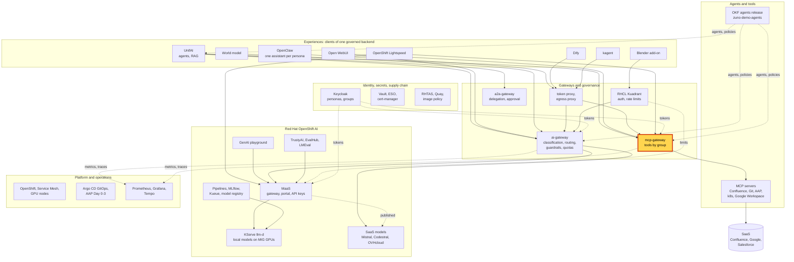
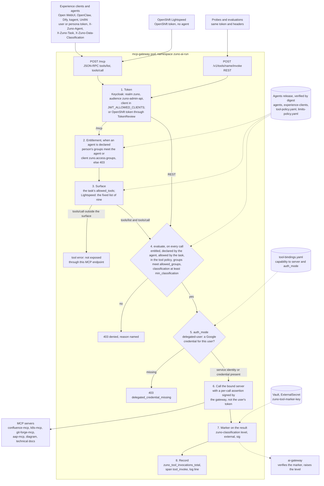

# Scenario: mcp-gateway - the same tools for every experience, filtered by who you are

> **Status:** Not rehearsed in this format. Prerequisites checked read-only on demo333 on 2026-11-13: Applications
> `zuno-mcp-d0`/`-d1`, `zuno-mcp-confluence-d0`/`-d1` and `zuno-mcp-k8s-d0`/`-d1` Synced and Healthy; Deployment
> `mcp-gateway` 1/1 (its pod was 33 minutes old at the check), reading the agents release `okf-corp@sha256:2918e463…`
> (release 0.14.3) from the internal Quay; gateway environment `AGENT_ENTITLEMENT_EVERY_CALL=true`,
> `AGENT_CHAIN_VERIFY=true`, `JWT_AUDIENCE=zuno-admin-api`, `JWT_ALLOWED_CLIENTS` listing the experience clients,
> `zuno-evaluations`, `zuno-stresstest` and `zuno-admin-api`, and nine capabilities in `MCP_FRONTDOOR_CAPABILITIES`;
> ExternalSecret `zuno-tool-marker-key` SecretSynced; `confluence-mcp`, `k8s-mcp`, `git-forge-mcp`, `aap-mcp` and
> `diagram-render` 2/2 Running; Deployment `open-webui` 1/1; Grafana 1/1 with the `three-experiences` and
> `agents-tools-rag` dashboards; the four local models Ready. The tool policy and the experience-client declarations
> of agents `main` are the same as in release 0.14.3.
> **Show-ready ([ADR-0606](../../../adr/0606-admit-new-experiences-with-a-definition-of-done-and-a-wip-limit.md)):**
> yes, golden-path probe `tools` (the 5-minute version also uses Open WebUI: run `open-webui` too).
> **Personas:** see [Personas](#personas).
> **Used in workshops:** [Sovereign and governed AI](../../workshops/sovereign-governed-ai.md),
> [Agentic AI](../../workshops/agentic-ai.md), [One governed backend, many experiences](../../five-experiences.md).

## Introduction

The mcp-gateway is the one door to company tools: Confluence, the technical documentation, Drive, Gmail, Git, AAP,
cluster reads and diagrams (see [Appendix A](#appendix-a---hld)). Every agent and every experience calls it with the
user's own token, or the token of a service account that acts for one persona. It also says who is calling (an agent
or an experience client) and for which task. The gateway answers "which tools" for each call, and the answer is the
intersection of five checks:

| Check | Question | Where it is declared |
|---|---|---|
| Entitlement | May this person use this agent or experience client? | `zuno.access.groups` of the agent or client sheet, in the agents release |
| Task | Does the task being run allow this tool? | `allowed_tools` of the task sheet; a task narrows its agent, never widens it |
| Tool policy | Is the tool listed and bound to a server? | `policies/tools/tool-policy.yaml` in the agents release |
| User groups | Do the person's Keycloak groups meet the tool's `allowed_groups`? | the token's `groups` claim against the tool policy |
| Classification | Is the call cleared for the tool's level? | the `X-Zuno-Data-Classification` header against the tool's `min_classification` |

One "no" is a no, and a missing input is a no. The tool list a client sees is computed with the same checks, so a
person is never offered a tool they cannot call. After the decision, two more rules apply: a tool that needs the
user's own provider credential (Google) is refused without one, and every result carries a signed classification
marker. How the gateway runs these steps: see [Appendix B](#appendix-b---lld).

**The message:** "Same question, different person, different tools. Who you are decides which tools you get, in every
experience, and every call is recorded in one place."

**Decisions:**
- [ADR-0010](../../../adr/0010-introduce-a-central-mcp-gateway.md): one central gateway for every MCP tool.
- [ADR-0011](../../../adr/0011-define-tool-authorization-as-policy-intersection.md): a tool is allowed only when
  every factor allows it.
- [ADR-0036](../../../adr/0036-enforce-the-complete-mcp-authorization-intersection-in-the-gateway.md): the gateway
  enforces the whole intersection and fails closed.
- [ADR-0040](../../../adr/0040-separate-agent-entitlement-from-business-role-authorization.md): entitlement to an
  agent is separate from the business role that grants tools.
- [ADR-0571](../../../adr/0571-evaluate-the-rhoai-mcp-gateway-before-extending-mcp-gateway.md): the Connectivity
  Link MCP gateway (Technology Preview) was evaluated and not adopted; `/mcp` applies the full intersection to callers
  that declare an agent.
- [ADR-0592](../../../adr/0592-declare-experience-clients-in-the-agents-release-apart-from-agents.md): experience
  clients are declared in the agents release, like agents.
- [ADR-0594](../../../adr/0594-give-the-three-experiences-the-same-mcp-tools-behind-signed-classification-markers.md):
  the same tools in every experience, filtered by group, behind signed classification markers.
- [ADR-0208](../../../adr/0208-standardize-enterprise-tool-authentication-and-delegation.md): a tool bound to the
  user's own credential is refused without it, never served with a shared account.

## Personas

The personas are fictional role accounts of the Keycloak realm `zuno`
([ADR-0349](../../../adr/0349-restructure-demo-personas-cluster-access-groups-and-new-agents.md)). They share one
password, kept in Vault at `keycloak/demo-personas`. The [catalogue](../../README.md#personas) lists all of them.

| Persona | Profile | What it can do here | Role in this demo |
|---|---|---|---|
| **sale-01** | Salesperson, front office. Groups `sales`, `agent_comage`, `agent_finage`. | In Open WebUI, three tools: Drive search, Gmail read, diagram generation. No Confluence: `search_confluence` is granted to `consultant`, `board`, `cdp`, `lightspeed_readonly` and `ocp-ai-ops` only. | Browser profile 1 of the 5-minute version: asks the Confluence question and gets no Confluence tool. |
| **consultant-02** | Consultant and architect, front office. Group `consultant` with six Confluence subgroups (build OpenShift and OpenShift AI, the four architecture spaces), `agent_tekos`, `agent_arkos`, `aap_ops`. | In Open WebUI, six tools: the three of sale-01 plus Confluence search, Confluence page read and technical-docs search. | Browser profile 2 of the 5-minute version: the same question, answered from Confluence. |
| **finance-01** | Finance, middle office. Groups `finance`, `agent_finage`. | In Open WebUI, two tools: Drive search and Gmail read. No diagram: `generate_diagram` is not granted to `finance`. Both tools need a Google credential, which nobody has on demo333. | Optional browser profile 3 of the 15-minute version: a narrower list, and a delegated-credential refusal. |
| **ai-ops-01** | AI platform operator, back office. Group `ocp-ai-ops` (admin on the Zuno namespaces, `zuno-monitoring` included). | The only group granted the five cluster read tools. Opens Grafana. | Shows the audit panels in the 15-minute version. |
| **paas-ops-01** | Platform operator, back office. Group `ocp-paas-ops` (cluster-admin). Must have signed in to OpenShift once. | Runs the golden-path probe, which reads the probe credentials and calls the gateway from inside its pod. | The presenter's `oc` terminal in the 15-minute version. |

Other identities:
- The golden-path probe `tools` calls as **consultant-01** (the probe's gateway persona), with a token of the Keycloak
  client `zuno-evaluations`, declaring agent `tekos` and task `answer-technical-question`. It never signs in on stage.
- OpenClaw calls as `service-account-openclaw-sale-01` and `service-account-openclaw-consultant-02`, Dify as
  `service-account-dify`, kagent as `service-account-kagent`. Each carries the groups of one persona, so it gets that
  persona's tools.
- The MCP servers never see the user's token. For each call they get a short-lived assertion signed by the gateway,
  bound to the tool and its arguments (`MCP_OUTBOUND_IDENTITY=assertion` on demo333).

## Before you start

- [ ] Golden-path probes `tools` and `open-webui` passed within the last hour (`ONLY=tools,open-webui make demo
  golden-path`), see [golden-path.md](../../golden-path.md).
- [ ] Browser profiles, signed in to `https://open-webui.apps.demo333.startx.fr` with **Continue with Keycloak**:
  - profile 1: **sale-01**;
  - profile 2: **consultant-02**;
  - profile 3, optional, 15-minute version: **finance-01**.
- [ ] Start a **new chat** in each profile. Chats created before 2026-11-03 keep their tool switch off.
- [ ] Warm the model: send one short question in profile 2 before the audience arrives.
- [ ] 15-minute version:
  - [ ] a terminal at the repository root, logged in with `oc` as **paas-ops-01**;
  - [ ] Grafana as **ai-ops-01**, dashboard **Zuno Platform / Five experiences**, time range last 1 hour;
  - [ ] the agents release open at
    [`policies/tools/tool-policy.yaml`](https://github.com/startxfr/zuno-demo-agents/blob/main/policies/tools/tool-policy.yaml)
    and [`experience-clients/open-webui/tasks/chat.md`](https://github.com/startxfr/zuno-demo-agents/blob/main/experience-clients/open-webui/tasks/chat.md).
- [ ] Known on screen: a Drive or Gmail tool call shows a red cross. No Google Workspace tenant is connected, so the
  gateway refuses it (`delegated_credential_missing`). Say it is the delegation rule, not a failure.

## 5-minute version

| Time | Do | Say | You should see |
|---|---|---|---|
| 0:00 | Profile 1, **sale-01**: click the tools button under the prompt (**Zuno tools**) | "I am a salesperson. My tools come from my job, not from this application's settings." | Three tools: Drive search, Gmail read, diagram generation. |
| 0:45 | Profile 2, **consultant-02**: the same button | "Same screen, a consultant. The platform gives the consultant Confluence and the technical documentation too." | Six tools: the three of sale-01 plus Confluence search, Confluence page read and technical-docs search. |
| 1:30 | Profile 2: click the suggestion card **Find our onboarding pages in Confluence** (prompt `Find our onboarding pages in Confluence.`) | "The model calls Confluence with my own identity. The gateway checked my groups first." | A list of onboarding pages from Confluence, with the tool call shown in the chat. |
| 2:45 | Profile 1: ask the same `Find our onboarding pages in Confluence.` | "Same question from the salesperson. The tool is not in this list, so the model cannot call it." | No Confluence tool call. The model says it cannot search Confluence. *(not rehearsed as sale-01)* |
| 3:45 | Say the rule | "Five checks decide each tool: who you are, which application you use, the task, the tool's own policy and how sensitive its data is. One 'no' is a no. The same rule applies in UnifAI, OpenClaw, Dify and kagent." | |
| 4:30 | Close | "Same question, different person, different tools. Who you are decides, in every experience, and every call is recorded in one place." | |

## 15-minute version

Run the 5-minute version, then:

| Time | Do | Say | You should see |
|---|---|---|---|
| 5:00 | Terminal: `ONLY=tools make demo golden-path` | "The platform's own check: one Confluence search through the gateway's REST door, declared as Tekos's task, with a consultant's token." | `PASS tools ... search_confluence answered by the confluence MCP server: <n> page(s) in <ms> ms`, then `RESULT: PASS`. |
| 6:00 | Open `policies/tools/tool-policy.yaml`, entry `search_confluence` | "The tool's own policy, in the signed agents release: who may call it, how sensitive its data is, and whether its results may reach an external model." | `allowed_groups` `consultant`, `board`, `cdp`, `lightspeed_readonly`, `ocp-ai-ops`; `min_classification: C2`; `external_model_policy.allow_context: false`. |
| 7:00 | Open `experience-clients/open-webui/client.okf.md`, then `tasks/chat.md` | "Open WebUI is declared like an agent: who may use it, and which tools its one task may call. Read tools only: no write, Git, AAP or Salesforce." | `access.groups` with eleven groups; `classification: C2`; six `allowed_tools`. |
| 8:00 | Optional, profile 3, **finance-01**: open **Zuno tools** | "Finance gets Drive and Gmail. No diagrams: that tool is not granted to finance." | Two tools: Drive search and Gmail read (seen on 2026-11-02, [WP-184](../../../roadmap/work-packages/wp-184-three-experiences-demonstration.md)). |
| 8:45 | Profile 3: ask `Search my Drive for the latest budget files.` *(untested prompt)* | "Drive and Gmail need my own Google credential. No Google tenant is connected to this demo, and the gateway never falls back to a shared account." | A red cross on the Drive tool call. In the audit: outcome `delegated_credential_missing`. |
| 10:00 | Show the marker from the [WP-191 evidence](../../../roadmap/evidence/wp-191-same-mcp-tools-live-proof.md) | "Every tool result ends with a signed level. The ai-gateway reads it: a turn that used Confluence is answered by a local model only. A marker that was edited fails its signature and counts as C2." | `[zuno-classification level=C2 external=0 sig=…]` after the Confluence results. |
| 11:00 | Optional terminal: `oc logs deploy/ai-gateway -n zuno-ai-run --since=15m \| grep "classification raised by tool results"` | "In Open WebUI the marker never verifies, because the UI rewrites tool results. The gateway then assumes the worst: C2, local only." | `classification raised by tool results: C1 -> C2, local_only False -> True (unmarked tool result) client=open-webui`, for the consultant-02 turn. |
| 12:00 | Grafana, row **Same tools, governed: cluster reads (ADR-0600)**, panel **All governed tool calls by tool and outcome (over range)** | "One audit for every experience and every agent: which tool, which server, which outcome." | `confluence` / `confluence.page.search` / `allowed` for the consultant-02 turn, `confluence` / `search_confluence` / `allowed` for the probe, `google-workspace` / `drive.document.search` / `delegated_credential_missing` if step 8:45 ran. |
| 13:00 | Say the refusal outside the task, quoting the [WP-208 rehearsal](../../../roadmap/evidence/wp-208-five-experiences-rehearsal.md) | "A client that asks for a tool its task does not declare is stopped at the door. When Dify asked for a cluster read, the answer was 'not exposed through this MCP endpoint'." | `k8s.resource.list` answered "not exposed through this MCP endpoint (ADR-0524 front-door allowlist / ADR-0571 agent declaration)". |
| 14:15 | Close | Repeat the message. | |

## If something goes wrong

| Symptom | Fallback | Say |
|---|---|---|
| The probe prints `FAIL tools search_confluence: HTTP 403 ...` | Read the reason aloud: it names the check that refused (entitlement, groups or classification). Stop the 15-minute version there. | "A refusal names its reason. That is what makes it auditable." |
| `FAIL tools search_confluence answered 200 with no page` | The Confluence server answered but found nothing. Show the Open WebUI steps only. | |
| The probe cannot `exec` into the gateway pod | The terminal is not logged in as **paas-ops-01**. Log in again before the session; on stage, skip to the policy files. | |
| No tools in a chat | Start a new chat. Old chats keep their tool switch off. | |
| A red cross on a Drive or Gmail call | Carry on. | "Drive and Gmail need the user's own Google credential, and no Google tenant is connected. The gateway refuses rather than use a shared account." |
| sale-01's answer claims to list Confluence pages | Point out that no tool call is shown: the model wrote it without data. | "No tool ran. The model guessed, and the platform gave it nothing to read." |
| 503 "no eligible provider" after a Confluence turn | No local model is ready, and a turn that used Confluence may only use local models. | "Confluence data stays in the cluster. With no local model, the gateway refuses." |
| No series in the Grafana panel | Widen the time range to 3 hours. Export and scrape take about a minute. | |

## Limits

- **Drive and Gmail are always refused on demo333.** Their bindings need the user's delegated Google credential, and
  fetching it from Keycloak's Google broker is not implemented (`components/mcp-gateway/app/delegation.py` returns
  none). The tool lists still show them; every call fails closed.
- **Markers never verify in Open WebUI.** It rewrites tool results before the next model call, so every tool turn
  there counts as unmarked, C2 and local only (accepted on 2026-11-03). OpenClaw passes the text through and its
  markers verify.
- **The audit counts only calls that reach the decision.** `zuno_tool_invocations_total` has the labels `tool`,
  `capability`, `mcp_server` and `outcome`. A call refused at the door ("not exposed through this MCP endpoint", or an
  agent the caller is not entitled to) is logged, not counted. Who called is in the gateway's log line and on the
  `tool_invoke` span (`zuno.user_sub`), not on the metric.
- **The `tool` label is the name the caller used.** The REST door gets the policy name (`search_confluence`); `/mcp`
  gets the capability (`confluence.page.search`). The same tool can appear on two rows.
- **The classification is declared by the caller.** The experience clients declare C2 on their tool connection.
  Declaring lower only narrows what they reach; the level of each result is then carried by its signed marker.
- **OpenShift Lightspeed is the one exception.** It cannot declare an agent, so a fixed list of nine capabilities
  (`MCP_FRONTDOOR_CAPABILITIES`) replaces the entitlement and task checks for it
  ([ADR-0524](../../../adr/0524-integrate-openshift-lightspeed-with-the-zuno-ai-platform.md)).
- **Experience clients get read tools only.** Writes, Git, AAP and Salesforce stay with the UnifAI agents, and a
  delegated write needs human approval (see the [delegation scenario](./a2a-delegation-approval.md)).
- **The servers keep their own limits.** The gateway decides who may call a tool; the MCP server behind it may still
  refuse. For example, `k8s-mcp` refuses Secrets and ConfigMaps whatever the caller's groups.

## Appendix A - HLD

Where the mcp-gateway sits in Zuno. The highlighted box is the subject of this page. Plain arrows carry requests,
dotted arrows carry identity, policy or telemetry.

## Appendix B - LLD

How the mcp-gateway decides a tool call. Drawn from `components/mcp-gateway/app/main.py` (the `/mcp` handler,
`_agent_surface`, `_authorize_and_invoke`), `app/policy.py` (`evaluate`, `agent_entitlement_refusal`),
`app/mcp_frontdoor.py` (`list_tools`, `dispatch`), `app/delegation.py`, `app/telemetry.py`,
`platform/bindings/tools/tool-bindings.yaml`, and `gitops/charts/mcp-gateway` (`values.yaml`,
`templates/deployment.yaml`).

