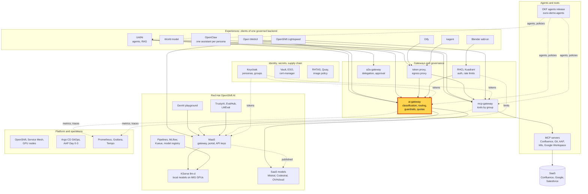
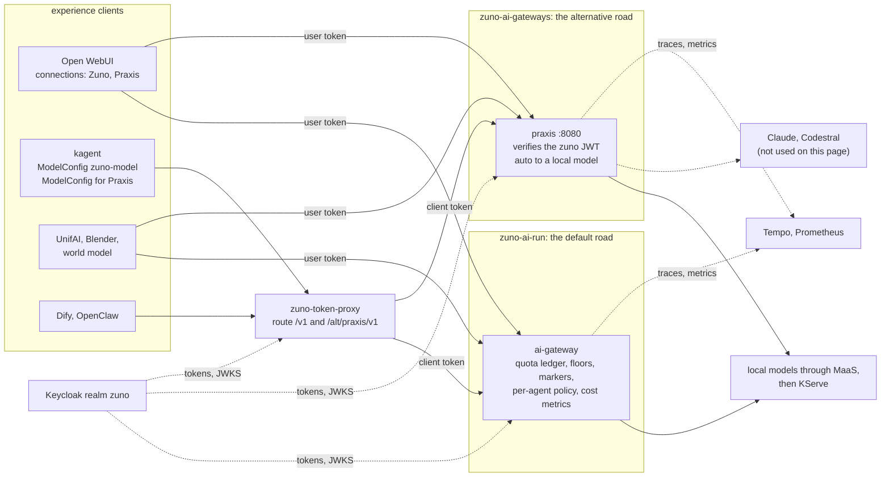

# Scenario: Multi-gateway - the same clients on the default gateway and on an alternative one

Last reviewed: 2026-11-20

## Introduction

Zuno sends every model call of every client through one governed gateway: the ai-gateway. This scenario shows that a
client can also reach a second gateway, Praxis AI, as one more connection next to the default one. The user keeps the same
Keycloak sign-in and the same screen. Only the model chosen in the client changes the road. The Zuno gateway stays the
default everywhere; the alternative is an extra, named connection. See [Appendix A](#appendix-a---hld) for where it
sits and [Appendix B](#appendix-b---lld) for what is inside it.

The scenario also shows what the alternative gateway does not do. The persona quota ledger, the classification floors
and the signed markers, the per-agent policy and the Zuno cost metrics belong to the Zuno gateway. A call that takes the
other road does not get them. Only C1 content is shown here, for that reason.

**The message:** "The same client, the same sign-in, two gateways. The default one governs everything; the alternative
one is a choice we make with open eyes, and we say what it does not enforce."

## Personas

The personas are fictional role accounts of the Keycloak realm `zuno`. They share one
password, kept in Vault at `keycloak/demo-personas`. The [catalogue](../../README.md#personas) lists all of them.

| Persona | Profile | What it can do here | Role in this demo |
|---|---|---|---|
| **ai-ops-01** | AI platform operator, back office. Groups `ocp-ai-ops`, `agent_tekos`, `openwebui_admin`. | Signs in to Open WebUI and to kagent (its front door admits `ocp-ai-ops` only). Opens Grafana and its Tempo explorer. | Signs in to both clients in both versions, and shows the traces and the dashboard. |
| **paas-ops-01** | Platform operator, back office. Group `ocp-paas-ops` (cluster-admin). | Reads the objects of the alternative gateways' namespace. | The presenter's `oc` terminal, in the 15-minute version. |
| **consultant-02** | Consultant and architect, front office. Group `consultant`. | Dify and OpenClaw act as this persona through the token proxy. | Named in the 15-minute version, for the clients that cannot forward the user's token. |
| **ai-dev-01** | AI developer. Group `ocp-ai-dev`. | Signs in to the Blender add-on and to Claude Code. | Named in the 15-minute version, for the clients that run on the workstation. |

Other identities:
- `service-account-kagent`, the service account of the Keycloak client `kagent`. The token proxy signs the calls of
  kagent with it. On the alternative road, the alternative gateway sees this identity, not the user's.
- The same holds for the token proxy of Dify and for the OpenClaw operator.

## Presenter lifecycle

`make demo use multi-gateway 5|15` selects this page.
Each section below is printed after its action's Ansible file (`ansible/demos/multi-gateway/<action>.yml`) has run, and
says what is left to the presenter. No action of this demo installs or removes anything on the cluster.

### Status

Nothing to do. The file reads the Deployment `praxis` in `zuno-ai-gateways`, the Deployments `open-webui` and
`kagent-controller`, and the Agent `zuno-diagnose-praxis`. If one is missing or not Ready, stop and tell the platform owner: this demo installs nothing.

### Check

Nothing to do when it passes. This page has no golden-path probe yet: rehearse it the same day. Read by hand that the
alternative connection is listed in Open WebUI's connections and that the second agent of kagent is `Accepted`. If
something fails, see [If something goes wrong](#if-something-goes-wrong).

### Install

Nothing to do. The alternative gateway is part of the shared platform: the file only verifies it.

### Start

The file prepares nothing on the cluster. What only a person does:

- [ ] A browser profile for **ai-ops-01**, signed in to Open WebUI and to kagent. A Keycloak session of another persona
  in the same browser gets a 403 from the kagent front door.
- [ ] In Open WebUI, a new chat. The model picker lists "Zuno" and, among the models tagged "Praxis", `praxis.auto`.
- [ ] In kagent, the agents `zuno-sre` and `zuno-diagnose-praxis` are listed.
- [ ] 15-minute version:
  - a terminal logged in with `oc` as **paas-ops-01**;
  - Grafana in the ai-ops-01 profile, the Tempo explorer and the dashboard **Zuno Platform / Five experiences**, last 1
    hour.
- [ ] Type only the prompts of this page. They contain no data of the company.

### Stop

Nothing to do. Close the browser profiles and the terminal. Delete the two test chats in Open WebUI.

### Uninstall

Nothing to do.

## 5-minute version

Profile **ai-ops-01**, signed in to Open WebUI.

| Time | Do | Say | You should see |
|---|---|---|---|
| 0:00 | Open the model picker of a new chat | "This is the chat everyone knows. It has two connections: Zuno, our governed gateway, and Praxis, an alternative one we added next to it." | "Zuno", "Zuno Code" and "Zuno wesh" from the default gateway, then the models of the alternative one, prefixed `praxis.` and tagged "Praxis": `praxis.auto`, the four local models, `praxis.claude` and `praxis.codestral-latest` (the list is the one read from Open WebUI's API on 2026-11-17; how the picker displays it is to confirm at the first rehearsal). |
| 0:45 | Pick **Zuno** and ask: `In two sentences, what does a Kubernetes liveness probe do?` | "A public question, on purpose. Only public content goes down the alternative road." | A short answer. |
| 1:30 | Pick **praxis.auto** and ask the same question | "Same sign-in, same screen, same question. The model name `auto` is mapped to a local model by the alternative gateway." | A short answer of the same kind. The wording differs. |
| 2:15 | Open kagent, agent **zuno-sre**. Ask: `What does it mean when a pod is in CrashLoopBackOff? Answer in two sentences and call no tool.` | "kagent is the second client. This agent uses the default road, through the token proxy." | A short answer, no tool call. |
| 3:00 | Open the agent **zuno-diagnose-praxis** and ask the same question | "Same agent, same instructions. Its model setting points to the alternative gateway." | A short answer, no tool call. |
| 3:45 | Say what the alternative road does not do | "On that road, my token budget is not counted, nothing raises the data class, and no per-agent policy applies. That is why we send public questions only." | |
| 4:30 | Close | "The same clients, two gateways. The default one governs. The other one is a choice we make knowing what it does not enforce." | |

## 15-minute version

Run the 5-minute version, then:

| Time | Do | Say | You should see |
|---|---|---|---|
| 5:00 | Grafana, Tempo explorer: find the trace of the Zuno question (service `ai-gateway`, last 15 minutes) | "The default road leaves a trace with the platform's own tags: persona, groups, the class of the data, the model chosen." | A trace with its `zuno.*` tags. See the [observability scenario](../foundation/observability-trace.md). |
| 6:30 | Find the trace of the Praxis question | "The alternative road leaves a trace too. It shows the routing and the provider chosen. It does not carry the platform's tags." | Spans named `routing.select` and `provider.route`, with a local model as the provider. The service name of Praxis is to confirm at the first rehearsal. |
| 8:00 | Dashboard **Five experiences**, row **Same backend, five experiences**, last 1 hour | "The Zuno road counts calls and tokens by experience and by persona. The other road does not feed that ledger." | The Open WebUI series counts the Zuno question and not the Praxis one. The persona budget of ai-ops-01 moved by the Zuno call only. |
| 9:15 | Terminal: `oc get pods,svc -n zuno-ai-gateways` | "The alternative gateways live in one namespace of their own, not in the governed one." | The Deployment `praxis` and its Service on port 8080. |
| 10:00 | Say how a client is wired | "Each client has one list of alternative gateways. It is empty by default. One entry adds a connection, and takes nothing away from the default one." | |
| 10:45 | UnifAI: the list of built-in models | "UnifAI shows one more model per alternative gateway, under the user's own token." | A model for Praxis next to `zuno-gateway`. |
| 11:30 | Dify: the model list of an app | "Dify cannot forward the user's token. Its calls go through the token proxy, which has an alternate route to the alternative gateway." | A model `praxis-auto` next to `auto`. |
| 12:15 | OpenClaw: the provider of an assistant | "Each assistant has a second provider, the same way." | A provider for Praxis next to `zuno`. |
| 13:00 | Blender add-on: the "Gateway override" field. World model: the gateway selector | "The add-on takes the alternative address in a field. The world model chooses its gateway for prompt enhancement." | The field and the selector, each with the default selected. |
| 13:45 | Say the identity difference | "Open WebUI, UnifAI, Blender and the world model send the user's own token. kagent, Dify and OpenClaw go through a proxy: the alternative gateway sees the proxy's identity." | |
| 14:30 | Close | Repeat the message. | |

## If something goes wrong

| Symptom | Fallback | Say |
|---|---|---|
| The picker lists no `praxis.auto` | The connection is not configured, or the alternative gateway is not Ready. Terminal: `oc get pods -n zuno-ai-gateways`. Show the Zuno road and the traces of an earlier take. | "The alternative gateway is optional. The default road does not depend on it." |
| The Praxis answer is slow or fails | Retry once. The alternative gateway is an alpha product. Continue with the Zuno answer and the trace of the earlier take. | "It is alpha. That is part of what we say when we show it." |
| kagent answers with a tool call | The prompt asked for none. Ask again, or continue: the point is the model setting, not the answer. | |
| 403 from the kagent front door | The browser holds a session of a persona outside `ocp-ai-ops`. Use the ai-ops-01 profile or a private window. | "The door admits the operations group only." |
| No Praxis trace in Tempo | Widen the time range to 1 hour. Export takes about a minute. If there is still none, say that the traces were not verified. | |
| The `praxis` series is missing in Grafana | Expected: the dashboard row counts the Zuno road only. Say so. | "That absence is the point." |

## Limits

- **Not rehearsed.** Nothing on this page was played. The labels, the span names, the service name and the
  checkpoints are expectations taken from the design and from the product's documentation.
- **Only C1 content is shown.** The alternative gateway has no classification floor and does not raise the data class of
  a conversation. A C2 or C3 text sent on that road would not be held back. The prompts of this page are public
  questions, and the kagent question asks for no tool, because a tool result is C2.
- **The alternative gateway does not enforce:**
  - the persona quota ledger: a call on that road is not counted in the persona's budget;
  - the classification floors and the signed tool-result markers;
  - the per-agent routing policy;
  - the Zuno cost metrics. It has its own request metrics and its own optional token limit.
- **MaaS budgets of Praxis.** Praxis's ServiceAccount shares the `<model>-platform` subscription with the ai-gateway (the platform tier), not the owner of a `<model>-praxis` one
  ([ADR-0619](../../../adr/0619-run-praxis-ai-as-an-alternative-ai-gateway-next-to-the-default-zuno-ai-gateway.md) note of 2026-11-20): the two identities have separate counters of the same size. A Praxis
  429 from MaaS falls back to the direct KServe step by design, so a client on that road never sees a MaaS 429.
- **It does not replace the Zuno gateways.** The signed delegation chain, the signed agent bundles and the per-call
  assertions stay in the Zuno gateways. Tools stay behind the mcp-gateway.
- **Identity.** A client that sends the user's token is seen by name on both roads. A client behind a proxy is seen as
  the proxy's identity on the alternative road.
- **Models.** The alternative gateway serves the local models, Claude and Codestral, and no other provider. This page
  uses `auto` only, which it maps to a local model.
- **Praxis is alpha.** Its configuration can change between releases.
- **The clients change.** Each client has one more connection. The recordings made before the wiring show the older
  screens.

## Appendix A - HLD

Where the brick sits in Zuno. The highlighted box is the subject of this page. Plain arrows carry requests, dotted
arrows carry identity, policy or telemetry.

## Appendix B - LLD

The two roads of one client, and what each one checks. Drawn from `gitops/charts/praxis` (the models, the `auto` alias,
the JWT check), the `altGateways` lists of the client charts (`gitops/charts/open-webui`, `gitops/charts/kagent`,
`gitops/charts/zuno-token-proxy`) and their values in `ansible/clusters/demo333.yml`. The page was not played: check
the names against the live objects.

## References

The decisions this page rests on:

- [ADR-0619](../../../adr/0619-run-praxis-ai-as-an-alternative-ai-gateway-next-to-the-default-zuno-ai-gateway.md): the
  alternative gateways next to the default one: the namespace, the models, the identity, the client contract, what the
  alternative road loses.
- [ADR-0587](../../../adr/0587-admit-additional-user-experiences-over-the-one-governed-backend.md): experiences are
  presentation layers over the one governed backend; ADR-0619 amends its first clause for the alternative scenarios.
- [ADR-0565](../../../adr/0565-derive-data-classification-from-okf-and-only-allow-raising-it.md): the classification
  that only rises, which the alternative road does not apply.
- [ADR-0349](../../../adr/0349-restructure-demo-personas-cluster-access-groups-and-new-agents.md): the demo personas,
  their groups and their shared password.
- [ADR-0616](../../../adr/0616-prepare-and-play-every-catalogue-demo-through-one-make-demo-lifecycle.md): the `make demo`
  lifecycle that the Presenter lifecycle section follows.

Evidence: the work packages of the clients:
[Open WebUI](../../../roadmap/work-packages/wp-296-give-open-webui-the-alternative-gateways.md),
[kagent](../../../roadmap/work-packages/wp-297-give-kagent-the-alternative-gateways-through-the-token-proxy.md),
[UnifAI](../../../roadmap/work-packages/wp-299-give-unifai-the-alternative-gateways.md),
[Dify](../../../roadmap/work-packages/wp-300-give-dify-the-alternative-gateways.md),
[OpenClaw](../../../roadmap/work-packages/wp-301-give-openclaw-the-alternative-gateways.md),
[Blender](../../../roadmap/work-packages/wp-302-give-the-blender-add-on-the-alternative-gateways.md),
[world model](../../../roadmap/work-packages/wp-303-give-world-model-the-alternative-gateways.md). On 2026-11-20 the
first five are Done, Blender is not started and the world model waits for its live proof.

## Page status

> **Status:** Not rehearsed. As of 2026-11-19 the work packages this page was written against are Done in the
> [tracker](../../../roadmap/implementation-roadmap.md) (the alternative gateway, and the Open WebUI and kagent
> wiring), but nobody has played the page since: its steps and checkpoints were written before they landed, so check
> them against the live objects before showing it. The 15-minute version also needs the Blender add-on (WP-302, not
> started) and the world model (WP-303, live proof pending). The page depends on
> [WP-292](../../../roadmap/work-packages/wp-292-deploy-praxis-ai-in-the-alternative-gateways-namespace.md),
> [WP-296](../../../roadmap/work-packages/wp-296-give-open-webui-the-alternative-gateways.md) and
> [WP-297](../../../roadmap/work-packages/wp-297-give-kagent-the-alternative-gateways-through-the-token-proxy.md) for
> the 5-minute version, and on the other client work packages for the 15-minute version.
> **Show-ready ([ADR-0606](../../../adr/0606-admit-new-experiences-with-a-definition-of-done-and-a-wip-limit.md)):**
> No golden-path probe: rehearse before showing it to an audience.
> **Personas:** see [Personas](#personas).
> **Used in workshops:** none.
