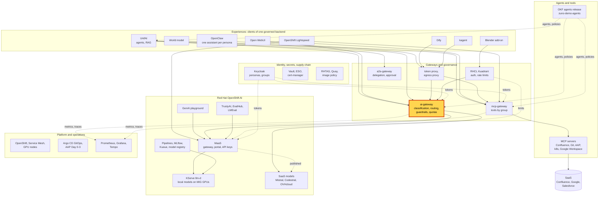
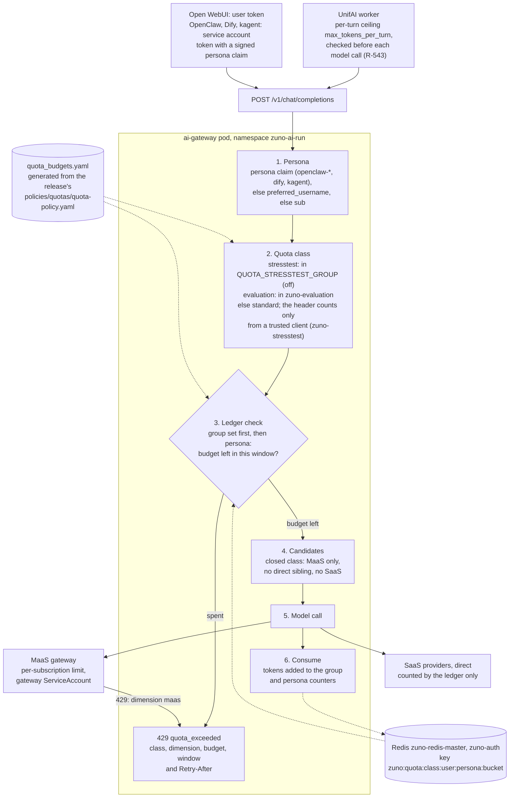

# Scenario: ai-gateway - one token budget per persona across the experiences

> **Status:** Not rehearsed in this format. Prerequisites checked read-only on demo333 on 2026-11-13: Applications
> `zuno-ai-gateway-d0`/`-d1` and `zuno-redis-d0`/`-d1` Synced and Healthy; Deployment `ai-gateway` 1/1 with
> `QUOTA_LEDGER_STORE=redis`, `REDIS_ADDR` on `zuno-redis-master.zuno-auth`, `QUOTA_FAIL_MODES_ENFORCED=true`,
> `QUOTA_CLOSED_CLASS_MAAS_ONLY=true`, `MAAS_QUOTA_429_PASSTHROUGH=true`, `MAAS_GATEWAY_IDENTITY=true`,
> `PERSONA_CLAIM_CLIENTS=openclaw-*,dify,kagent`, `TRUSTED_PLATFORM_CLIENTS=zuno-stresstest`, and no
> `QUOTA_STRESSTEST_GROUP` (the tight class is off); StatefulSet `zuno-redis-master` 1/1, with a volume (its pod was
> recreated about 110 minutes before the check); MaaS subscription `gpt-oss-20b-ai-gateway` at 1,000,000 tokens per
> hour, owned by the ai-gateway ServiceAccount; no `zuno-token-quota` TokenRateLimitPolicy; Grafana 1/1 with the
> `three-experiences` dashboard; Tempo Ready; the four local models Ready.
> **Show-ready ([ADR-0606](../../../adr/0606-admit-new-experiences-with-a-definition-of-done-and-a-wip-limit.md)):**
> no golden-path probe. Rehearse it before showing it to an audience.
> **Personas:** see [Personas](#personas).
> **Used in workshops:** [three experiences](../../three-experiences.md), [five experiences](../../five-experiences.md),
> [sovereign and governed AI](../../workshops/sovereign-governed-ai.md).

## Introduction

Every model call of every experience goes through the ai-gateway (see [Appendix A](#appendix-a---hld)). Before it
sends a call, the gateway checks a **token ledger**. After the call, it adds the tokens used. The ledger keys the user
budget by **persona** and **quota class**, never by client. So sale-01 spends one budget in Open WebUI, in UnifAI and
through its OpenClaw assistant. The counters are kept in Redis, so a gateway restart does not reset them. How the
persona and the class are found, and what a refusal looks like: see [Appendix B](#appendix-b---lld).

The classes come from the signed agents release
([`policies/quotas/quota-policy.yaml`](https://github.com/startxfr/zuno-demo-agents/blob/main/policies/quotas/quota-policy.yaml)):

| Class | Who runs under it | Per user (persona) | Per group | `fail_mode` |
|---|---|---|---|---|
| `standard` | everyone, by default | 10,000,000 tokens per 24 h | 100,000,000 per 24 h | open |
| `evaluation` | members of `zuno-evaluation` (the `eval-*` and `stress-*` personas) | 20,000,000 per 24 h | 200,000,000 per 24 h | open |
| `intensive` | no task opts in today; only a trusted platform client can ask for it | 500,000 per 24 h | 5,000,000 per 24 h | closed |
| `stresstest` | members of the group named by `QUOTA_STRESSTEST_GROUP` (off), or the trusted client `zuno-stresstest` when it asks for it | 2,000 per 5 min | 8,000 per 5 min | closed |

MaaS also counts tokens, but per subscription and per model, not per person. Since the amendment of 2026-11-05 to
ADR-0570, the per-person and per-group budgets live in the gateway's ledger only, by design.

**The message:** "One person, one budget, whatever the screen. Spending it in one experience spends it in all of
them."

**Decisions:**
- [ADR-0593](../../../adr/0593-key-the-per-user-quota-and-telemetry-by-persona-across-experiences.md): the user
  budget and the telemetry are keyed by persona across experiences.
- [ADR-0511](../../../adr/0511-define-okf-quota-policy-enforced-via-kuadrant.md): quota classes in the agents release,
  explicit refusals, fail closed by default.
- [ADR-0570](../../../adr/0570-slim-the-ai-gateway-by-delegating-quotas-keys-and-exposure-to-maas.md), amendment of
  2026-11-05: the ledger is the permanent design for the user and group budgets; MaaS keeps the per-subscription
  limits.
- [ADR-0587](../../../adr/0587-admit-additional-user-experiences-over-the-one-governed-backend.md): experiences are
  presentation layers over one governed backend, with one budget per person.
- [ADR-0579](../../../adr/0579-extend-okf-to-v0-3-with-skills-model-roles-guardrails-and-limits.md): `zuno.limits`
  in the agent sheets. The optional per-turn ceiling `max_tokens_per_turn` (R-543) was added to it later, in the
  agents release.

## Personas

The personas are fictional role accounts of the Keycloak realm `zuno`
([ADR-0349](../../../adr/0349-restructure-demo-personas-cluster-access-groups-and-new-agents.md)). They share one
password, kept in Vault at `keycloak/demo-personas`. The [catalogue](../../README.md#personas) lists all of them.

| Persona | Profile | What it can do here | Role in this demo |
|---|---|---|---|
| **sale-01** | Salesperson, front office. Groups `sales`, `agent_comage`, `agent_finage`. | Class `standard`: 10 million tokens per day, one counter for Open WebUI, UnifAI and its OpenClaw assistant. | The persona of the 2026-11-03 proof, quoted in the 5-minute version. Signs in to Open WebUI and UnifAI in the optional replay. |
| **ai-ops-01** | AI platform operator, back office. Group `ocp-ai-ops` (admin on the Zuno namespaces, `zuno-monitoring` included). | Opens Grafana and the Tempo search UI. | Shows the budget panel (5-minute version) and the persona on the trace (15-minute version). |
| **paas-ops-01** | Platform operator, back office. Group `ocp-paas-ops` (cluster-admin). | Reads the gateway settings and the MaaS subscriptions. Must have signed in to OpenShift once. | The presenter's `oc` terminal in the 15-minute version. |
| `eval-consultant-01` and the other `eval-*` accounts | Evaluation copies of the personas, in the group `zuno-evaluation`. Never signed in on stage. | Class `evaluation`, a budget of their own, so a test campaign never starves a demo persona. | Named only, in the limits. |

Other identities:
- `service-account-openclaw-sale-01` acts as **sale-01**. Its tokens carry a signed `persona` claim, so its calls
  spend sale-01's budget. In the same way `service-account-dify` and `service-account-openclaw-consultant-02` spend
  consultant-02's budget, and `service-account-kagent` spends ai-ops-01's.
- The ai-gateway's own ServiceAccount owns the MaaS subscriptions it calls through (for example
  `gpt-oss-20b-ai-gateway`).
- The Keycloak client `zuno-stresstest` is the only trusted platform client on demo333: only it may pick a class with
  the `X-Zuno-Quota-Class` header.

## Before you start

- [ ] No golden-path probe covers this scenario: rehearse it the same day.
- [ ] Grafana in a browser profile signed in as **ai-ops-01** (OpenShift sign-in), dashboard **Zuno Platform / Five
  experiences**, time range last 24 hours, `client` = All.
- [ ] A few hours before the session, use **sale-01** once in Open WebUI and once through its OpenClaw assistant
  ([OpenClaw scenario](../experiences/openclaw.md)), so the panel and the trace have something to show.
- [ ] Keep the 2026-11-03 evidence open: [WP-190 proof](../../../roadmap/evidence/wp-190-persona-quota-proof.md).
- [ ] 15-minute version:
  - [ ] a terminal logged in with `oc` as **paas-ops-01**;
  - [ ] the quota policy open in the agents release:
    [`policies/quotas/quota-policy.yaml`](https://github.com/startxfr/zuno-demo-agents/blob/main/policies/quotas/quota-policy.yaml);
  - [ ] the Tempo search UI `https://tempo-jaegerui-zuno-monitoring.apps.demo333.startx.fr`, signed in as
    **ai-ops-01**.
- [ ] Known on screen: the budget panel counts by Keycloak group, not by person. A persona with three groups appears on
  three rows. Say so before anyone asks.

## 5-minute version

| Time | Do | Say | You should see |
|---|---|---|---|
| 0:00 | Show the class table of the Introduction | "Every person has a token budget: 10 million tokens a day, inside a group ceiling of 100 million. The budget belongs to the person, not to the application." | |
| 1:00 | Grafana, row **One budget across the experiences**, panel **One group across the experiences: tokens (over range)** | "One gateway counts every experience. Here is one group's spend in Open WebUI, OpenClaw and UnifAI, side by side." | One row per group and client, for example the `sales` group with `open-webui` and `openclaw-sale-01`, if sale-01 used them in the range. |
| 2:30 | Show the evidence below | "We proved it on 3 November. We gave sale-01 a budget of 2,000 tokens for five minutes. Its OpenClaw assistant spent it in one turn. Then Open WebUI, UnifAI and the assistant itself refused sale-01, with the same answer." | The same 429 body for the three experiences. |
| 4:00 | Close | "One person, one budget, whatever the screen. Spending it in one experience spends it in all of them." | |

**Evidence of the shared budget (2026-11-03, ai-gateway build 36,
[WP-190 proof](../../../roadmap/evidence/wp-190-persona-quota-proof.md)).** sale-01 and its OpenClaw service account
were put in a group under the `stresstest` class (2,000 tokens per user per 5 minutes), in the bucket 01:10-01:15 UTC:
- 01:10-01:12, sale-01's OpenClaw assistant, one large turn: 200, 2,124 tokens (24 prompt, 2,100 completion);
- 01:12:40, Open WebUI as sale-01: 429
  `{"error":"quota_exceeded","quota_class":"stresstest","dimension":"user","budget_tokens":2000,"window":"5m"}`;
- 01:12-01:14, UnifAI (team `agent-comage`): the card "Rate limit reached, quota_exceeded, You can retry in 1min 57s";
- 01:14:00, OpenClaw, a short turn: 429, the same body, in 0.03 s.

## 15-minute version

Run the 5-minute version, then:

| Time | Do | Say | You should see |
|---|---|---|---|
| 5:00 | Open `policies/quotas/quota-policy.yaml` in the agents release | "The budgets are declared in the signed agents release, beside the tool policy. The gateway reads a slice generated from it and never defines an amount itself." | Four classes. `standard` and `evaluation` with `fail_mode: open`, `intensive` and `stresstest` with `fail_mode: closed`. |
| 6:30 | `oc get deploy ai-gateway -n zuno-ai-run -o jsonpath='{range .spec.template.spec.containers[0].env[*]}{.name}={.value}{"\n"}{end}' \| grep -E '^(QUOTA\|PERSONA\|MAAS_QUOTA)'` | "The ledger writes to Redis, so a restart does not give anyone a fresh budget. Fail modes are enforced. The tight test class is off." | `MAAS_QUOTA_429_PASSTHROUGH=true`, `QUOTA_FAIL_MODES_ENFORCED=true`, `PERSONA_CLAIM_CLIENTS=openclaw-*,dify,kagent`, `QUOTA_CLOSED_CLASS_MAAS_ONLY=true`, `QUOTA_LEDGER_STORE=redis`. No `QUOTA_STRESSTEST_GROUP`. |
| 8:00 | Explain the persona key with [Appendix B](#appendix-b---lld) | "Open WebUI and UnifAI call with my own token. OpenClaw, Dify and kagent call as service accounts, whose tokens carry a signed `persona` claim. The ledger keys my budget on that persona, so the three paths meet on one counter." | The Redis key in Appendix B: `zuno:quota:<class>:user:<persona>:<bucket>`. |
| 9:00 | `oc get maassubscriptions.maas.opendatahub.io gpt-oss-20b-ai-gateway -n models-as-a-service -o jsonpath='{.spec}'` | "MaaS counts too, but per subscription and per model. Everything the gateway sends draws on the gateway's own subscription. Per-person budgets exist only in the ledger: that is the 2026-11-05 decision." | `tokenRateLimits` of 1,000,000 tokens per `1h`, owner `system:serviceaccount:zuno-ai-run:ai-gateway`. |
| 10:00 | Say what each refusal means | "A 429 that names `dimension: user` or `group` comes from the ledger. One that names `dimension: maas` comes from a MaaS subscription limit." | |
| 10:45 | Explain `fail_mode: closed` | "`stresstest` is fail closed. If its budget file cannot be read, it refuses. It is served only through MaaS, where tokens are counted, so it never falls back to a SaaS model that would escape the count. With the GPU models down, its calls end in an error before any token is counted." | On 2026-11-02, with the GPU nodes down, three Open WebUI chats under `stresstest` returned 502 ([WP-184](../../../roadmap/work-packages/wp-184-three-experiences-demonstration.md)). |
| 11:45 | The per-turn ceiling (R-543), from the [v0.14.5 addendum](../../../roadmap/release-notes/v0.14.5-addendum.md) | "A daily budget does not stop one runaway answer. An agent's signed sheet may also set `max_tokens_per_turn`. UnifAI checks it before each model call and ends the turn cleanly." | On 2026-11-11 a test bundle with a ceiling of 300, played as ai-ops-01, ended a turn that used a tool on "Token ceiling reached for this turn (1893/300 tokens)". A turn with a single model call is never cut. |
| 13:00 | Tempo search UI: service `ai-gateway`, operation `model_call`, tags `zuno.persona=sale-01`, last 24 hours | "The dashboards count groups. The person is on the trace, whatever the screen." | Spans with `zuno.persona=sale-01` and different `zuno.client` values (`open-webui`, `openclaw-sale-01`), if sale-01 used both in the range. *(search not rehearsed)* |
| 14:30 | Close | Repeat the message. | |

**Optional replay of the 2026-11-03 proof (rehearsal only).**

> **Warning:** the replay changes the cluster: a Keycloak group, a gateway setting that rolls the ai-gateway pod, a
> revert. Never run it during a freeze (see the [freeze protocol](../../freeze-protocol.md)), and only with the
> platform owner's go. It is not a stage step.

1. Check that the local models are Ready (`oc get llminferenceservice -n zuno-ai-run`). `stresstest` is served only
   through MaaS: with the models down, the calls fail before any token is counted.
2. Put **sale-01** and `service-account-openclaw-sale-01` in one Keycloak group (WP-190 used `zuno-quota-stresstest`).
   Both are needed: the class comes from the token's groups.
3. Set the ai-gateway value `quotaStresstestGroup` to that group (it renders `QUOTA_STRESSTEST_GROUP`). The pod rolls.
4. Just after a five-minute boundary of the clock (:00, :05, ...), ask sale-01's OpenClaw assistant for one long answer,
   for example `Write a detailed 1,500-word guide to preparing a first sales meeting with a new customer.`
   *(untested prompt)*. Use one large turn, not several parallel ones: concurrent calls all pass the check before any
   consumption is counted.
5. In the same five minutes, ask any question in Open WebUI as sale-01, then in UnifAI. Both must be refused with the
   body of the evidence above.
6. Revert: empty the group, remove the value, and check that `QUOTA_STRESSTEST_GROUP` is gone from the Deployment.

## If something goes wrong

| Symptom | Fallback | Say |
|---|---|---|
| The budget panel is empty | Widen the range to 7 days. If it is still empty, nobody used the experiences in the range: show the evidence only. | "No traffic, nothing to count. The proof is the run of 3 November." |
| Grafana does not load | Skip the panel. The evidence and the terminal steps carry the scenario. | |
| A persona gets a 429 with `"dimension":"maas"` during another scenario | Carry on with another persona or another model. That is a MaaS subscription limit, not the persona budget. | "That limit belongs to a model subscription. The person's own budget is a different counter." |
| A persona gets a 429 with `"dimension":"user"` in class `standard` | The persona spent its 10 million tokens today. The 24-hour windows are fixed and restart at 00:00 UTC; the `Retry-After` header gives the seconds left. | "The rule at work: the budget is spent, so every screen refuses." |
| Replay: 502 instead of 429 | The local models are not ready. Stop the replay and revert. | |
| Replay: OpenClaw keeps answering after the budget is spent | The service account is not in the group, or its token lacks the `persona` claim (ADR-0593, operational considerations). Revert and check the group first. | |
| The Tempo search finds no span | Widen to 7 days. The export takes about a minute. | |

## Limits

- **The shared budget is quoted, not replayed on stage.** Replaying it needs a group, a gateway setting, a pod roll, a
  revert and a five-minute window.
- **The group budget is keyed by the caller's whole set of groups**, joined (`_group_key` in
  `components/ai-gateway/app/quota.py`). Two personas share it only if they hold exactly the same groups: sale-01 and
  its OpenClaw service account do; sale-01 and sale-02 do not.
- **Check before consume.** Concurrent calls all pass the check, and the call that crosses the budget is never cut. A
  budget can be overrun by the calls in flight.
- **Fixed windows.** Buckets follow the clock: the 24-hour budgets restart at 00:00 UTC, the 5-minute ones at :00, :05,
  and so on.
- **Redis is best effort.** A Redis fault is logged and the pod's own counter applies; it never fails a request. The
  ai-gateway runs one replica.
- **No per-person metric.** Since WP-225 lot B (ADR-0603 M15) no metric carries a `user` label. The dashboards count
  by group; one person's calls are on the trace (`zuno.persona`) and in the ledger.
- **MaaS does not count per person.** Through the gateway, every persona draws on the gateway's subscription
  (1,000,000 tokens per hour on gpt-oss-20b). Direct MaaS keys from the portal use group subscriptions instead, for
  example `gpt-oss-20b-sales` at 5,000 tokens per hour, and never touch the ledger: see the
  [MaaS portal scenario](../rhoai/maas-portal-api-keys.md). SaaS providers are called directly, so only the ledger
  counts them.
- **The request-rate limits of the policy are not enforced** for the in-cluster experiences. The only live
  request-rate limit is the workstation route's (`ai-gateway-workstation`, 60 requests per user per 5 minutes, used by
  Blender).
- **The per-turn ceiling is opt-in and UnifAI only.** No agent of release 0.14.3 sets `max_tokens_per_turn`, and the
  corp limits policy sets no ceiling. The cap is checked before each model call, so the last call can pass it (1,893
  tokens against 300), and a single-call turn is never cut. The other experiences have no per-turn ceiling.
- **Evaluation personas run out quickly.** A delegating Arkos turn costs about 65,000 tokens, and on 2026-11-03 a few
  such turns ended in a rate limit of about 16 minutes
  ([WP-174 evidence](../../../roadmap/evidence/wp-174-arkos-to-tekos-delegation-2026-11-02.md)). The evidence does
  not say which counter refused. The `evaluation` class allows 20 million tokens per user per day, so the user budget
  alone does not explain it (not verified).

## Appendix A - HLD

Where the ai-gateway sits in Zuno. The highlighted box is the subject of this page. Plain arrows carry requests,
dotted arrows carry identity, policy or telemetry.

## Appendix B - LLD

How the ai-gateway charges a call to a budget. Drawn from `components/ai-gateway/app/quota.py` (`TokenBudgetLedger`,
`RedisCounterStore`), `app/main.py` (`_platform_context`, `_default_quota_class`, `_skips_direct_sibling`,
`_skips_unmetered_candidate`), `app/auth.py` (`CallerIdentity.persona`), `app/maas_adapter.py`
(`MaasQuotaExceeded`), the generated `app/quota_budgets.yaml`, and `gitops/charts/ai-gateway` (`values.yaml`,
`templates/deployment.yaml`). The per-turn ceiling is from the
[v0.14.5 addendum](../../../roadmap/release-notes/v0.14.5-addendum.md).

