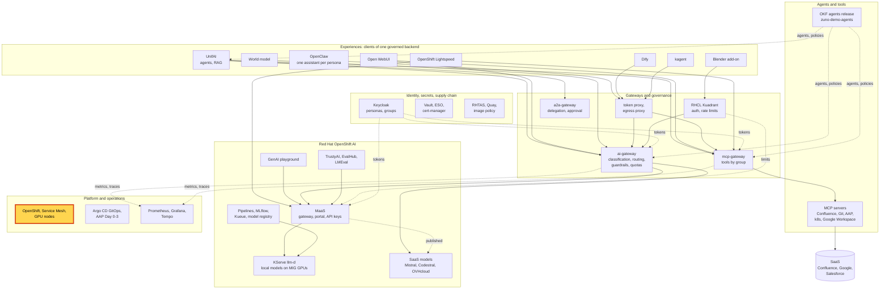
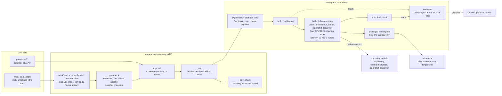

# Scenario: Chaos engineering - the cluster keeps serving

Last reviewed: 2026-11-21

## Introduction

Chaos engineering means breaking parts of a system on purpose, in a controlled way, to prove that it heals. Zuno uses
the open-source tool krkn for this. Its scenarios run as steps of an OpenShift Pipeline, `chaos-infra`, in the
namespace `zuno-chaos`. A small service, cerberus, gives one health signal for the whole cluster: it answers `True`
when the cluster is healthy and `False` when it is not. Nobody starts a chaos run alone: the run is an Ansible
Automation Platform (AAP) workflow, and a person must approve it in AAP before anything breaks.

In this scenario the platform operator breaks infrastructure parts of OpenShift, one at a time:

| Tier | What breaks | How long | Version |
|---|---|---|---|
| `pods` | One Prometheus pod, then one router pod, then one `openshift-apiserver` pod are deleted | until each pod is replaced | 5 minutes |
| `hog` | CPU load (80 % of the node), then memory load (half of the node's memory) on one infra node | about 60 s each | 15 minutes |
| `latency` | 50 ms of network delay and 2 % of lost packets on the same infra node | 60 s | 15 minutes |

The infra node is the one node labelled `zuno.io/chaos-target=true`. It is never a GPU node and never a control-plane
node. It runs Argo CD, the image registry, Alertmanager and the Thanos querier, and no router. The chaos tool sits in
the box "OpenShift, Service Mesh, GPU nodes" of the platform map (see [Appendix A](#appendix-a---hld)). Its pipeline,
its approval and its health signal are in [Appendix B](#appendix-b---lld).

This scenario is new. The chaos component is installed on demo333 since 2026-11-22, and the platform pipeline of
[the other chaos scenario](chaos-platform.md) ran that day. No run of the `chaos-infra` pipeline is recorded: the
infrastructure tiers were left out of that day. Every "You should see" cell below says what the design should show, not
what was seen.

**The message:** we break parts of the cluster on purpose, with a person's approval, and the cluster heals by itself
while it keeps serving.

## Personas

The personas are fictional role accounts of the Keycloak realm `zuno`. They share one password, kept in Vault at
`keycloak/demo-personas`. The [catalogue](../../README.md#personas) lists all of them.

| Persona | Profile | What it can do here | Role in this demo |
|---|---|---|---|
| **paas-ops-01** | Platform operator, back office. Groups `ocp-paas-ops` (cluster-admin), `agent_tekos`, `aap_admin`, `openwebui_admin`. | cluster-admin: reads every namespace, the nodes and the ClusterOperators. AAP superuser through `aap_admin`: may approve a workflow's approval step. | The only persona on stage, in both versions: the OpenShift console, the `oc` terminal and the approval in AAP. |

Other identities:
- the ServiceAccount `chaos-pipeline` in `zuno-chaos`. The pipeline's steps run as this account. It deletes the pods
  and starts the helper pods of the `hog` and `latency` tiers. Nobody signs in with it.
- the local AAP `admin` account (Vault `aap/admin`). `make demo start` uses it to launch the workflow through the AAP
  API. Never on stage.

## Presenter lifecycle

`make demo use chaos-infrastructure 5|15` selects this page. Each section below is printed after its action's Ansible
file (`ansible/demos/chaos-infrastructure/<action>.yml`) has run, and says what is left to the presenter. Start changes
the cluster: it launches the chaos workflow, which deletes pods once you approve it.

### Status

Nothing to do when it passes. The file reads the Argo CD Application of the chaos component and the Deployment
`cerberus` in `zuno-chaos`. If one is missing or not Healthy, stop: this demo installs nothing. The chaos component is
installed by the platform owner with `make d2 install chaos`.

### Check

Nothing to do when it passes. The file reads the Pipelines `chaos-infra` and `chaos-application` in `zuno-chaos`, the
AAP workflow `zuno-day3-chaos-infra-workflow` in `zuno-aap`, and runs `make d3 check recovery`, which says whether the
cluster is healthy now: nodes, ClusterOperators, stuck pods. No golden-path probe covers this page: rehearse it the same
day. Do not start a chaos run on a cluster that the check reports unhealthy.

### Install

Nothing to do. The chaos component is part of the shared platform: the file only verifies it.

### Start

The file launches the AAP workflow `zuno-day3-chaos-infra-workflow` with the tier `pods`, and returns at once. It is a
changing unit: `make demo start` asks you to type the demo id (`DEMO_CONFIRM`). The workflow runs its pre-check
(health signal `True`, the cluster healthy, no other chaos run active), then waits at its approval step. Nothing is
broken before you approve. Run it just before the session: the pre-check reads the cluster at that moment, and the
approval expires one hour after it. If Start ran more than an hour before the 1:30 row, run it again. Start launches a
chaos run: inside a demo freeze it needs the platform owner's go. If the other chaos demo was started too, approve one
run at a time: a second run started while the first is going fails.

What only a person does:

- [ ] A browser profile for **paas-ops-01** (password in Vault, `keycloak/demo-personas`). Sign in to the OpenShift
  console, and to AAP at `https://aap.apps.demo333.startx.fr` through Keycloak. A sign-in of **paas-ops-01** to AAP
  has not been tried yet: try it before the session.
- [ ] In AAP, **Automation Execution**, **Jobs**: the workflow `zuno-day3-chaos-infra-workflow` is running, its
  pre-check node is green and its approval node is waiting. Do not approve it yet.
- [ ] In the console: **Pipelines**, project `zuno-chaos`. Keep the tab open.
- [ ] A terminal logged in with `oc` as **paas-ops-01**, at the repository root. For the 15-minute version, a second
  terminal for the `make d3 chaos` commands: they wait until their run ends.
- Known on screen, not a failure: during the 60 s of the `hog` and `latency` tiers, the console's monitoring views and
  Argo CD may be slow. They run on the infra node under load.

### Stop

The file waits for the end of the latest run of the workflow (the one Start launched, or a later one you launched by
hand), for at most 20 minutes, and prints its result. It changes nothing, but it calls the AAP API, so `make demo stop`
asks for the demo id too. If the run still waits for its approval, the file says so: deny the approval in AAP. Then
close the browser profile and the terminals.

### Uninstall

Nothing to do.

## 5-minute version

Profile **paas-ops-01**, OpenShift console and terminal.

| Time | Do | Say | You should see |
|---|---|---|---|
| 0:00 | Console: **Pipelines**, project `zuno-chaos`, pipeline `chaos-infra`. Terminal: `oc get pipelines -n zuno-chaos` | "To prove that our cluster heals, we break parts of it on purpose. The tool is krkn. Each experiment is a pipeline, declared in Git like the rest of the platform." | The Pipelines `chaos-infra`, `chaos-application` and `zuno-chaos-provider-cut`. In the console, the tasks of `chaos-infra`: a health gate, the scenario steps, a final check. |
| 0:45 | `oc get --raw /api/v1/namespaces/zuno-chaos/services/http:cerberus:8080/proxy/` | "Before we break anything, we ask one question: is the cluster healthy? This small service watches the cluster and answers yes or no." | `True`. |
| 1:30 | AAP: **Automation Execution**, **Jobs**, the running `zuno-day3-chaos-infra-workflow`, its approval node, **Approve** | "Nobody breaks the cluster alone. The run waits here until a person approves it, and AAP records who did." | The pre-check node is green. After **Approve**, the approval node turns green and the run node starts. |
| 2:30 | Console: **Pipelines**, **PipelineRuns**, the new run of `chaos-infra`. Terminal: `oc get pipelineruns -n zuno-chaos` | "The pipeline checks the health first. Then it deletes one Prometheus pod, one router pod and one API server pod, one after the other, and waits each time for the cluster to heal." | One `chaos-infra-` run, Running, then Succeeded: the gate, the three pod scenarios, the final check, each green. The three pods take a few minutes in all; talk over the wait. |
| 3:15 | `oc get pods -n openshift-monitoring -l app.kubernetes.io/name=prometheus`, `oc get pods -n openshift-ingress`, `oc get pods -n openshift-apiserver` | "Each deleted pod is already replaced. The other replicas served the traffic in the meantime." | In each list, one pod is only a few minutes old (column AGE), and every pod is Running. |
| 4:00 | `oc get clusteroperators` | "The cluster's own components report their state. None of them is down." | Every ClusterOperator `AVAILABLE True` and `DEGRADED False`. |
| 4:30 | Close | "We break parts of the cluster on purpose, with a person's approval, and the cluster heals by itself while it keeps serving." | |

## 15-minute version

Run the 5-minute version, then:

| Time | Do | Say | You should see |
|---|---|---|---|
| 5:00 | `oc get nodes -l zuno.io/chaos-target=true` | "Now we put load on one node. Only one node carries this label. It is an infra node, never a GPU node and never a control-plane node." | One node, `Ready`; its ROLES column names `infra`. |
| 5:45 | **Optional cluster change, run by hand, outside a freeze only. The step never runs it.** Second terminal: `make d3 chaos infra TIER=hog CHAOS_CONFIRM=infra`, then approve the new workflow in AAP | "The second tier puts pressure on that node: first its CPU, then its memory, about one minute each." | The command waits. In AAP, a new `zuno-day3-chaos-infra-workflow` waits at its approval node; after **Approve**, a new `chaos-infra-` PipelineRun starts. If the first run has not ended yet, the pre-check refuses: one chaos run at a time. |
| 7:15 | Console: **Compute**, **Nodes**, the labelled node, **Metrics**. Terminal: `oc adm top node -l zuno.io/chaos-target=true` | "Here is the pressure: the CPU near 80 %, then half of the memory taken. This node runs Argo CD and part of the monitoring, so those screens may slow down. The AI applications do not run here." | The CPU graph climbs, then the memory graph, then both fall back. The console's monitoring views may be slow for about a minute. |
| 8:15 | `oc get pods -n zuno-chaos`, then `oc get pods -n zuno-ai-run` | "The load comes from small helper pods in our chaos namespace, and they are removed at the end. The AI workloads stay Ready." | In `zuno-chaos`, helper pods while the tier runs; afterwards only the `cerberus` pod and the Completed task pods of the runs. In `zuno-ai-run`, every pod Running and Ready. |
| 9:15 | **Optional cluster change, run by hand, outside a freeze only. The step never runs it.** When the `hog` run has ended: `make d3 chaos infra TIER=latency CHAOS_CONFIRM=infra`, then approve in AAP | "The third tier makes the network of the same node slow and lossy: 50 milliseconds more on every packet, and 2 % of the packets lost, for one minute." | A new workflow waits at its approval node; after **Approve**, a new `chaos-infra-` PipelineRun starts and ends after a few minutes. |
| 10:45 | `oc get pipelineruns -n zuno-chaos` | "Each run ends with the same final check as it started with. If the cluster had not healed in time, the run would be red, and AAP would show it." | The `pods`, `hog` and `latency` runs, each `Succeeded`. |
| 11:45 | Name the worker reboot scenario | "krkn can also reboot a whole worker. We have it, but it is off: it needs cloud credentials, and we do not reboot nodes in a demo." | |
| 12:30 | `make d3 check recovery` | "After the chaos, our own recovery check reads the whole cluster: nodes, cluster operators, stuck pods." | The check passes. It takes about a minute. |
| 14:00 | Close | Repeat the message. | |

## If something goes wrong

| Symptom | Fallback | Say |
|---|---|---|
| `make demo start`, or the pre-check node in AAP, fails because another chaos run is active | Read `oc get pipelineruns -n zuno-chaos`: a run is Running. Wait for its end, then run `make demo start` again. If there is no time, present the 5-minute version from the last run's PipelineRun. | "One chaos run at a time: the platform refuses a second one." |
| The health signal answers `False`, or the pre-check or the pipeline's gate is red, before anything was broken | Do not approve and do not launch. Show what is unhealthy: `oc get clusteroperators`, then `make d3 check recovery`. Deny the approval in AAP. | "The cluster is not healthy right now, so the platform refuses to break it more. This refusal is part of the design." |
| A pod is not back within its time limit: the final check of the PipelineRun is red | Stop the sequence: launch nothing more. Run `make d3 check recovery` and read its next step. Tell the platform owner. | "This is what chaos engineering is for: it found something that does not heal in time." |
| The approval stays unanswered (nobody approved, or the session ended) | Nothing breaks while it waits. Deny it in AAP. The approval expires by itself after one hour. `make demo stop` gives up after 20 minutes and says so. | |
| The console's monitoring views or Argo CD are slow during `hog` or `latency` | Expected: they run on the infra node under load. Show the terminal instead; they recover a minute later. | "We loaded the node that hosts them. The AI applications run elsewhere." |
| **paas-ops-01** cannot sign in to AAP, or sees no approval | Approve as an AAP admin outside the screen, or skip the AAP rows and show the PipelineRun. | |

## Limits

- **Not proven on a cluster yet.** The charts are prerelease: `chaos-cerberus` 21.3.398 and `chaos-pipeline` 21.3.400.
  The component is installed on demo333 since 2026-11-22, but no run of `chaos-infra` is recorded for any of its three
  tiers. A run on stage would be the first one.
- **A run is a change to the cluster.** Inside a demo freeze, Start and every `make d3 chaos` row need the platform
  owner's go. Each `make d3 chaos` command is a whole workflow (pre-check, approval, run, post-check): the platform
  workflows took about 5 minutes each on 2026-11-22, so the 15-minute version may take longer.
- **One pod at a time, from a closed list.** The pipeline deletes the pods its values name, nothing else: no
  namespace, no Deployment, no node.
- **Never etcd and never a control-plane node.** The `pods` tier deletes an `openshift-apiserver` pod, which runs on
  the control plane, but never touches etcd or a node.
- **No node reboot in the demo.** The worker reboot scenario exists in krkn but is off. It needs cloud credentials
  with the right to reboot an instance, which come later with a dedicated cloud user.
- **The helper pods of `hog` and `latency` are privileged.** They run in `zuno-chaos` only, and they are removed at
  the end of the run.
- **The `hog` and `latency` tiers slow the services of the infra node:** Argo CD, the image registry, Alertmanager and
  the Thanos querier. A deployment or an image pull during those 60 s may be slower.
- **One chaos run at a time.** The pre-check refuses a run while another one is active.
- **The health signal is coarse.** cerberus answers `False` when a ClusterOperator is Degraded or a pod of a watched
  namespace is not Running, wherever it is.
- **No recorded walkthrough and no GIF yet.**

## Appendix A - HLD

Where the chaos tool sits in Zuno: in the highlighted box "OpenShift, Service Mesh, GPU nodes", next to the platform it
breaks. Plain arrows carry requests, dotted arrows carry identity, policy or telemetry.

## Appendix B - LLD

The path of one chaos run, from the approval in AAP to the final check. Drawn from the design of the chaos component
(the pipeline chart `chaos-pipeline`, the health chart `chaos-cerberus`, the AAP workflows of the `aap-config` chart and
the demo files under `ansible/demos/chaos-infrastructure/`). Compared with the merged component on 2026-11-23, not with a run.

## References

The decisions this page rests on:

- [ADR-0626](../../../adr/0626-chaos-engineering-with-krkn-and-tekton-pipelines.md): chaos engineering with krkn and
  Tekton pipelines, launched by an AAP workflow with an approval step, one chaos run at a time.
- [ADR-0624](../../../adr/0624-drive-the-day3-stresstest-from-scenario-drivers-and-named-profiles.md): the Day 3
  stresstest, whose bounded disruptions ADR-0626 replaces once krkn has run live.
- [ADR-0536](../../../adr/0536-live-node-failover-drill-for-qwen-model-fallback.md): the node failover drill, which
  stays apart from this scenario.
- [ADR-0418](../../../adr/0418-execute-day-0-and-day-1-operations-as-aap-job-templates.md): operations run as AAP
  templates and workflows.
- [ADR-0349](../../../adr/0349-restructure-demo-personas-cluster-access-groups-and-new-agents.md): the demo personas,
  their groups and their shared password.
- [ADR-0616](../../../adr/0616-prepare-and-play-every-catalogue-demo-through-one-make-demo-lifecycle.md): the
  `make demo` lifecycle that the Presenter lifecycle section follows.

Evidence:

- [WP-316](../../../roadmap/work-packages/wp-316-run-chaos-pipelines-and-the-two-chaos-demos.md): the chaos component
  and the two chaos demos.
- [The demo-day page of 2026-11-24](../../demo-day-2026-11-24.md): what ran on 2026-11-22, and that the infrastructure
  tiers did not.

## Page status

> **Status:** Written from the design on 2026-11-21; not rehearsed yet. The chaos component is installed on demo333
> since 2026-11-22, but no run of the `chaos-infra` pipeline is recorded: the infrastructure tiers were left out of the
> validation of that day. Every "You should see" cell describes what the design should show. Whether the infra node
> still carries the label `zuno.io/chaos-target=true` was not read again.
> The timings of the rows are estimates, not measures.
> **Show-ready ([ADR-0606](../../../adr/0606-admit-new-experiences-with-a-definition-of-done-and-a-wip-limit.md)):**
> No. No golden-path probe covers this page, and it has never run. Rehearse it before showing it to an audience. A
> rehearsal needs a person to approve the workflow in AAP while it runs.
> **Personas:** see [Personas](#personas).
> **Used in workshops:** none yet. A workshop agenda has no optional row, and a chaos run would change the timing of
> [Trusted platform and operations](../../workshops/trusted-platform-ops.md): play this page after it, on its own.
