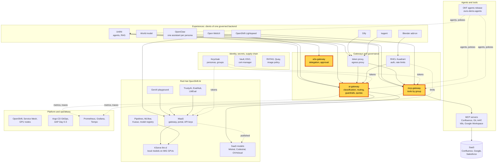
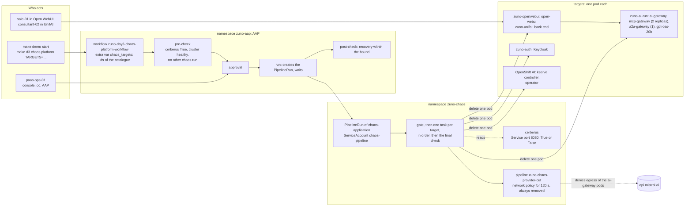

# Scenario: Chaos engineering - the AI platform keeps answering

Last reviewed: 2026-11-21

## Introduction

Chaos engineering means breaking parts of a system on purpose, in a controlled way, to prove that it heals. In this
scenario we break parts of the Zuno AI platform while a person keeps chatting with it. The tool is krkn. Each
experiment is a step of the OpenShift Pipeline `chaos-application`, in the namespace `zuno-chaos`. The parts we may
break come from a closed list of targets, kept in Git. A target is one pod of one application, or one cut to an
external model provider. Nobody starts a run alone: the run is an Ansible Automation Platform (AAP) workflow, and a
person must approve it in AAP before anything breaks.

| Target | What breaks | Replicas | What the design expects | Version |
|---|---|---|---|---|
| `pod-ai-gateway`, `pod-mcp-gateway` | one pod of the AI gateway, then one pod of the tools gateway | 2 each | no cut: the other pod answers | 5 minutes |
| `pod-a2a-gateway` | the pod of the agent-to-agent gateway | 1 | delegation between agents stops for a short time, then comes back | 5 minutes |
| `pod-open-webui` | the Open WebUI pod | 1 | the page is unavailable for a short time | 15 minutes |
| `pod-unifai` | the UnifAI back end, `unifai-multiagent-be` | 1 | live answers stop streaming and the UI reconnects; the agent's run goes on in its worker; a pending approval is kept, but an approval click sent during the restart fails and must be sent again | 15 minutes |
| `pod-keycloak` | the Keycloak pod | 1 | for about one to two minutes, new sign-ins and token refreshes fail; tokens already issued keep working until they expire | 15 minutes |
| `pod-kserve-controller`, `pod-rhoai-operator` | the model-serving controller, then the OpenShift AI operator | 1 each | the models already served keep answering | 15 minutes |
| `provider-cut-mistral` | the SaaS provider Mistral is unreachable for 120 s | - | "Zuno Code" answers from a local model | 15 minutes |
| `pod-model-gpt-oss` | the pod of the local model gpt-oss-20b | 1 | the gateway answers from another local model while the model reloads, for up to 15 minutes | 15 minutes, optional |

The gateways are the highlighted boxes of the platform map (see [Appendix A](#appendix-a---hld)). The pipeline, the
approval and the health signal are in [Appendix B](#appendix-b---lld).

This scenario is new. It has not run on a cluster yet. Its first live run is planned for 2026-11-22. Every "You should
see" cell below says what the design should show, not what was seen.

**The message:** we kill parts of the AI platform on purpose, with a person's approval, and people keep getting
answers while it heals.

## Personas

The personas are fictional role accounts of the Keycloak realm `zuno`. They share one password, kept in Vault at
`keycloak/demo-personas`. The [catalogue](../../README.md#personas) lists all of them.

| Persona | Profile | What it can do here | Role in this demo |
|---|---|---|---|
| **paas-ops-01** | Platform operator, back office. Groups `ocp-paas-ops` (cluster-admin), `agent_tekos`, `aap_admin`, `openwebui_admin`. | cluster-admin: reads every namespace. AAP superuser through `aap_admin`: may approve a workflow's approval step. | Launches and approves the chaos runs, and reads the cluster, in both versions: the OpenShift console, the `oc` terminal and AAP. |
| **sale-01** | Salesperson, front office. Groups `sales`, `agent_comage`, `agent_finage`. | Open WebUI user: the models **Zuno** and **Zuno Code**. | The everyday employee: keeps chatting in Open WebUI while the platform is broken, in both versions. |
| **consultant-02** | Consultant and architect, front office. Groups `consultant` with its Confluence subgroups, `agent_tekos`, `agent_arkos`, `aap_ops`. | UnifAI: the team workspace `agent-tekos`, where it chats with the agent Tekos. | Chats with Tekos in UnifAI while its back end restarts, in the 15-minute version. |

Other identities:
- the ServiceAccount `chaos-pipeline` in `zuno-chaos`. The pipeline's steps run as this account: it deletes the pods
  and creates, then always removes, the network policy of the provider cut. Nobody signs in with it.
- the local AAP `admin` account (Vault `aap/admin`). `make demo start` uses it to launch the workflow through the AAP
  API. Never on stage.

## Presenter lifecycle

`make demo use chaos-platform 5|15` selects this page. Each section below is printed after its action's Ansible file
(`ansible/demos/chaos-platform/<action>.yml`) has run, and says what is left to the presenter. Start changes the
cluster: it launches the chaos workflow, which deletes pods once you approve it.

### Status

Nothing to do when it passes. The file reads the Argo CD Application of the chaos component, the Deployment `cerberus`
in `zuno-chaos`, the three gateways in `zuno-ai-run`, Open WebUI, and the model `gpt-oss-20b`. If one is missing or not
Ready, stop: this demo installs nothing. The chaos component is installed by the platform owner with
`make d2 install chaos`.

### Check

Nothing to do when it passes. The file reads the Pipelines `chaos-application` and `zuno-chaos-provider-cut` in
`zuno-chaos`, the AAP workflow `zuno-day3-chaos-platform-workflow` in `zuno-aap`, and runs `make d3 check recovery`,
which says whether the cluster is healthy now. No golden-path probe covers this page: rehearse it the same day. Do not
start a chaos run on a cluster that the check reports unhealthy.

### Install

Nothing to do. The chaos component is part of the shared platform: the file only verifies it.

### Start

The file launches the AAP workflow `zuno-day3-chaos-platform-workflow` with the targets `pod-ai-gateway`,
`pod-mcp-gateway` and `pod-a2a-gateway`, and returns at once. It is a changing unit: `make demo start` asks you to type
the demo id (`DEMO_CONFIRM`). The workflow runs its pre-check (health signal `True`, the cluster healthy, no other chaos
run active), then waits at its approval step. Nothing is broken before you approve. Run it just before the session:
the pre-check reads the cluster at that moment.

What only a person does:

- [ ] Browser profile 1, **paas-ops-01** (password in Vault, `keycloak/demo-personas`). Sign in to the OpenShift
  console, and to AAP at `https://aap.apps.demo333.startx.fr` through Keycloak. A sign-in of **paas-ops-01** to AAP
  has not been tried yet: try it before the session. In the console, open **Pipelines**, project `zuno-chaos`.
- [ ] Browser profile 2, **sale-01**: sign in to Open WebUI at `https://open-webui.apps.demo333.startx.fr`, a new chat,
  model **Zuno**.
- [ ] 15-minute version: browser profile 3, **consultant-02**: sign in to UnifAI at
  `https://unifai-ui-zuno-unifai.apps.demo333.startx.fr`, team workspace `agent-tekos`, **Collaboration Hub**, a
  session on the workflow `tekos`. Keep a private window ready for the sign-in row.
- [ ] In AAP, **Automation Execution**, **Jobs**: the workflow `zuno-day3-chaos-platform-workflow` is running, its
  pre-check node is green and its approval node is waiting. Do not approve it yet.
- [ ] A terminal logged in with `oc` as **paas-ops-01**, at the repository root. For the 15-minute version, a second
  terminal for the `make d3 chaos` commands: they wait until their run ends.

### Stop

The file waits for the end of the latest run of the workflow (the one Start launched, or a later one you launched by
hand), for at most 20 minutes, and prints its result. It changes nothing, but it calls the AAP API, so `make demo stop`
asks for the demo id too. If the run still waits for its approval, the file says so: deny the approval in AAP. After a
run of `pod-model-gpt-oss`, check that the model is Ready again with `make d2 check models`. Then close the browser
profiles and the terminals.

### Uninstall

Nothing to do.

## 5-minute version

| Time | Do | Say | You should see |
|---|---|---|---|
| 0:00 | Profile **sale-01**, Open WebUI, model **Zuno**. Ask: `In one short sentence, say what you can help me with.` | "Here is an employee using our AI platform. While she works, we are going to break parts of the platform under her." | An answer in a few seconds. |
| 0:45 | Profile **paas-ops-01**, console: **Pipelines**, project `zuno-chaos`, pipeline `chaos-application`. Terminal: `oc get pipelines -n zuno-chaos` | "Each experiment is a pipeline, declared in Git. It may only break what a closed list allows: one pod at a time, of a named application." | The Pipelines `chaos-infra`, `chaos-application` and `zuno-chaos-provider-cut`. |
| 1:30 | AAP: **Automation Execution**, **Jobs**, the running `zuno-day3-chaos-platform-workflow`, its approval node, **Approve** | "Nobody breaks the platform alone. The run waits here until a person approves it, and AAP records who did. This run kills one pod of the AI gateway, one of the tools gateway, then the agent-to-agent gateway." | The pre-check node is green. After **Approve**, the approval node turns green and the run node starts. |
| 2:15 | Profile **sale-01**: ask the same question again, then once more a minute later | "The AI gateway runs two copies. We just killed one of them. She does not notice." | Each answer arrives, as at 0:00. No error in the chat. |
| 3:00 | Console: **Pipelines**, **PipelineRuns**, the new run of `chaos-application`. Terminal: `oc get pipelineruns -n zuno-chaos` | "The pipeline checks the health first, then runs one task per target, and waits each time for the platform to heal. It ends with the same health check." | One `chaos-application-` run: the gate, then `pod-ai-gateway`, `pod-mcp-gateway`, `pod-a2a-gateway`, then the final check, each green as it ends. The run takes a few minutes; talk over the wait. |
| 3:45 | `oc get pods -n zuno-ai-run -l app.kubernetes.io/name=a2a-gateway` | "The agent-to-agent gateway has a single copy by design. Delegation between agents stopped for a short time, then the platform started a new pod. The chat does not use it." | One pod, Running and Ready, only a few minutes old (column AGE). |
| 4:30 | Close | "We kill parts of the AI platform on purpose, with a person's approval, and people keep getting answers while it heals." | |

## 15-minute version

Run the 5-minute version, then:

| Time | Do | Say | You should see |
|---|---|---|---|
| 5:00 | **Optional cluster change, run by hand, outside a freeze only. The step never runs it.** When the first run has ended, second terminal: `make d3 chaos platform TARGETS=pod-open-webui,pod-unifai CHAOS_CONFIRM=platform`, then approve the new workflow in AAP | "Now the applications people see. They run one copy each, so this time people will notice, for a short time." | The command waits. In AAP, a new `zuno-day3-chaos-platform-workflow` waits at its approval node; after **Approve**, a new `chaos-application-` PipelineRun starts. If the first run has not ended yet, the pre-check refuses: one chaos run at a time. |
| 6:00 | Profile **sale-01**: reload Open WebUI while the run deletes its pod, then ask: `In one short sentence, say what you can help me with.` | "Open WebUI restarts. Her conversations are kept in the platform's database, not in the pod." | For a short time the page does not load, then it comes back with the conversation list. Whether she must sign in again is not known yet: check it at the first rehearsal. Then an answer. |
| 7:00 | Profile **consultant-02**, UnifAI, session on `tekos`. Ask: `In one short sentence, say what you can help me with.`, while the run deletes the UnifAI back-end pod, `unifai-multiagent-be` | "UnifAI's back end restarts too. The live stream of the answer is cut, but the agent's run goes on in a separate worker, and the page reconnects." | The answer stops streaming, the page reconnects, then the answer is there. If an approval card is open, it is still there after the restart. |
| 8:00 | `oc get pods -n zuno-openwebui`, then `oc get pods -n zuno-unifai` | "Both pods are new. Nothing was restarted by hand." | In each list, the pod the run deleted is replaced by one only a few minutes old, Running and Ready. |
| 9:00 | **Optional cluster change, run by hand, outside a freeze only. The step never runs it.** When the previous run has ended: `make d3 chaos platform TARGETS=pod-keycloak CHAOS_CONFIRM=platform`, then approve in AAP | "Now the identity provider. Keycloak runs one copy." | A new workflow waits at its approval node; after **Approve**, a new `chaos-application-` PipelineRun starts. |
| 9:45 | A private window: sign in to Open WebUI as **sale-01**. Then profile **sale-01**: ask the same question | "While Keycloak restarts, nobody new can sign in, and no token can be refreshed. People already signed in keep working: their tokens stay valid until they expire." | In the private window, the sign-in fails for about one to two minutes, then works. In profile **sale-01**, the answer arrives. |
| 10:45 | **Optional cluster change, run by hand, outside a freeze only. The step never runs it.** When the previous run has ended: `make d3 chaos platform TARGETS=pod-kserve-controller,pod-rhoai-operator,provider-cut-mistral CHAOS_CONFIRM=platform`, then approve in AAP | "Now the model platform's controllers, and then the SaaS provider: for two minutes, our gateway cannot reach Mistral." | A new workflow waits at its approval node; after **Approve**, a new `chaos-application-` PipelineRun starts. |
| 11:30 | `oc get llminferenceservices -n zuno-ai-run`, then profile **sale-01**: ask the same question | "The controllers manage the models; they do not serve them. While they restart, the models already running keep answering." | Every model `READY True`, and an answer. |
| 12:30 | Profile **sale-01**: switch to **Zuno Code** and ask: `write Python code that checks the format of an email address` | "Code questions normally go to Mistral Codestral. Mistral is unreachable right now, so the gateway falls back to a model on our own GPUs." | A Python function with a regular expression, served by a local model. Grafana or the trace would name it; not shown here. |
| 13:15 | `oc get pipelineruns -n zuno-chaos` | "Every run is recorded: what was broken, when, and whether the platform healed in time." | Every `chaos-application-` run `Succeeded`. |
| 13:45 | **Optional cluster change, run by hand, outside a freeze only. The step never runs it. The long one: up to 15 minutes.** Only when the session goes on after the close: `make d3 chaos platform TARGETS=pod-model-gpt-oss CHAOS_CONFIRM=platform`, then approve in AAP | "Last, we can kill a model itself. The gateway answers from another local model while it reloads, which takes up to fifteen minutes." | A new workflow waits at its approval node; after **Approve**, the gpt-oss-20b pod is deleted. Answers keep coming from another local model. `oc get llminferenceservice gpt-oss-20b -n zuno-ai-run` shows `READY True` again within 15 minutes. |
| 14:15 | Close | Repeat the message. | |

## If something goes wrong

| Symptom | Fallback | Say |
|---|---|---|
| `make demo start`, a `make d3 chaos` command, or the pre-check node in AAP fails because another chaos run is active | Read `oc get pipelineruns -n zuno-chaos`: a run is Running. Wait for its end, then launch again. If there is no time, skip the row. | "One chaos run at a time: the platform refuses a second one." |
| The health signal answers `False`, or the pre-check or the pipeline's gate is red, before anything was broken | Do not approve and do not launch. Show what is unhealthy: `oc get clusteroperators`, then `make d3 check recovery`. Deny the approval in AAP. | "The platform is not healthy right now, so it refuses to be broken more. This refusal is part of the design." |
| A target is not back within its time limit: its task or the final check of the PipelineRun is red | Stop the sequence: launch nothing more. Run `make d3 check recovery` and read its next step. Tell the platform owner. | "This is what chaos engineering is for: it found something that does not heal in time." |
| The approval stays unanswered (nobody approved, or the session ended) | Nothing breaks while it waits. Deny it in AAP. `make demo stop` gives up after 20 minutes and says so. | |
| sale-01 gets an error in the chat during the 5-minute version | Ask again. Note the time: with two copies of each gateway, the design expects no error. Report it after the session. | "A short error, and the next question works: the platform healed." |
| In UnifAI, an approval click sent while the back end restarts fails | Click again once the page has reconnected. The pending approval itself is kept. In UnifAI 0.1.74 the reason typed with it is lost: type it again. To reject, click **Reject**, then **Reject** next to **Cancel**. | |
| Sign-ins still fail more than two minutes after the Keycloak pod was deleted | Read `oc get pods -n zuno-auth`. Stop the sequence and tell the platform owner. Sessions already open go on. | |
| The gpt-oss-20b model is not Ready 15 minutes after its pod was deleted | Run `make d2 check models`. Tell the platform owner. The gateway keeps answering from the other local models. | |

## Limits

- **Not proven on a cluster yet.** The charts `chaos-cerberus` and `chaos-pipeline` 21.3.391 are prerelease. On
  2026-11-21 they had passed an admission dry-run on demo333 and had never run. The first live run is planned for
  2026-11-22.
- **One pod at a time, from a closed list of targets.** The targets are named in `platform/chaos/targets.yaml`, each
  with its namespace, its selector and the time it has to recover. Nothing outside the list can be broken: no
  namespace, no Deployment, no node.
- **Never etcd, never a control-plane node, no node reboot.**
- **One chaos run at a time.** The pre-check refuses a run while another one is active, so the 15-minute rows wait for
  the end of the previous run.
- **The provider cut is a network policy** created for 120 s and always removed at the end, even when the run fails.
- **The model target is long.** gpt-oss-20b may take up to 15 minutes to be Ready again. During that time the gateway
  answers from another local model, which may be slower or less precise.
- **The UnifAI approval click is lost during the restart** and must be sent again; in 0.1.74 the reason typed with it
  is lost too.
- **The health signal is coarse.** cerberus answers `False` when a ClusterOperator is Degraded or a pod of a watched
  namespace is not Running, wherever it is.
- **No recorded walkthrough and no GIF yet.**

## Appendix A - HLD

Where the targets sit in Zuno: the highlighted boxes are the gateways of the 5-minute version. The 15-minute version
also breaks Open WebUI, UnifAI, Keycloak, the model platform and the link to a SaaS provider. Plain arrows carry
requests, dotted arrows carry identity, policy or telemetry.

## Appendix B - LLD

The path of one chaos run, from the approval in AAP to the final check, and the targets it may reach. Drawn from the
design of the chaos component (the pipeline chart `chaos-pipeline`, the health chart `chaos-cerberus`, the Zuno task
of the provider cut, the target catalogue `platform/chaos/targets.yaml`, the AAP workflows of the `aap-config` chart)
and from the demo files under `ansible/demos/chaos-platform/`. The component's own files are written in parallel with
this page: compare the diagram with them once they are merged.

## References

The decisions this page rests on:

- [ADR-0626](../../../adr/0626-chaos-engineering-with-krkn-and-tekton-pipelines.md): chaos engineering with krkn and
  Tekton pipelines, launched by an AAP workflow with an approval step, one closed list of targets, one chaos run at a
  time.
- [ADR-0624](../../../adr/0624-drive-the-day3-stresstest-from-scenario-drivers-and-named-profiles.md): the Day 3
  stresstest, whose bounded disruptions ADR-0626 replaces once krkn has run live.
- [ADR-0101](../../../adr/0101-provide-ha-for-shared-agent-platform-services.md): which shared services run more than
  one copy.
- [ADR-0418](../../../adr/0418-execute-day-0-and-day-1-operations-as-aap-job-templates.md): operations run as AAP
  templates and workflows.
- [ADR-0349](../../../adr/0349-restructure-demo-personas-cluster-access-groups-and-new-agents.md): the demo personas,
  their groups and their shared password.
- [ADR-0616](../../../adr/0616-prepare-and-play-every-catalogue-demo-through-one-make-demo-lifecycle.md): the
  `make demo` lifecycle that the Presenter lifecycle section follows.

Evidence:

- [WP-316](../../../roadmap/work-packages/wp-316-run-chaos-pipelines-and-the-two-chaos-demos.md): the chaos component
  and the two chaos demos; its live evidence is planned for 2026-11-22.
- [WP-311](../../../roadmap/work-packages/wp-311-inflict-bounded-disruptions-beside-the-stress-load.md): the first list
  of bounded disruptions, written for the stresstest and never run live; its targets moved to the chaos catalogue.

## Page status

> **Status:** Written from the design on 2026-11-21; not rehearsed yet. Nothing on this page has run on a cluster:
> the chaos component was not installed on demo333 on 2026-11-21, and every "You should see" cell describes what the
> design should show. The first live validation is planned for 2026-11-22, step by step on the platform owner's go.
> The timings of the rows are estimates, not measures.
> **Show-ready ([ADR-0606](../../../adr/0606-admit-new-experiences-with-a-definition-of-done-and-a-wip-limit.md)):**
> No. No golden-path probe covers this page, and it has never run. Rehearse it before showing it to an audience. A
> rehearsal needs a person to approve the workflow in AAP while it runs.
> **Personas:** see [Personas](#personas).
> **Used in workshops:** none yet. A workshop agenda has no optional row, and a chaos run would change the timing of
> [Trusted platform and operations](../../workshops/trusted-platform-ops.md): play this page after it, on its own.
