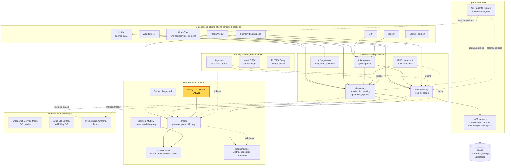
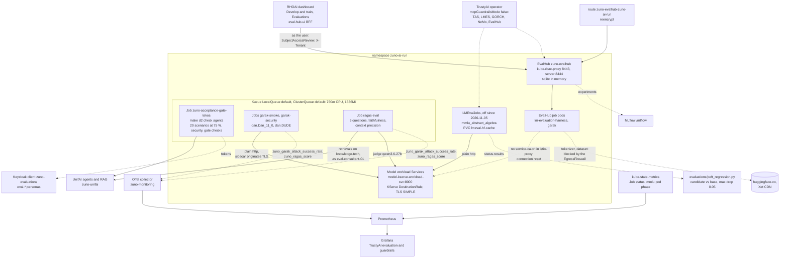

# Scenario: RHOAI TrustyAI - evaluating models and agents before they change

> **Status:** Not rehearsed in this format. Prerequisites checked read-only on demo333 on 2026-11-13:
> - **0 LMEvalJobs** on the cluster and no `lmeval-hf-cache` PVC: `lmEval.enabled: false` since 2026-11-05 (see
>   [Limits](#limits)).
> - `EvalHub/zuno-evalhub` in `zuno-ai-run`: `Ready=True`. Active collections `standard-llm-evals-v1`,
>   `safety-and-fairness-v1`, `reasoning-v1` and `leaderboard-v2`; providers `lm-evaluation-harness` and `garak`. Its
>   pod had been recreated about 140 minutes before the check. Its run history is an in-memory database, so it starts
>   empty after each restart.
> - Route `zuno-evalhub-zuno-ai-run.apps.demo333.startx.fr` (reencrypt, to the instance's kube-rbac-proxy) and the
>   RoleBinding `zuno-evalhub-user` for `ocp-ai-ops` and `ocp-ai-dev`.
> - Jobs `garak-smoke`, `garak-security` and `ragas-eval` `Complete` on 2026-11-09. Job `zuno-acceptance-gate-tekos`
>   `Complete` on 2026-11-11 (14:30Z, 2 minutes). Kueue admitted all four (ClusterQueue `default`). Their pods were
>   already gone, so their logs were not available.
> - DSC `zuno-dsc` with `mcpGuardrailsMode: false`; dashboard flags `disableLMEval: false` and `guardrails: true`.
> - GrafanaDashboard `trustyai` present, Grafana 1/1. EgressFirewall `default` in `zuno-ai-run` applied.
>
> At the time of the check (about 00:50 CET), the DSC was `Ready=False` with `TrustyAIReady=False`.
> `trustyai-service-operator-controller-manager` and `trustyai-operator-module-controller-manager` had been in
> CrashLoopBackOff since about 21:30Z on 2026-11-12, and the GuardrailsOrchestrator `zuno-guardrails-smoke` was in
> phase `Error`. **paas-ops-01** had still not signed in to OpenShift.
> **Show-ready ([ADR-0606](../../../adr/0606-admit-new-experiences-with-a-definition-of-done-and-a-wip-limit.md)):** no
> golden-path probe. Rehearse it before showing it to an audience.
> **Personas:** see [Personas](#personas).
> **Used in workshops:** [RHOAI end to end](../../workshops/rhoai-end-to-end.md).

## Introduction

TrustyAI is the evaluation and guardrails part of Red Hat OpenShift AI. In Zuno it measures models and agents before
a change reaches users (see [Appendix A](#appendix-a---hld)). Four evaluators run as Jobs from Git, and their results
land on one Grafana dashboard:
- **LM-Eval** benchmarks a served model on a standard task;
- **RAGAS** scores the answers of the RAG against the documents it retrieved, with a local model as the judge;
- **Garak** attacks a model with known jailbreak prompts;
- the **acceptance gate** runs each agent's twenty business scenarios and its security checks, with a 75% bar.

The same LM-Eval and Garak providers are offered as self-service in the dashboard's **Evaluations** page, through an
EvalHub instance. The Jobs, the EvalHub path and the traps are in [Appendix B](#appendix-b---lld). The guardrails half
of TrustyAI has its own page, [guardrails](../governance/guardrails.md).

This scenario shows past results. Running an evaluation is a cluster change: rehearse only.

**The message:** "Models and agents are measured before they change: a benchmark, the quality of the RAG answers,
jailbreak resistance, and twenty scenarios per agent with a 75% bar. The results stay visible, failures included."

**Decisions:**
- [ADR-0027](../../../adr/0027-evaluate-every-agent-with-twenty-acceptance-scenarios.md): twenty acceptance scenarios
  per agent.
- [ADR-0028](../../../adr/0028-require-a-seventy-five-percent-evaluation-threshold.md): 75% is the release threshold.
- [ADR-0108](../../../adr/0108-automate-model-evaluation-with-lm-eval.md): LM-Eval benchmarks as Git-managed
  LMEvalJobs, one input of the model quality gate.
- [ADR-0534](../../../adr/0534-integrate-trustyai-for-ai-evaluation-and-guardrails.md): TrustyAI for evaluation with
  LM-Eval, RAGAS and Garak; `mcpGuardrailsMode` stays `false`; a fine-tune must not regress its base model.
- [ADR-0567](../../../adr/0567-move-trustyai-guardrails-into-the-ai-gateway.md): the guardrails moved into the
  ai-gateway; the evaluation Jobs stay in TrustyAI.
- [ADR-0107](../../../adr/0107-introduce-automated-model-quality-gates.md): the quality gate that blocks a promotion
  below the threshold.

## Personas

The personas are fictional role accounts of the Keycloak realm `zuno`
([ADR-0349](../../../adr/0349-restructure-demo-personas-cluster-access-groups-and-new-agents.md)). They share one
password, kept in Vault at `keycloak/demo-personas`. The [catalogue](../../README.md#personas) lists all of them.

| Persona | Profile | What it can do here | Role in this demo |
|---|---|---|---|
| **ai-ops-01** | AI platform operator, back office. Groups `ocp-ai-ops` (admin on the Zuno namespaces, `zuno-monitoring` included), `agent_tekos`, `openwebui_admin`. | Opens Grafana. Bound to the Role `zuno-evalhub-user` in `zuno-ai-run`: may list collections and providers, and create, read and delete evaluations. | Shows the TrustyAI dashboard in the 5-minute version. |
| **ai-dev-01** | AI developer, back office. Groups `ocp-ai-dev` (edit on the Zuno namespaces), `agent_tekos`. | Same EvalHub rights as ai-ops-01, through `zuno-evalhub-user`. Launched the six test runs of 2026-11-07 from the **Evaluations** page. | Shows the **Evaluations** page in the 15-minute version. Does not start a run. |
| **paas-ops-01** | Platform operator, back office. Group `ocp-paas-ops` (cluster-admin). | Reads the EvalHub, Kueue, Job and DSC objects. | The presenter's `oc` terminal in the 15-minute version. |

Other identities:
- The acceptance gate signs in as the `eval-*` copies of the personas named in each `scenarios.yaml`. Tokens come
  from the Keycloak client `zuno-evaluations` (Vault `zuno/keycloak/zuno-evaluations`).
- `ragas-eval` asks UnifAI's RAG as **eval-consultant-01**.
- EvalHub's evaluation pods run as the instance's job ServiceAccount, not as the user who launched them.

## Before you start

- [ ] **paas-ops-01** has signed in once to the OpenShift console. On 2026-11-13 it had not: its group `ocp-paas-ops`
  did not exist. Then log a terminal in with `oc` as **paas-ops-01**, at the repository root.
- [ ] `oc get deploy -n redhat-ods-applications trustyai-service-operator-controller-manager` is 1/1, and
  `oc get evalhub zuno-evalhub -n zuno-ai-run` is `Ready`. On 2026-11-13 the operator was 0/1 and the instance Ready.
- [ ] Browser profile **ai-ops-01**: Grafana `https://grafana-route-zuno-monitoring.apps.demo333.startx.fr`, dashboard
  **Zuno Platform / TrustyAI evaluation & guardrails**, last 7 days. Check that the panels **RAGAS scores (real
  UnifAI retrievals)** and **Garak attack success rate (jailbreak probes)** have rows. They keep the last value for 30
  days; the last runs were on 2026-11-09.
- [ ] Browser profile **ai-dev-01**: `https://rh-ai.apps.demo333.startx.fr`, **Develop & train > Evaluations**,
  project `zuno-ai-run`. A stale page fails with `ChunkLoadError`: hard refresh (Ctrl+Shift+R). Rehearse the
  navigation: the menu names of RHOAI 3.6.0-ea.2 were not checked in a browser for this page.
- [ ] An editor or a GitHub tab on [`evaluations/tekos/scenarios.yaml`](../../../../evaluations/tekos/scenarios.yaml)
  and [`evaluations/tekos/gate_config.yaml`](../../../../evaluations/tekos/gate_config.yaml).
- [ ] Do not start an evaluation on stage: no EvalHub run, no LMEvalJob, no re-run of the Garak, RAGAS or gate Jobs.
  Each is a cluster change: rehearse only, never during a freeze.
- [ ] No golden-path probe covers this scenario.

## 5-minute version

| Time | Do | Say | You should see |
|---|---|---|---|
| 0:00 | Say what is measured | "Before a model or an agent changes, the platform measures it four ways: a standard benchmark, the quality of the RAG answers, resistance to jailbreaks, and twenty business scenarios per agent." | |
| 0:45 | Profile **ai-ops-01**, Grafana, **TrustyAI evaluation & guardrails**, row **Evaluation jobs**, panel **Garak / RAGAS job outcomes** | "The evaluators are ordinary Jobs on the cluster, declared in Git. Each one has a pass or a fail." | `garak-security`, `garak-smoke` and `ragas-eval` with 1 under succeeded. |
| 1:30 | Row **Scores (latest run)**, panel **RAGAS scores (real UnifAI retrievals)** | "RAGAS asks two questions about each RAG answer: is it grounded in the documents the agent retrieved, and were those documents relevant? The judge is a model that runs on our own GPUs, so no data leaves." | One row per question and metric (`faithfulness`, `llm_context_precision`). The questions are in French, for example "Comment configurer un cluster OpenShift ?". Values not read in the 2026-11-13 check. |
| 2:30 | Panel **Garak attack success rate (jailbreak probes)** | "Garak attacks a model with known jailbreaks. Higher is worse. Our French fine-tune never says 'I refuse' to a DAN prompt. We found it with this tool, and it stays visible here until it is fixed." | `mitigation.MitigationBypass` for `qwen3.5-9b-wesh` at or near 1. On 2026-09-02 on demo222: 0 passes out of 5, a 100% attack success rate. |
| 3:30 | Open `evaluations/tekos/scenarios.yaml`, then `gate_config.yaml` | "Each agent has twenty scenarios, and it must pass 75% of them and every security check. On 2026-10-23 on this cluster, Tekos passed 17 of the 18 scenarios that apply to it and 12 of 12 security checks." | Twenty scenarios, from `Portal loads all agent tiles` on; `scenario_threshold: 0.75`. |
| 4:30 | Close | "Models and agents are measured before they change: a benchmark, the quality of the RAG answers, jailbreak resistance, and twenty scenarios per agent with a 75% bar. The results stay visible, failures included." | |

## 15-minute version

Run the 5-minute version, then:

| Time | Do | Say | You should see |
|---|---|---|---|
| 5:00 | Profile **ai-dev-01**, **Develop & train > Evaluations**, project `zuno-ai-run` | "The same evaluators are self-service in the OpenShift AI dashboard. A developer picks a benchmark from four collections and a provider." | The EvalHub page with its collections and the providers `lm-evaluation-harness` and `garak`. The run list may be empty: the history is lost at each restart. |
| 6:15 | Do not start a run. Explain why | "On this cluster a run from this page cannot finish. The evaluation pod downloads its tokenizer and dataset from Hugging Face, which our egress firewall blocks. And a vendor defect breaks its TLS to models inside the service mesh. We documented both rather than open the firewall." | |
| 7:15 | Terminal: `oc get evalhub zuno-evalhub -n zuno-ai-run -o jsonpath='{.status.activeCollections}{"\n"}{.status.activeProviders}{"\n"}'`, then `oc get rolebinding zuno-evalhub-user -n zuno-ai-run -o jsonpath='{.subjects[*].name}'` | "Access is Kubernetes RBAC on virtual resources. The vendor grants project admins nothing here by default, so we bind two groups." | The four collections and the two providers; `ocp-ai-ops ocp-ai-dev`. |
| 8:15 | `oc get workloads -n zuno-ai-run`, then `oc get clusterqueue default -o jsonpath='{.spec.resourceGroups[0].flavors[0].resources}'` | "The scheduled evaluation Jobs go through Kueue. The queue is deliberately small: it lets one multi-gigabyte image pull at a time onto nodes with little disk." | Workloads for garak, ragas and the acceptance gate, `ADMITTED` and `FINISHED` True; `cpu` 750m and `memory` 1536Mi. |
| 9:15 | `oc get job zuno-acceptance-gate-tekos -n zuno-ai-run -o jsonpath='{.metadata.labels}'` | "The gate Job never asked for a queue. Kueue enrolled it because its namespace is labelled: on this operator the namespace is the unit of opt-in, not the Job." | `kueue.x-k8s.io/queue-name: default`. |
| 10:00 | `oc get lmevaljobs -A`, then open the `lmEval` block of [`gitops/charts/models/values.yaml`](../../../../gitops/charts/models/values.yaml) | "LM-Eval benchmarks are Git-managed LMEvalJobs. They are off on this release: the operator cannot read their status and holds the whole DataScienceCluster not ready. The last run was on 2026-11-05: 0.67 for qwen3.5-9b and 0.70 for qwen3.6-27b on MMLU abstract algebra." | `No resources found`. `enabled: false`; `base_url: http://...-kserve-workload-svc...:8000/...`. |
| 11:15 | Point at `base_url` | "Note the plain http. The pod is in the mesh, and its sidecar already speaks TLS to the model. A client that does its own TLS on top fails on the first request. The LMEvalJob has no field to change that, so the client must speak plain http." | |
| 12:00 | Show the PEFT regression result of [WP-109](../../../roadmap/work-packages/wp-109-trustyai-zuno-stack-integration-and-model-comparison.md) | "A fine-tune is compared with its base model on the same benchmark. Our French register fine-tune scored 0.55 against 0.67 for its base: minus 12 points, beyond the 5-point tolerance. The check said FAIL, and we kept the result." | Base `acc=0.67`, `qwen3.5-9b-wesh` `acc=0.55`, threshold `0.05`. |
| 13:00 | `oc get dsc zuno-dsc -o jsonpath='{.spec.components.trustyai}'` | "One switch to avoid. `mcpGuardrailsMode: true` restarts TrustyAI as a guardrails-only service. LM-Eval and EvalHub disappear, and TrustyAI still reports Ready." | `{"managementState":"Managed","mcpGuardrailsMode":false}`. |
| 14:00 | Close. The training side is on the [LoRA pipeline](./lora-pipeline-mlflow-kueue.md) page: its `evaluate` step runs the same acceptance gate before any registration. | Repeat the message. | |

## If something goes wrong

| Symptom | Fallback | Say |
|---|---|---|
| The RAGAS or Garak panel is empty | The panels keep the last value for 30 days. Widen the range, then show the [WP-109](../../../roadmap/work-packages/wp-109-trustyai-zuno-stack-integration-and-model-comparison.md) record: RAGAS `faithfulness=1.0` and context precision about 1.0 on three questions, Garak 100% attack success on the wesh fine-tune (demo222, 2026-09-02). | "The scores come from the last scheduled run; here is the record of it." |
| **Garak / RAGAS job outcomes** shows a failure | Say it. The Jobs are deliberately small and run against live models: a model restart fails them. | "A failed evaluation is shown, not hidden." |
| The **Evaluations** page says "Evaluations unavailable", or shows nothing | Check `oc get evalhub zuno-evalhub -n zuno-ai-run` and the TrustyAI operator. For an empty list as ai-dev-01, check the RoleBinding `zuno-evalhub-user`. Show the terminal steps instead. | |
| `ChunkLoadError` on the **Evaluations** page | Hard refresh (Ctrl+Shift+R): the browser kept a module from before an upgrade. | |
| Someone asks to launch an evaluation | Decline: no egress to Hugging Face, and the mesh defect. | "On this cluster we evaluate from Git-managed Jobs; the self-service page needs egress we chose not to open." |
| `oc get workloads -n zuno-ai-run` is empty | Kueue removed the finished Workloads. Show `oc get jobs -n zuno-ai-run` and their `kueue.x-k8s.io/queue-name` label. | |
| The DSC or `TrustyAIReady` is False | Say it. On 2026-11-13 the TrustyAI operators were crash-looping; the existing EvalHub instance and the finished Jobs were not affected. | "The operator restarts; what it already created keeps working." |

## Limits

- **Nothing is evaluated live in this scenario.**
  - LMEvalJobs are off on RHOAI 3.6.0-ea.2. The TrustyAI module cannot read an LMEvalJob status, so it holds the DSC
    `Ready=False` as long as any LMEvalJob exists, even a succeeded one
    ([WP-195](../../../roadmap/work-packages/wp-195-update-every-operator-on-demo333-through-the-repository.md)).
  - EvalHub runs launched from the page cannot finish on demo333. There is no egress to Hugging Face (user decision,
    2026-11-07). And a vendor defect breaks TLS to meshed models: the job pods mount no service CA into `istio-proxy`,
    while KServe's DestinationRule needs one ([WP-115](../../../roadmap/work-packages/wp-115-trustyai-dashboard-ui-flags-and-evalhub.md)).
    The documented workaround is to evaluate only models outside the mesh.
  - Re-running Garak, RAGAS or the gate means recreating Argo CD-managed Jobs: rehearse only.
- **Two separate evaluation paths.** EvalHub runs are plain Jobs of the instance. The Git-managed LMEvalJobs and the
  Garak, RAGAS and gate Jobs never appear in the **Evaluations** page. EvalHub keeps its history in memory only.
- **LM-Eval scores have no Prometheus path.** The dashboard shows only the pod phase of the `mmlu` jobs. The scores
  are in the LMEvalJob `status.results`, reported by `make d2 check models` and `make d3 check trustyai-config`.
- **LM-Eval in the mesh needs plain http.** Each LMEvalJob calls `http://<model>-kserve-workload-svc:8000`, and the
  sidecar originates the TLS. https from the client gives double TLS and fails on the first request.
- **LM-Eval needs its cache.** Its pod runs offline. The PVC `lmeval-hf-cache` and a prefetch Job, both rendered by
  the models chart with LM-Eval, fill the tokenizer from S3 and the one MMLU subject before the job starts. Without
  them every task falls back to a download the operator blocks.
- **Small samples.** MMLU is scoped to one subject (about 400 requests) for GPU capacity. RAGAS scores three French
  questions on `knowledge.tech`. Garak sends two DAN probes, five generations each, to the wesh fine-tune. The Garak
  comparison run on the base model was inconclusive.
- **The acceptance counts.** Comage has 22 scenarios and Arkos 21. Skipped scenarios are left out of the count, never
  counted as passes. Scenario 19 needs the in-cluster Kubernetes client. A persona whose daily budget is spent fails
  turns for reasons unrelated to the agent.
- **`mcpGuardrailsMode` must stay `false`.** At `true`, the operator runs only the NeMo guardrails service and silently
  drops LM-Eval, EvalHub, the GuardrailsOrchestrator and TrustyAIService.

## Appendix A - HLD

Where the evaluation bricks sit in Zuno. The highlighted box is the subject of this page. Plain arrows carry requests,
dotted arrows carry identity, policy or telemetry.

## Appendix B - LLD

The four Git-managed evaluators, the EvalHub self-service path, and where the results go. Drawn from
`gitops/charts/trustyai-config/` (`values.yaml`, `templates/evalhub.yaml`, `templates/evalhub-user-rbac.yaml`,
`templates/job-garak-smoke.yaml`, `templates/job-garak-security.yaml`, `templates/job-ragas-eval.yaml`),
`components/trustyai-eval/ragas_eval.py`, `gitops/charts/models/` (`values.yaml` `lmEval`,
`templates/lmevaljob.yaml`, `templates/pvc-lmeval-cache.yaml`, `templates/job-lmeval-cache-prefetch.yaml`,
`templates/networkpolicy-evalhub-clients.yaml`), `ansible/roles/agents/tasks/run_acceptance_gate.yml`,
`evaluations/tekos/` (`run_acceptance_gate.py`, `scenarios.yaml`, `gate_config.yaml`),
`evaluations/peft_regression.py`, `gitops/charts/kueue/values.yaml` and
`gitops/charts/grafana/templates/dashboard-trustyai.yaml`, with the live ConfigMap `zuno-evalhub-config`.

