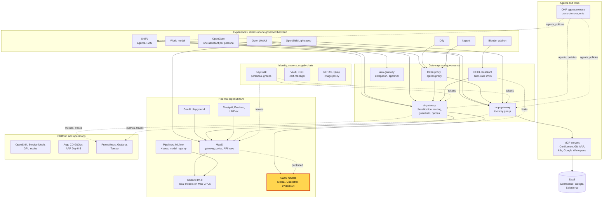
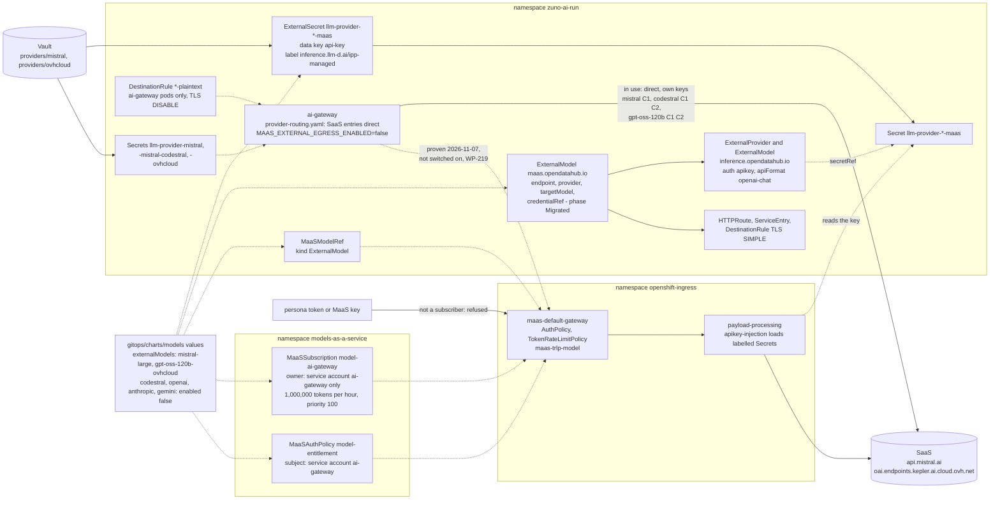

# Scenario: RHOAI external models - SaaS models published through MaaS, callable by the router only

> **Status:** Not rehearsed in this format. Prerequisites checked read-only on demo333 on 2026-11-13: Applications
> `zuno-models-d0`/`-d1` and `zuno-llm-d1` Synced and Healthy; ExternalModels (`maas.opendatahub.io`) `mistral-large`
> (provider `mistral`, target `mistral-large-4`, endpoint `api.mistral.ai`) and `gpt-oss-120b-ovhcloud` (provider
> `openai-compatible`, target `gpt-oss-120b`, endpoint `oai.endpoints.kepler.ai.cloud.ovh.net`), phase `Migrated`,
> each owning an `inference.opendatahub.io` ExternalModel and an ExternalProvider, both `Ready`; MaaSModelRefs
> `mistral-large` and `gpt-oss-120b-ovhcloud` `Ready`; MaaSSubscriptions `mistral-large-ai-gateway` and
> `gpt-oss-120b-ovhcloud-ai-gateway` Active, owner the ai-gateway's service account only, 1,000,000 tokens per hour,
> priority 100; MaaSAuthPolicies `mistral-large-entitlement` and `gpt-oss-120b-ovhcloud-entitlement` Active with that
> one subject; TokenRateLimitPolicies `maas-trlp-mistral-large` and `maas-trlp-gpt-oss-120b-ovhcloud` present;
> ExternalSecrets `llm-provider-mistral-maas` and `llm-provider-ovhcloud-maas` `SecretSynced`, their target template
> labelled `inference.llm-d.ai/ipp-managed: "true"` (the Secrets were not read); `payload-processing` 1/1 in
> `openshift-ingress`; Deployment `ai-gateway` 1/1 with `MAAS_EXTERNAL_EGRESS_ENABLED=false`; ConfigMap
> `zuno-provider-routing` identical to the repository file, `via_maas: true` on the four local `-maas` entries only. Not
> healthy at the time of the check: `maas-controller` in CrashLoopBackOff (21 restarts). No model was called.
> **paas-ops-01** had still not signed in to OpenShift.
> **Show-ready ([ADR-0606](../../../adr/0606-admit-new-experiences-with-a-definition-of-done-and-a-wip-limit.md)):** no
> golden-path probe. Rehearse it before showing it to an audience.
> **Personas:** see [Personas](#personas).
> **Used in workshops:** [RHOAI end to end](../../workshops/rhoai-end-to-end.md).

## Introduction

Two SaaS models are published in Models-as-a-Service like the local ones: Mistral Large on Mistral's own API, and
gpt-oss-120b on OVHcloud AI Endpoints. Each one is an `ExternalModel` (endpoint, provider, target model, credential)
with a `MaaSModelRef`, a subscription and an auth policy, on the same gateway as the models on Zuno's GPUs (see
[Appendix A](#appendix-a---hld)). The subscription has one owner: the ai-gateway's service account. No persona, MaaS key
or other application may call a SaaS model through MaaS, so every SaaS call passes the ai-gateway's data
classification first.

Today the ai-gateway still calls every SaaS provider directly, with its own keys: Mistral Large, gpt-oss-120b and
Codestral. The MaaS path of the two published models answered real completions on 2026-11-07; moving the ai-gateway onto
it is the next step. The objects, the key and the two paths are in [Appendix B](#appendix-b---lld).

**The message:** "SaaS models are governed like our own: one catalogue, and one caller allowed, the platform's router.
Nobody sends data to a SaaS model without the classification check."

**Decisions:**
- [ADR-0541](../../../adr/0541-integrate-mistral-and-gpt-oss-120b-as-maas-externalmodels.md): Mistral and OVHcloud
  gpt-oss-120b are MaaS `ExternalModel`s. Implemented on 2026-11-07: real completions through both, after the
  credential label fix and the move to `mistral-large-4`.
- [ADR-0570](../../../adr/0570-slim-the-ai-gateway-by-delegating-quotas-keys-and-exposure-to-maas.md): every provider
  should become a MaaS model. Its amendment of 2026-10-24 keeps the chat SaaS providers direct, as a named exception,
  with the MaaS objects in place and only the ai-gateway subscribed.
- [ADR-0021](../../../adr/0021-route-models-according-to-c1-c2-c3-classification.md): routing by C1/C2/C3; C3 never
  leaves the cluster.
- [ADR-0416](../../../adr/0416-consume-gpt-oss-120b-via-ovhcloud-ai-endpoints.md): gpt-oss-120b on OVHcloud, C1 and C2,
  Finage excluded.
- [ADR-0417](../../../adr/0417-consume-codestral-via-mistral-api.md): Codestral on the Mistral API, with a dedicated
  key, C1 and C2.

## Personas

The personas are fictional role accounts of the Keycloak realm `zuno`
([ADR-0349](../../../adr/0349-restructure-demo-personas-cluster-access-groups-and-new-agents.md)). They share one
password, kept in Vault at `keycloak/demo-personas`. The [catalogue](../../README.md#personas) lists all of them.

| Persona | Profile | What it can do here | Role in this demo |
|---|---|---|---|
| **paas-ops-01** | Platform operator, back office. Groups `ocp-paas-ops` (cluster-admin), `agent_tekos`, `aap_admin`, `openwebui_admin`. | Reads the MaaS objects in `zuno-ai-run` and `models-as-a-service`. MaaS subscription `gpt-oss-20b-ocp-paas-ops` on gpt-oss-20b only: no SaaS model. | The presenter's `oc` terminal in both versions. In the 15-minute version its own OpenShift token is refused on a SaaS model. |
| **ai-ops-01** | AI platform operator, back office. Group `ocp-ai-ops` (admin on the Zuno namespaces, `zuno-monitoring` included). | Opens Grafana. | Shows in the 15-minute version which SaaS providers served calls. |
| **finance-01** | Finance, middle office. Groups `finance`, `agent_finage`. | Its agent, Finage, is excluded from gpt-oss-120b (ADR-0416). The ai-gateway enforces it. | Named only. |
| **consultant-01** | Consultant and architect, front office. Group `consultant` and its Confluence subgroups. | Open WebUI user; **Zuno Code** goes to Codestral first. | Named only: asked the question of the Codestral-down drill of 2026-11-05. |

Other identities:
- `system:serviceaccount:zuno-ai-run:ai-gateway`, the only subscriber of the two SaaS models (1,000,000 tokens per
  hour each, priority 100);
- `payload-processing` in `openshift-ingress`, the RHOAI component that injects the provider key into a MaaS call.

## Before you start

- [ ] **paas-ops-01** has signed in once to the OpenShift console: on 2026-11-13 it had not. Then log a terminal in
  with `oc` as **paas-ops-01**, at the repository root, large font.
- [ ] Check the objects: `oc get externalmodels.maas.opendatahub.io,maasmodelrefs -n zuno-ai-run`. Expect `Migrated`
  for the two ExternalModels and `Ready` for the six model refs.
- [ ] Check the controller that was crash-looping on 2026-11-13:
  `oc get pods -n redhat-ods-applications | grep maas-controller`.
- [ ] Open [`platform/ai-gateway/provider-routing.yaml`](../../../../platform/ai-gateway/provider-routing.yaml) in an
  editor, at the SaaS entries (`- name: openai` and below).
- [ ] 15-minute version: set `export MAAS=https://maas.apps.demo333.startx.fr/zuno-ai-run` in the terminal.
- [ ] 15-minute version: Grafana `https://grafana-route-zuno-monitoring.apps.demo333.startx.fr` as **ai-ops-01**,
  dashboard **AI models & serving**, last 24 hours.
- [ ] 15-minute version: open [WP-125](../../../roadmap/work-packages/wp-125-external-models-through-maas.md) at
  "Live verification (2026-11-07, demo333, RHOAI 3.6.0-ea.2)" and the
  [WP-194 evidence](../../../roadmap/evidence/wp-194-zuno-code-live-proof.md) at section T5.
- [ ] Known on screen, not a failure: the two ExternalModels show phase `Migrated`. RHOAI 3.6 converted each one to
  its new API group (`inference.opendatahub.io`) and keeps ours as the owner.

## 5-minute version

| Time | Do | Say | You should see |
|---|---|---|---|
| 0:00 | `oc get externalmodels.maas.opendatahub.io -n zuno-ai-run` | "Two SaaS models, declared like any other platform object: the provider, the model, the endpoint, and a key kept in Vault." | `gpt-oss-120b-ovhcloud`: `openai-compatible`, `gpt-oss-120b`, `oai.endpoints.kepler.ai.cloud.ovh.net`. `mistral-large`: `mistral`, `mistral-large-4`, `api.mistral.ai`. Phase `Migrated`. |
| 1:00 | `oc get maasmodelrefs -n zuno-ai-run` | "Models-as-a-Service publishes them on the same gateway as the four models on our own GPUs." | Six refs `Ready`: `gpt-oss-20b`, `qwen35-9b`, `qwen35-9b-wesh`, `qwen36-27b-instruct`, `mistral-large`, `gpt-oss-120b-ovhcloud`. |
| 2:00 | `oc get maassubscriptions -n models-as-a-service -o custom-columns=NAME:.metadata.name,OWNER:.spec.owner.users,PRIORITY:.spec.priority \| grep -e mistral -e 120b` | "Who may call them? One identity: the platform's router. No person, no API key, no other application. A developer gets a key for a model on our GPUs; nobody gets one for a SaaS model." | `mistral-large-ai-gateway` and `gpt-oss-120b-ovhcloud-ai-gateway`, owner `[system:serviceaccount:zuno-ai-run:ai-gateway]`, priority `100`. |
| 3:00 | Editor, `provider-routing.yaml`, the SaaS entries | "The router decides by data class. Mistral Large may see C1 data only, the lowest level. gpt-oss-120b and Codestral may see C1 and C2. C3, the confidential level, never leaves the cluster. Today the router still calls these providers with its own keys; moving it onto the MaaS path is the next step." | `mistral`: `eligible_for: [C1]`. `ovhcloud-gpt-oss-120b` and `mistral-codestral`: `[C1, C2]`. No `via_maas` on any SaaS entry. |
| 4:15 | Close | "SaaS models are governed like our own: one catalogue, and one caller allowed, the platform's router. Nobody sends data to a SaaS model without the classification check." | |

## 15-minute version

Run the 5-minute version, then:

| Time | Do | Say | You should see |
|---|---|---|---|
| 5:00 | `oc get externalproviders -n zuno-ai-run`, then `oc get externalprovider mistral-large -n zuno-ai-run -o jsonpath='{.spec.auth}'` | "RHOAI 3.6 split our object into its new API: an ExternalProvider holds the endpoint and the key reference, an ExternalModel the route. Ours stays the owner, so Git still drives both." | Both providers `Ready`. `{"secretRef":{"name":"llm-provider-mistral-maas"},"type":"apikey"}`. |
| 6:15 | `oc get externalsecret llm-provider-mistral-maas -n zuno-ai-run -o jsonpath='{.spec.target.template.metadata.labels}'` | "The key comes from Vault, `providers/mistral`, the same value the router uses. One trap: the RHOAI component that injects the key only loads Secrets that carry this label. Without it, every call answered 500 'credentials not found'." | `{"inference.llm-d.ai/ipp-managed":"true","zuno.io/managed-by":"argocd"}`. |
| 7:30 | `curl -s -o /dev/null -w '%{http_code}\n' -H "Authorization: Bearer $(oc whoami -t)" $MAAS/gpt-oss-20b/v1/models`, then the same on `$MAAS/mistral-large/v1/models` *(untested commands)* | "My own token, a platform administrator. MaaS lets me reach a model on our GPUs on my group's subscription. The SaaS model refuses me: I am not the router." | `200`, then a refusal (`403` expected). |
| 9:00 | Show WP-125, "Live verification (2026-11-07)" | "On 2026-11-07 both SaaS models answered through MaaS, with the router's own token. Before the label: 500. Then our Mistral account refused `mistral-large-latest`, so both paths moved to `mistral-large-4`." | The table: `gpt-oss-120b-ovhcloud` 500 then 200; `mistral-large` 500, then 403 `tier_not_allowed`, then 200. |
| 10:30 | `oc get deploy ai-gateway -n zuno-ai-run -o jsonpath='{.spec.template.spec.containers[*].env[?(@.name=="MAAS_EXTERNAL_EGRESS_ENABLED")].value}'` | "The switch that sends the router's SaaS calls through MaaS is off. When it is on, MaaS will hold the only copy of the keys and count the SaaS tokens too." | `false`. |
| 11:30 | Grafana **AI models & serving**, panel **Model calls (rate, by provider/model/outcome)** | "What the router actually sent out, provider by provider, next to the local models." | The SaaS providers that served calls in the range, for example `mistral-codestral`, next to the local `-maas` providers. An empty SaaS series means no task used a SaaS model in the range. |
| 12:30 | Show the WP-194 evidence, section T5 | "Codestral does not go through MaaS at all: the router calls it with a dedicated key, for the **Zuno Code** model. On 2026-11-05 we broke it on purpose. The user got a normal answer from a local model, in the same trace, one second after the failure." | Two traces: `mistral-codestral` error `Invalid model` in under a second, then `local-maas` ok in 40 to 66 s. |
| 13:45 | Point to the routing and sovereignty scenarios | "Which model a task gets is the [routing scenario](../governance/ai-gateway-routing.md). Which data may go out is the [sovereignty scenario](../governance/ai-gateway-sovereignty.md)." | |
| 14:15 | Close | Repeat the message. | |

## If something goes wrong

| Symptom | Fallback | Say |
|---|---|---|
| A model ref is not `Ready` or a subscription not `Active` | Check `maas-controller` (`oc get pods -n redhat-ods-applications \| grep maas-controller`). Show the chart instead: `externalModels` and the SaaS entries of `maas.models` in [`gitops/charts/models/values.yaml`](../../../../gitops/charts/models/values.yaml). | "The controller that keeps these objects is restarting; the declaration in Git is the same." |
| `oc get externalmodels` lists other columns than expected | Without the group, `oc` picks the `inference.opendatahub.io` objects. Use `externalmodels.maas.opendatahub.io`. | |
| The persona token gets 401 on the local model as well | paas-ops-01 has not signed in, so its group and subscription do not match yet, or the token expired. Skip the step and show the subscription owners again. | |
| The SaaS model answers 200 to the persona token | Stop the step and say so: a SaaS call outside the router is a defect. | "This must not happen, and I will not explain it away." |
| No SaaS series in Grafana | Widen to 7 days, or say that no task used a SaaS model in the range: the local models come first for most tasks. | |

## Limits

- **The router does not use the MaaS path yet.** `mistral`, `mistral-codestral`, `ovhcloud-gpt-oss-120b` and the
  `openai`, `gemini` and `anthropic` entries are all called directly by the ai-gateway with its own keys. The cutover
  of the two published models and the Finage negative test wait in
  [WP-219](../../../roadmap/work-packages/wp-219-run-the-adr-0570-checks-once-their-blockers-clear.md). Until then MaaS
  counts no SaaS token; the ai-gateway's quota ledger does.
- **Two Secrets per key.** The router's Secret and the MaaS mirror read the same Vault value; the mirror exists because
  the ExternalModel needs a data key named `api-key`. The router's copy goes once the cutover is done (ADR-0570 clause
  4).
- **Codestral is not published in MaaS.** Its `externalModels` entry is `enabled: false`, like OpenAI, Anthropic and
  Gemini.
- **OpenAI chat format only.** On `mistral-large`, `/v1/messages` (Anthropic format) answers 500: the API translation
  of RHOAI is not enabled here
  ([WP-220](../../../roadmap/work-packages/wp-220-evaluate-the-rhoai-3-6-mcp-lifecycle-portal-and-workbenches-v2-components.md),
  section 5).
- **`mistral-large-4` answers `content` as a list with a `thinking` block.** A client must handle it.
- **Mistral Large is C1 only.** It is held back from C2 until a data-handling review.
- **The Finage exclusion from gpt-oss-120b** is enforced by the ai-gateway only, not by MaaS (ADR-0541).
- **The MaaS path is not shown live.** Only the router may call it, and the router does not use it yet; the
  15-minute version quotes the recorded proof instead.
- **The persona refusal at 7:30 is untested.**

## Appendix A - HLD

Where the external models sit in Zuno. The highlighted box is the subject of this page. Plain arrows carry requests,
dotted arrows carry identity, policy or telemetry.

## Appendix B - LLD

The objects behind one SaaS model, the key path, and the two call paths: the direct one in use, the MaaS one proven
and not yet used. Drawn from `gitops/charts/models/templates/externalmodel.yaml`, `maas.yaml` and
`destinationrule-external-model-plaintext.yaml`, `gitops/charts/models/values.yaml` (`externalModels`, the SaaS entries
of `maas.models`, `maas.saasSubscriptions.gatewayOnly`), `platform/ai-gateway/provider-routing.yaml`, and the live
objects listed in the status banner.

