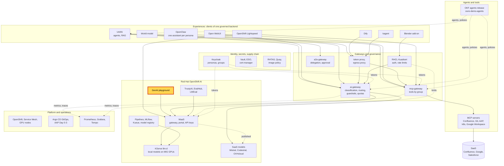
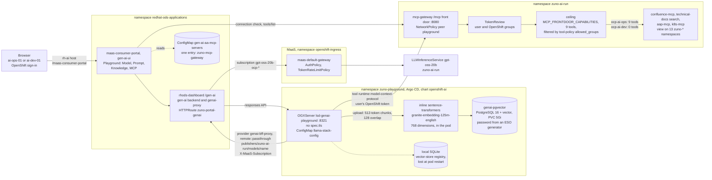

# Scenario: RHOAI GenAI playground - chat, a cited document and governed MCP tools

> **Status:** Not rehearsed in this format. Prerequisites checked read-only on demo333 on 2026-11-13: Applications
> `zuno-openshift-ai-d0`/`-d1`, `zuno-mcp-d1` and `zuno-models-d1` Synced and Healthy; in `zuno-playground`, OGXServer
> `lsd-genai-playground` `Ready` without a `spec.tls` block, its pod 1/1 with 0 restarts and 9 ReplicaSets (no
> growth), `genai-pgvector` 1/1 on the Bound 5Gi claim `genai-pgvector-storage`, ExternalSecret
> `genai-pgvector-credentials` `SecretSynced`; ConfigMap `llama-stack-config` registers
> `publishers/zuno-ai-run/models/` `gpt-oss-20b`, `qwen3.5-9b`, `qwen3.5-9b-wesh` and `qwen3.6-27b-instruct`;
> ConfigMap `gen-ai-aa-mcp-servers` holds one entry, `zuno-mcp-gateway`; Deployment `mcp-gateway` 1/1 with the nine
> `MCP_FRONTDOOR_CAPABILITIES`, and its NetworkPolicy admits `zuno-playground` and `redhat-ods-applications` on 8080;
> DSC `MaaSConsumerPortalAvailable=True`, `OGXReady=True`, `ModelsAsAServiceReady=True`; Deployments
> `maas-consumer-portal`, `gen-ai-ui`, `maas-ui` and `rhods-dashboard` available; HTTPRoutes `zuno-portal-genai`,
> `zuno-portal-dashboard` and `zuno-portal-oauth-callback` present; the four `LLMInferenceService` Ready;
> MaaSSubscriptions `gpt-oss-20b-ocp-ai-dev`, `-ocp-ai-ops` and `-ocp-paas-ops` Active; OpenShift groups `ocp-ai-ops`
> (ai-ops-01) and `ocp-ai-dev` (ai-dev-01) present. Not healthy at the time of the check: the DSC was `Ready=False`
> (TrustyAI: the guardrails smoke object in Error) and `maas-controller` was in CrashLoopBackOff (21 restarts). Their
> effect on the playground was not tested: check both before any session. **paas-ops-01** had still not signed in to
> OpenShift (no group `ocp-paas-ops`).
> **Show-ready ([ADR-0606](../../../adr/0606-admit-new-experiences-with-a-definition-of-done-and-a-wip-limit.md)):** no
> golden-path probe. Rehearse it before showing it to an audience.
> **Personas:** see [Personas](#personas).
> **Used in workshops:** [RHOAI end to end](../../workshops/rhoai-end-to-end.md).

## Introduction

The GenAI playground is the page of Red Hat OpenShift AI where a person tries a model, a document and MCP tools before
writing any code. In Zuno it opens from the MaaS consumer portal and sits on top of the platform (see
[Appendix A](#appendix-a---hld)):
- the chat calls a local model through MaaS, on the subscription of the person's group;
- the MCP tools come from the Zuno mcp-gateway, which checks the person's own OpenShift token and groups.

Zuno ships one ready-made playground in the namespace `zuno-playground`, created by Argo CD: the OGX server
`lsd-genai-playground`, a pgvector database for uploaded documents, and the four local models registered as
`publishers/zuno-ai-run/models/<name>`. The portal's own **Create playground** button is not used: the copy it makes
restarts forever on this release. The pods, the configuration and the three request paths (chat, documents, tools) are
in [Appendix B](#appendix-b---lld).

**The message:** "Developers and operators try our models, their own documents and our tools in Red Hat's playground.
The platform still decides which model budget and which tools each person gets."

**Decisions:**
- [ADR-0587](../../../adr/0587-admit-additional-user-experiences-over-the-one-governed-backend.md): the playground is
  a model and MCP testing tool, not an end-user experience; it may be shown as the operator's tool.
- [ADR-0201](../../../adr/0201-complete-the-openshift-ai-maas-governance-plane-integration.md): MaaS is the model
  access plane; the playground's chat consumes the person's subscription.
- [ADR-0524](../../../adr/0524-integrate-openshift-lightspeed-with-the-zuno-ai-platform.md): the mcp-gateway's `/mcp`
  front door accepts an OpenShift user token (TokenReview) and derives `tools/list` from that user's groups.
- [ADR-0036](../../../adr/0036-enforce-the-complete-mcp-authorization-intersection-in-the-gateway.md): every tool
  offered or called is the intersection of the front door's ceiling and the tool policy.
- [ADR-0322](../../../adr/0322-migrate-from-llama-stack-configuration-to-the-openshift-ai-ogx-operator.md): the OGX
  operator is active in the DataScienceCluster.
- [ADR-0603](../../../adr/0603-close-the-medium-severity-security-gaps-found-in-the-2026-11-06-review.md) (M3): the
  playground's OGX server keeps TLS verification off, a documented exception for a demo-only vendor UI.

## Personas

The personas are fictional role accounts of the Keycloak realm `zuno`
([ADR-0349](../../../adr/0349-restructure-demo-personas-cluster-access-groups-and-new-agents.md)). They share one
password, kept in Vault at `keycloak/demo-personas`. The [catalogue](../../README.md#personas) lists all of them.

| Persona | Profile | What it can do here | Role in this demo |
|---|---|---|---|
| **ai-ops-01** | AI platform operator, back office. Groups `ocp-ai-ops` (admin on the Zuno namespaces, `zuno-playground` included), `agent_tekos`, `openwebui_admin`. | Subscription `gpt-oss-20b-ocp-ai-ops`: 5,000,000 tokens per hour on gpt-oss-20b. Nine MCP tools: Confluence search and page read, technical-docs search, two AAP audits, four read-only Kubernetes tools. | The operator of the 5-minute version: chats, connects the tools, has the cluster read. Uploads the document in the 15-minute version. |
| **ai-dev-01** | AI developer, back office. Groups `ocp-ai-dev` (edit on the Zuno namespaces), `agent_tekos`. | Subscription `gpt-oss-20b-ocp-ai-dev`, same budget. No MCP tool: `ocp-ai-dev` is in none of the tool policy's `allowed_groups`. | The contrast of the 15-minute version: same playground, same model, zero tools. |
| **paas-ops-01** | Platform operator, back office. Group `ocp-paas-ops` (cluster-admin). | Reads the playground objects, the portal's MCP catalogue and the mcp-gateway configuration. Opens the OpenShift console dashboards. | The presenter's `oc` terminal in the 15-minute version. |

Other identities:
- the MCP connection uses each persona's **own OpenShift token**, pasted in the playground: the mcp-gateway resolves it
  by TokenReview, there is no shared tool account;
- the MCP backends reach Confluence and AAP with their own technical identities, within what the gateway allows for
  the user's groups (for Confluence, the spaces of those groups).

## Before you start

- [ ] Both personas have signed in to OpenShift before (their `User` objects existed on 2026-11-13). Password: Vault
  `keycloak/demo-personas`.
- [ ] Two private browser windows:
  - window 1: **ai-ops-01**;
  - window 2: **ai-dev-01** (15-minute version only).
- [ ] In each window open `https://rh-ai.apps.demo333.startx.fr/maas-consumer-portal/` and sign in. It is the
  **OpenShift** sign-in, with Keycloak behind it.
- [ ] Open **Playground** and pick the project **Zuno Playground**. Never press **Create playground** in any other
  project.
- [ ] **Settings**, **Model**: `publishers/zuno-ai-run/models/gpt-oss-20b`, subscription `gpt-oss-20b-ocp-ai-ops`
  (window 1) or `gpt-oss-20b-ocp-ai-dev` (window 2). The human subscriptions cover gpt-oss-20b only.
- [ ] Check the model and the playground: `oc get llminferenceservice gpt-oss-20b -n zuno-ai-run` (`READY True`),
  `oc get ogxserver -n zuno-playground` (`Ready`).
- [ ] Check the two items that were unhealthy on 2026-11-13:
  - `oc get pods -n redhat-ods-applications | grep maas-controller`;
  - `oc get dsc -o jsonpath='{.items[0].status.conditions[?(@.type=="Ready")].message}'`.
- [ ] Warm the model: ask one question in window 1 before the audience arrives.
- [ ] The MCP token of each persona, fetched before the session in that persona's window:
  `https://oauth-openshift.apps.demo333.startx.fr/oauth/token/request`, **Display Token**. It is valid 24 hours and
  carries all of that persona's OpenShift rights. Never show it on screen; paste it with screen sharing paused.
- [ ] 15-minute version, the document to upload. Copy
  [travel-and-expense-policy.md](../../unifai-rag-upload/travel-and-expense-policy.md) to a file named
  `travel-and-expense-policy.txt` on the laptop: the playground accepts PDF, CSV and TXT files, 10 MB at most. It is
  fictional. Never upload `questions.md` (it holds the answers) or a real business document. If **Uploaded files**
  already lists it from a rehearsal, remove it so the audience sees a real upload.
- [ ] 15-minute version: a terminal logged in with `oc` as **paas-ops-01**, at the repository root. On 2026-11-13
  paas-ops-01 had never signed in to OpenShift: sign it in once to the console first.
- [ ] Known on screen, not a failure: a RAG answer can show a malformed citation marker such as `{{cit[1]ation:1}}`.
  The model wrote the marker badly; the citation itself works
  ([WP-220](../../../roadmap/work-packages/wp-220-evaluate-the-rhoai-3-6-mcp-lifecycle-portal-and-workbenches-v2-components.md),
  section 18).

## 5-minute version

Window 1, **ai-ops-01**.

| Time | Do | Say | You should see |
|---|---|---|---|
| 0:00 | **Playground**, project **Zuno Playground**, **Settings**, **Model** | "This is Red Hat's GenAI playground, inside the OpenShift AI portal. I signed in with my company account. The playground is already set up for us: our models, a vector database, our tools." | Model `publishers/zuno-ai-run/models/gpt-oss-20b`, subscription `gpt-oss-20b-ocp-ai-ops`. |
| 0:45 | Ask: `Réponds en une phrase : quelle est la capitale de la France ?` | "The model runs on our own GPUs. The call goes through Models-as-a-Service and counts against my group's subscription: 5 million tokens an hour." | `La capitale de la France est Paris.` and the metric chips. On 2026-11-06: about 160 tokens per second, first token in 630 to 690 ms ([screenshot](../../../assets/img/wp220-playground-chart-chat-ai-ops.png)). |
| 1:45 | **Settings**, **MCP**: on the row `zuno-mcp-gateway`, click the lock in **Auth**, paste ai-ops-01's token (screen sharing paused), **Save** | "Red Hat's playground lists one MCP server: our own tool gateway. The gateway does not trust the playground. It checks my own OpenShift token and gives me the tools of my group." | **Connection successful**, `9 out of 9 tools are active` ([screenshot](../../../assets/img/wp220-playground-chart-mcp-9-tools.png)). |
| 3:00 | Ask: `Which pods of zuno-ai-run are not Running, and how many are?` *(untested prompt in the playground; tested in [kagent](../experiences/kagent.md) on 2026-11-06)* | "As an AI platform operator I may read the cluster. The model chose the tool; the gateway checked my groups before the call. It cannot read a Secret, and the cluster tools cannot change anything." | A **Tool response: k8s.resource.list** block under the answer, then a count of pods. The numbers change from day to day. |
| 4:15 | Close | "Developers and operators try our models, their own documents and our tools in Red Hat's playground. The platform still decides which model budget and which tools each person gets." | |

## 15-minute version

Run the 5-minute version, then:

| Time | Do | Say | You should see |
|---|---|---|---|
| 5:00 | Window 1, **Settings**, **Knowledge**: switch **RAG** on, **Upload** `travel-and-expense-policy.txt` | "Now a document of my own. The playground cuts it into chunks, embeds them with a small model inside its own pod and stores them in PostgreSQL with pgvector, in the same namespace. Nothing leaves the cluster." | The file under **Uploaded files**; **Knowledge** shows `On`. |
| 6:00 | Ask: `Which code goes on a rental car booking?` *(untested prompt in the playground; tested in UnifAI live RAG)* | "The answer comes with its source." | `ZN-CAR-7`, with `1 cited, 1 retrieved` (or more) under the answer. On 2026-11-06 a PDF quote and `Quel est le montant total du devis ?` gave `1 cited, 1 retrieved` ([screenshot](../../../assets/img/wp220-playground-chart-rag-devis.png), amount masked). |
| 7:15 | Window 2, **ai-dev-01**: **Playground**, project **Zuno Playground**, subscription `gpt-oss-20b-ocp-ai-dev`. Ask `Réponds en une phrase : quelle est la capitale de la France ?` | "A developer. Same playground, same model, the developers' own subscription." | `La capitale de la France est Paris.` ([screenshot](../../../assets/img/wp220-playground-chart-chat-ai-dev.png)). |
| 8:15 | Window 2, **Settings**, **MCP**: connect `zuno-mcp-gateway` with ai-dev-01's own token | "Same server, same gateway, another group. The developer group has no tool in our policy, so the gateway lists none. We kept it that way on purpose, to show the difference." | **Connection successful**, `0 out of 0 tools are active` ([screenshot](../../../assets/img/wp220-playground-chart-mcp-ai-dev-0-tools.png)). |
| 9:15 | Terminal: `oc get ogxserver,deploy,pvc -n zuno-playground`, then `oc get rs -n zuno-playground --no-headers \| wc -l` | "This playground is ours, in Git. The portal would create its own copy. On this release the operator rewrites that copy's CA bundle every second in a different order, and each rewrite restarts the server. Ours has no TLS block and stays up." | OGXServer `lsd-genai-playground` `Ready`; Deployments `genai-pgvector` and `lsd-genai-playground` 1/1; PVC `genai-pgvector-storage` Bound; 9 ReplicaSets (2026-11-13). |
| 10:30 | `oc get cm gen-ai-aa-mcp-servers -n redhat-ods-applications -o jsonpath='{.data}'`, then `oc get deploy mcp-gateway -n zuno-ai-run -o jsonpath='{.spec.template.spec.containers[*].env[?(@.name=="MCP_FRONTDOOR_CAPABILITIES")].value}'` | "The playground's MCP catalogue holds one entry: the front door of our gateway, with no secret in it. The gateway offers at most nine tools on that door. Eight read; one launches the cluster health-check job in Ansible Automation Platform." | The entry `zuno-mcp-gateway`, url `http://mcp-gateway.zuno-ai-run.svc.cluster.local:8080/mcp`. The nine capabilities: `confluence.page.search`, `confluence.page.read`, `knowledge.tech.search`, `aap.platform.audit`, `aap.cluster.audit`, `k8s.resource.read`, `k8s.resource.list`, `k8s.events.read`, `k8s.logs.read`. |
| 11:45 | Open the tool policy of the agents release: [policies/tools/tool-policy.yaml](https://github.com/startxfr/zuno-demo-agents/blob/main/policies/tools/tool-policy.yaml), the `k8s.*` entries | "Who gets which tool is written in the signed agents release, not in the playground. The four cluster reads list `ocp-ai-ops` only. Confluence, technical docs and the AAP audits list it too. `ocp-ai-dev` is on none of them: default deny." | `allowed_groups: [ocp-ai-ops]` on `k8s.resource.read`, `k8s.resource.list`, `k8s.events.read` and `k8s.logs.read`. |
| 13:00 | Optional *(not rehearsed)*: OpenShift console as **paas-ops-01**, **Observe**, **Dashboards**, project `redhat-ods-monitoring`, dashboard **Usage**, subscription `gpt-oss-20b-ocp-ai-ops` | "The playground's chats are metered like any other MaaS call, per user and per subscription." | **Total tokens** and **Token consumption chart** for the subscription in the range. |
| 14:15 | Close | Repeat the message. | |

## If something goes wrong

| Symptom | Fallback | Say |
|---|---|---|
| **Playground** shows "To begin you must deploy a model", or the project is **Startx default project** | Pick the project **Zuno Playground**. The portal's own **Playground** and **AI asset endpoints** list only models flagged as AI assets in the `Startx default project`; the Zuno models live in `zuno-ai-run`. | |
| The page offers **Create playground** | You are in another project. Do not press it: that copy loops on its CA bundle and never becomes Ready (WP-220, section 15). Switch to **Zuno Playground**. | "This release has a defect on that path; we ship our own copy instead." |
| The chat answers "Server error" | Check `oc get llminferenceservice gpt-oss-20b -n zuno-ai-run` and `oc get httproute zuno-portal-genai -n redhat-ods-applications`: without that route the stack's model proxy answers 404 (WP-220, section 16). Show the screenshots of the 5-minute rows instead. | "The model behind the playground is not answering; the screenshots show the same flow." |
| The model list shows only a greyed reranker | The OGX server is not Ready: `oc get ogxserver,pods -n zuno-playground`. | |
| A qwen model returns an error | Use gpt-oss-20b. The three human subscriptions cover that model only. | |
| MCP connection fails or the gateway answers 401 | The token expired (24 hours) or belongs to the other persona. Fetch a new one in the same window. | |
| The model answers without calling a tool | Ask the prompt tested on 2026-11-06: `Cherche dans Confluence une page sur le portail MaaS et donne-moi le titre.` It produced a **Tool response: confluence.page.search** block; Confluence found no page, which is fine: the call is the proof. | "The platform decides which tools are offered; the model decides whether to call one." |
| `Vector_store 'vs_...' not found`, or the uploaded file is gone | The OGX pod restarted: its vector-store registry is a local SQLite file, lost at each restart. Upload the file again. | |
| `maas-controller` still crash-looping | If the chat answers, carry on: the gateway policies already exist. If it does not, stop the chat steps and show the screenshots. | |

## Limits

- **A testing tool, not an end-user experience** (ADR-0587). The chat goes to MaaS directly, not through the
  ai-gateway: no data classification, no guardrails and no per-persona budget apply, only the MaaS subscription.
  Only the four local models are registered; no SaaS model is offered.
- **gpt-oss-20b only, in practice.** The stack lists four models, but the human subscriptions cover gpt-oss-20b only.
  The three qwen entries are registered by their served names (`qwen3.5-9b`), while their MaaS model refs are named
  `qwen35-9b`; whether they would resolve was not tested.
- **The MCP token is a full OpenShift token.** It is pasted by the user, lives 24 hours and carries all of that user's
  OpenShift rights (admin on the Zuno namespaces for ai-ops-01). Where the portal keeps it during the session was not
  checked.
- **The front door has no agent or task.** The tools are the front door's ceiling filtered by the tool policy's
  groups. The playground cannot be narrowed to one task as UnifAI or Open WebUI are; see
  [MCP tools by group](../governance/mcp-tools-by-group.md).
- **`aap.cluster.audit` launches a real job** in Ansible Automation Platform (the Day 0 health check). Do not ask
  for it on stage unless you mean it.
- **Uploads may be visible to other users of the project.** One OGX server serves the whole project; whether another
  persona sees the uploads was not tested. Upload fictional documents only.
- **A pod restart loses the vector-store registry** (local SQLite); pgvector keeps the chunks but the playground no
  longer finds them.
- **TLS verification is off inside the OGX server** (`--insecure`, `VLLM_TLS_VERIFY=false`), kept under ADR-0603 M3
  for this vendor UI.
- **A playground created from the portal in another namespace is the vendor's version** and loops on its CA bundle.
  The upstream report is drafted, not sent
  ([evidence](../../../roadmap/evidence/wp-220-ogx-ca-bundle-vendor-report.md)).
- **This scenario does not cover** API keys (see [MaaS portal and API keys](./maas-portal-api-keys.md)) or how
  models are served (see [model serving with llm-d on MIG](./model-serving-llmd-mig.md)).

## Appendix A - HLD

Where the GenAI playground sits in Zuno. The highlighted box is the subject of this page. Plain arrows carry requests,
dotted arrows carry identity, policy or telemetry.

## Appendix B - LLD

The ready-made playground and its three paths: chat to MaaS, documents to pgvector, tools to the mcp-gateway. Drawn
from `gitops/charts/openshift-ai/templates/playground.yaml`, `gen-ai-mcp-servers.yaml`, `maas-portal-genai-route.yaml`
and `values.yaml` (`playground`, `genAiMcpServers`), `gitops/charts/mcp-gateway/values.yaml` (`frontdoorCapabilities`,
`playground`) and `templates/networkpolicy.yaml`, `components/mcp-gateway/app/mcp_frontdoor.py` and `app/auth.py`
(`validate_token_or_kubernetes`), `gitops/charts/mcp-k8s/values.yaml`, the agents release's
`policies/tools/tool-policy.yaml`, and the live objects listed in the status banner. How the portal's backend
authenticates to MaaS was not traced.

