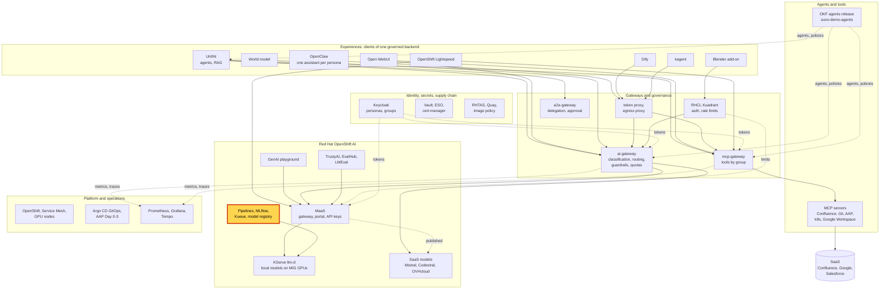
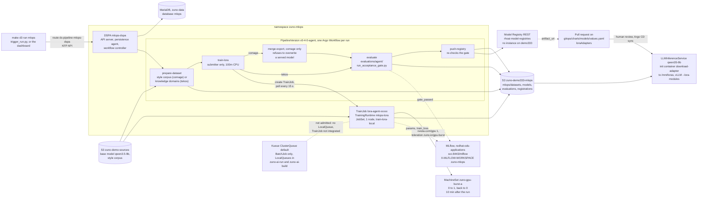

# Scenario: RHOAI pipelines - from a dataset to a fine-tuned LoRA adapter

> **Status:** Not rehearsed in this format. Prerequisites checked read-only on demo333 on 2026-11-13:
> - `DataSciencePipelinesApplication/mlops-dspa` in `zuno-mlops`: `APIServerReady=True` but `Ready=False`. Its
>   workflow controller was in CrashLoopBackOff (15 restarts in 69 minutes), so a new run would not execute.
> - Route `ds-pipeline-mlops-dspa-zuno-mlops.apps.demo333.startx.fr`.
> - Pipelines `mlops`, `mlops-comage` and `mlops-tekos`, with the versions `v0-3-0-*` and `v0-4-0-*` (the `v0-4-0` pair
>   was created on 2026-11-09). No Argo Workflow object is left in the namespace.
> - One TrainJob, `lora-comage-4c28m` (run `wp126-20260908-195101`): `Complete` on 2026-09-08 after 29 minutes, on the
>   TrainingRuntime `mlops-lora`.
> - MachineSet `zuno-gpu-burst-a` at 0, with a MachineAutoscaler from 0 to 1.
> - `MLflow/mlflow` Available, version 3.15.2, `status.address.url` ending in `/mlflow`. MLflowConfigs in `zuno-mlops`
>   and `zuno-ai-run`.
> - Kueue: ClusterQueue `default` (750m CPU and 1536Mi; MIG slices 4 x `1g.24gb` and 2 x `2g.48gb`), LocalQueues in
>   `zuno-ai-build` and `zuno-ai-run` only, no Workload in `zuno-mlops`.
> - **No ModelRegistry instance.** The DSC component `modelregistry` is Managed, but only the model catalog runs in
>   `rhoai-model-registries`.
> - `qwen35-9b` Ready, without an adapter: `loraAdapters: []` on demo333, by design.
>
> At the time of the check (about 00:50 CET), the DSC `zuno-dsc` was `Ready=False`. The controllers of JobSet, the
> Kubeflow Trainer, the model registry operator and TrustyAI had been in CrashLoopBackOff since their pods were
> recreated, about 21:30Z on 2026-11-12. Check them before any session.
> **Show-ready ([ADR-0606](../../../adr/0606-admit-new-experiences-with-a-definition-of-done-and-a-wip-limit.md)):** no
> golden-path probe. Rehearse it before showing it to an audience.
> **Personas:** see [Personas](#personas).
> **Used in workshops:** [RHOAI end to end](../../workshops/rhoai-end-to-end.md).

## Introduction

LoRA adapts a model to one agent with a few megabytes of extra weights trained on top of a frozen base model. In Zuno
the path is one Kubeflow pipeline per agent, in the project `zuno-mlops` (see [Appendix A](#appendix-a---hld)):
1. prepare the dataset;
2. train the adapter;
3. run the agent's own acceptance gate;
4. register the adapter if it passes.

The training step runs as a Kubeflow TrainJob on a GPU node that the cluster adds for the run and removes after it.
Each run is mirrored into MLflow. Serving the adapter is a reviewed change in Git, never an automatic step. The
pipeline, the TrainJob, the tracking calls and the serving path are in [Appendix B](#appendix-b---lld).

This scenario shows past runs. Starting a run is a cluster change: rehearse only, never during a freeze.

**The message:** "A fine-tuned model is a build artefact like any other. A pipeline trains it, MLflow records it, the
agent's own tests gate it, and it is served only after a human approves the change in Git."

**Decisions:**
- [ADR-0302](../../../adr/0302-build-dataset-to-model-mlops-pipelines.md): a KFP pipeline, S3 storage, an evaluation
  gate before the registry, human-reviewed promotion. Decisions 1, 3 and 5-7 were verified live by WP-133.
- [ADR-0301](../../../adr/0301-introduce-lora-and-peft-model-customization.md): adapters are versioned, registered
  artefacts, selected statically, and inherit the classification of their training data (decisions 2-4).
- [ADR-0526](../../../adr/0526-fine-tune-and-serve-a-french-urban-register-model-variant.md): the other serving path.
  The adapter is merged into a standalone model, served as `qwen35-9b-wesh`.
- [ADR-0539](../../../adr/0539-delegate-lora-training-compute-to-a-kfp-submitted-trainjob.md): KFP still
  orchestrates. The training step submits a TrainJob to a namespaced TrainingRuntime and waits.
- [ADR-0538](../../../adr/0538-adopt-rhoai-35-workload-surfaces-mlflow-kueue-trainingjobs.md): MLflow tracking that
  never fails a run; Kueue's first consumers are evaluation Jobs, not training.
- [ADR-0321](../../../adr/0321-delegate-kueue-lifecycle-to-the-red-hat-build-of-kueue-operator.md): Kueue is run by
  the Red Hat build of Kueue operator.
- [ADR-0351](../../../adr/0351-share-rtx-pro-6000-gpus-via-nvidia-mig-with-scale-from-zero-burst-capacity.md): a
  whole-GPU burst node that scales from zero.

## Personas

The personas are fictional role accounts of the Keycloak realm `zuno`
([ADR-0349](../../../adr/0349-restructure-demo-personas-cluster-access-groups-and-new-agents.md)). They share one
password, kept in Vault at `keycloak/demo-personas`. The [catalogue](../../README.md#personas) lists all of them.

| Persona | Profile | What it can do here | Role in this demo |
|---|---|---|---|
| **ai-dev-01** | AI developer, back office. Groups `ocp-ai-dev` (edit on the Zuno namespaces, `zuno-mlops` included), `agent_tekos`. | Reads the pipelines, runs and training jobs of `zuno-mlops`. `edit` also aggregates the read of MLflow `experiments` in that workspace. Could start a run: not in this scenario. | Shows the pipeline, the training job and the experiment in the RHOAI dashboard (5-minute version). |
| **paas-ops-01** | Platform operator, back office. Group `ocp-paas-ops` (cluster-admin). | Reads the DSPA, the TrainJob, the TrainingRuntime, the Kueue queues, MLflow and the serving objects in every namespace. Runs `make d3 run mlops` in a rehearsal. | The presenter's `oc` terminal in the 15-minute version. |

Other identities:
- `pipeline-runner-mlops-dspa`, the ServiceAccount of the KFP step pods, and `zuno-mlops-d1-mlops`, the ServiceAccount
  of the TrainJob pod. Both hold the Role `mlflow-workspace-writer` in `zuno-mlops`.
- The `evaluate` stage signs in to Keycloak as demo personas, like the acceptance gate. The password is copied into
  the Secret `acceptance-gate-credentials` by `ansible/roles/mlops`.

## Before you start

- [ ] **paas-ops-01** has signed in once to the OpenShift console. On 2026-11-13 it had not: its group `ocp-paas-ops`
  did not exist. Then log a terminal in with `oc` as **paas-ops-01**, at the repository root.
- [ ] `oc get dspa mlops-dspa -n zuno-mlops -o jsonpath='{range .status.conditions[*]}{.type}={.status} {end}'`. The
  run list needs `APIServerReady=True`. On 2026-11-13, `WorkflowControllerReady=False`.
- [ ] `oc get deploy -n redhat-ods-applications kubeflow-trainer-controller-manager model-registry-operator-controller-manager`
  and `oc get deploy -n openshift-jobset-operator jobset-controller-manager`: all were 0/1 on 2026-11-13.
- [ ] Browser profile **ai-dev-01** on `https://rh-ai.apps.demo333.startx.fr`, project **Zuno MLOps** (`zuno-mlops`).
  Open the pipeline run list and the training jobs page once, and choose the run to show. The content of the run list
  was not checked on 2026-11-13. Rehearse the navigation: the menu names of RHOAI 3.6.0-ea.2 were not checked in a
  browser for this page.
- [ ] A second tab on the MLflow UI, `https://rh-ai.apps.demo333.startx.fr/mlflow` (the HTTPRoute
  `zuno-portal-dashboard` routes `/mlflow` on that host), workspace `zuno-mlops`, experiment `mlops-comage`. Not opened
  in the 2026-11-13 check.
- [ ] A third tab on the evidence of the registered adapter:
  [WP-133](../../../roadmap/work-packages/wp-133-lora-adapter-live-proof.md). demo333 has no Model Registry instance.
- [ ] Optional, the day before: a fresh run with `make d3 run mlops` (agent `comage` by default). **Cluster change:
  rehearse only, never during a freeze.** It scales up the burst GPU node (billed). Expect 2 to 7 minutes for the
  node and about 30 minutes of training. The run then stops at `merge-export` by design (see [Limits](#limits)). Do it
  only when the Trainer and JobSet controllers are Available.
- [ ] No golden-path probe covers this scenario.

## 5-minute version

| Time | Do | Say | You should see |
|---|---|---|---|
| 0:00 | Say what the pipeline does | "We adapt a model to one agent with LoRA: a few megabytes of extra weights on a frozen base model. One pipeline does it, and every step leaves a record." | |
| 0:45 | Profile **ai-dev-01**, RHOAI dashboard, project **Zuno MLOps**, **Pipelines**: open `mlops-tekos`, version `v0-4-0-tekos`, and show its graph | "Four steps: prepare the data, train, run the agent's own acceptance tests, register. If the tests fail, nothing is registered." | `prepare-dataset` → `train-lora` → `evaluate` → `push-registry`. `mlops-comage` has a fifth step, `merge-export`, before `evaluate`. |
| 1:45 | **Training jobs** page of the same project, or `oc get trainjob -n zuno-mlops` | "Training needs a whole GPU. The cluster added a GPU node for this run, the job finished in half an hour, and the node went away ten minutes later. Nobody pays for an idle GPU." | `lora-comage-4c28m`, `Complete`, created 2026-09-08. |
| 2:45 | MLflow tab, experiment `mlops-comage` | "Every run is recorded with its parameters and its training loss. Two runs can be compared side by side. If tracking is down, training still runs: the record of truth is in S3." | Runs named by their run id (for example `wp126-20260908-195101`), with `base_model`, `lora_r`, `lora_alpha`, `lora_dropout`, `example_count` and the training metrics. A run that stopped at `merge-export` has no `gate_passed`. Not opened in the 2026-11-13 check. |
| 3:45 | Evidence tab, WP-133 | "This is the registered adapter for Tekos. It passed the gate, it was registered, and it was served after a reviewed change in Git: vLLM loaded it next to its base model and answered with it. That proof was made on our previous cluster; this cluster has no registry instance yet." | Model Registry version `wp126-20260904-201830`, the log line `Loaded new LoRA adapter: name 'tekos-lora'`. |
| 4:30 | Close | "A fine-tuned model is a build artefact like any other. A pipeline trains it, MLflow records it, the agent's own tests gate it, and it is served only after a human approves the change in Git." | |

## 15-minute version

Run the 5-minute version, then:

| Time | Do | Say | You should see |
|---|---|---|---|
| 5:00 | Terminal: `oc get dspa,pipelines,pipelineversions -n zuno-mlops` | "The pipeline server is OpenShift AI's own, one per project. The pipeline is compiled from a template in Git, one version per agent. A version is immutable: any change gets a new version number." | `mlops-dspa`; `mlops`, `mlops-comage`, `mlops-tekos`; `v0-3-0-*` and `v0-4-0-*`. |
| 6:15 | `oc get trainingruntime mlops-lora -n zuno-mlops -o yaml`, then `oc get machineautoscaler zuno-gpu-burst-a -n openshift-machine-api` | "KFP orchestrates. Only the GPU step is a TrainJob, and its GPU, node selector and toleration are chart configuration, not code. Asking for a whole GPU is what makes the autoscaler add the burst node." | `nvidia.com/gpu: "1"`, toleration `zuno.io/gpu-burst`, node selector `machine.startx.io/group: gpu-burst`; the autoscaler with MIN 0 and MAX 1. |
| 7:30 | `oc get clusterqueue,localqueue -A`, then `oc get workloads -n zuno-mlops` | "Kueue does not queue this training. The operand integrates plain batch Jobs only, and `zuno-mlops` has no queue. Kueue queues the evaluation Jobs in `zuno-ai-run`. There the queue is deliberately small: one multi-gigabyte image pull at a time on nodes with little disk." | ClusterQueue `default`; LocalQueues in `zuno-ai-build` and `zuno-ai-run`; `No resources found in zuno-mlops`. |
| 8:45 | `oc get job zuno-acceptance-gate-tekos -n zuno-ai-run -o jsonpath='{.metadata.labels}'` | "A trap we hit: labelling a namespace for Kueue is not an opt-in per Job. This gate Job never asked for a queue. Kueue enrolled it because its namespace is labelled." | `kueue.x-k8s.io/queue-name: default`. |
| 9:45 | `oc get mlflow mlflow -o jsonpath='{.status.address.url}'`, then `oc get configmap zuno-mlops-d1-mlops-config -n zuno-mlops -o yaml \| grep MLFLOW_` | "MLflow is OpenShift AI's operand, one server for every project. Three details are in no schema: the `/mlflow` path prefix, a workspace header on each call, and Kubernetes RBAC on a virtual API group. The pipeline server also had to trust the service CA, or every run creation failed." | `https://mlflow.redhat-ods-applications.svc:8443/mlflow`; `MLFLOW_TRACKING_URI` and `MLFLOW_WORKSPACE: zuno-mlops`. |
| 10:45 | `oc get role mlflow-workspace-writer -n zuno-mlops -o yaml` | "Tracking never fails a run. The price is that a missing permission looks like 'no runs appeared', not like an error. A green run with an empty experiment means RBAC first." | `apiGroups: mlflow.kubeflow.org`, resources `experiments`, `datasets`, `registeredmodels`. |
| 11:45 | `oc get configmap zuno-mlops-d1-mlops-config-comage zuno-mlops-d1-mlops-config-tekos -n zuno-mlops -o yaml \| grep MLOPS_LORA_TARGET_MODULES` | "A real incompatibility. Qwen3.5 fuses query, key and value into one module in most of its layers. An adapter trained on that fused module registered fine, then crashed vLLM when it loaded. Tekos now trains only on the plain attention projections. Comage keeps them because its adapter is merged into a full model and never loaded as an adapter." | Comage: `...(self_attn\.(q\|k\|v\|o)_proj\|linear_attn\.(in_proj_qkv\|out_proj))`. Tekos: `...self_attn\.(q\|k\|v\|o)_proj` only. |
| 13:00 | Open [`gitops/charts/models/values.yaml`](../../../../gitops/charts/models/values.yaml) at `loraAdapters`, then `oc get llminferenceservice qwen35-9b -n zuno-ai-run` | "Promotion is a pull request on this list. An init container downloads the adapter next to the base model and vLLM serves both under two names. A C2 or C3 adapter is refused on a model that MaaS exposes. On this cluster the list is empty until its own pipeline produces an adapter." | The `tekos-lora` entry: version `wp126-20260904-201830`, `path: /mnt/loras/tekos-lora`, `classification: C1`. `qwen35-9b` Ready. |
| 14:15 | Close | Repeat the message. | |

## If something goes wrong

| Symptom | Fallback | Say |
|---|---|---|
| The **Pipelines** page says the pipeline server is not available | `mlops-dspa` is not Ready (on 2026-11-13 its workflow controller was crash-looping). Show `oc get pipelines,pipelineversions -n zuno-mlops` and the DAG in [`pipeline.py.tpl`](../../../../gitops/charts/mlops/files/pipeline.py.tpl). | "The pipeline server is restarting. The pipeline itself is in Git and on the cluster." |
| The run list is empty | The run records live in the pipeline database; none was checked on 2026-11-13. Show the TrainJob and the [WP-126](../../../roadmap/work-packages/wp-126-finalize-lora-trainjob.md) record. | |
| The **Training jobs** page is empty | Use `oc get trainjob -n zuno-mlops`. If the Trainer controller is down, the object is still there. | |
| MLflow answers 404 | The path must carry `/mlflow`. | "The MLflow operand serves under a path prefix that no schema documents." |
| The experiment `mlops-comage` has no run, or no gate result | Tracking is best-effort. Check the Role `mlflow-workspace-writer`, then show the [WP-116](../../../roadmap/work-packages/wp-116-mlflow-experiment-tracking.md) record (the wesh run in `mlops-comage`, on demo222). | "Tracking never blocks training, so a gap there is silent." |
| The Model Registry page offers no registry | Expected on demo333: no ModelRegistry instance exists. Use the WP-133 record. See [model catalog and registry](./model-catalog-registry.md). | "The registry step was proven on our previous cluster. This one has no registry instance yet." |
| Someone asks to start a run now | Decline. It is a cluster change, it takes more than 30 minutes, and it adds a billed GPU node. | "We start runs in a rehearsal, not on stage." |

## Limits

- **No adapter is registered or served on demo333.** demo333 has no ModelRegistry instance and `loraAdapters: []`.
  The whole chain, from dataset to adapter served by vLLM, was proven on demo222 on 2026-09-04 and 2026-09-05
  ([WP-133](../../../roadmap/work-packages/wp-133-lora-adapter-live-proof.md)).
- **A run started on demo333 today would not reach the registry.**
  - `tekos` fails at `prepare-dataset`. It declares the knowledge domain `knowledge.tech`, whose `document_embeddings`
    table was retired with rag-service (WP-168).
  - `comage` trains, then `merge-export` refuses to overwrite the weights that `qwen35-9b-wesh` serves. `evaluate` and
    `push-registry` never run, and the run ends `FAILED` by design, as in
    [WP-126](../../../roadmap/work-packages/wp-126-finalize-lora-trainjob.md).
- **Kueue does not queue the training.**
  - The Kueue operand integrates `BatchJob` only, and `zuno-mlops` has no LocalQueue. The burst MachineSet (0 to 1)
    is what bounds training.
  - In a labelled namespace, Kueue enrols every Job: there is no per-Job opt-out on this operator, and `labelPolicy:
    QueueName` does not change it ([WP-117](../../../roadmap/work-packages/wp-117-kueue-gpu-quota-and-queued-workloads.md)).
- **Packed LoRA modules crash vLLM.** An adapter that targets the fused `linear_attn.in_proj_qkv` module of Qwen3.5's
  hybrid-attention layers registers and parses, then fails at load time in vLLM's `expand_packed_lora`. This is a
  training-time choice: target the plain `self_attn.{q,k,v,o}_proj` modules (32 modules instead of 80).
- **MLflow is a view, not the record.** The S3 manifests stay the record of truth. Tracking is non-fatal, so a
  missing permission or CA shows as missing rows, not as an error.
- **Adapter selection is static.** One adapter per entry in `loraAdapters`, attached to `qwen35-9b` only, chosen by a
  reviewed change. No per-request selection.
- **Cost and time.** A run holds a billed whole-GPU node for its training, up to a 4-hour timeout, plus 10 minutes
  before scale-down.
- **This scenario does not cover** the model catalog ([model catalog and registry](./model-catalog-registry.md)),
  the serving of the base models ([model serving with llm-d on MIG](./model-serving-llmd-mig.md)) or the evaluators
  behind the gate ([evaluation with TrustyAI and EvalHub](./evaluation-trustyai-evalhub.md)).

## Appendix A - HLD

Where the pipelines sit in Zuno. The highlighted box is the subject of this page. Plain arrows carry requests, dotted
arrows carry identity, policy or telemetry.

## Appendix B - LLD

One pipeline run, from the trigger to a served adapter. Drawn from `gitops/charts/mlops/` (`values.yaml`,
`templates/dspa.yaml`, `templates/pipeline.yaml`, `templates/trainingruntime.yaml`, `templates/agent-configmaps.yaml`,
`files/pipeline.py.tpl`), `components/mlops/src/` (`mlops.py`, `trainjob.py`, `mlflow_tracking.py`,
`download_adapter.py`), `ansible/roles/mlops/tasks/run.yml`, `gitops/charts/mlflow/` (`values.yaml`,
`templates/mlflow.yaml`, `templates/workspace-rbac.yaml`), `gitops/charts/kueue/` (`values.yaml`,
`templates/queue-resources.yaml`), `gitops/charts/models/templates/llminferenceservice-qwen35.yaml` and
`ansible/clusters/demo333.yml`, with the live objects listed in the status banner.

