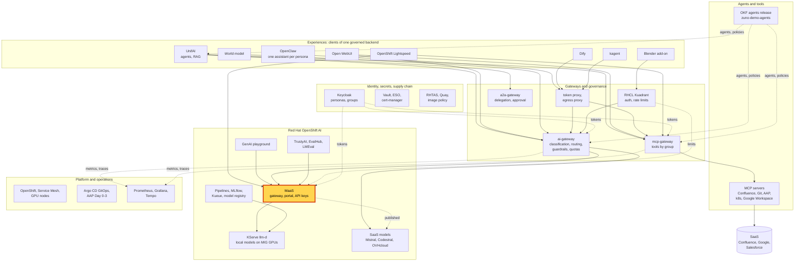
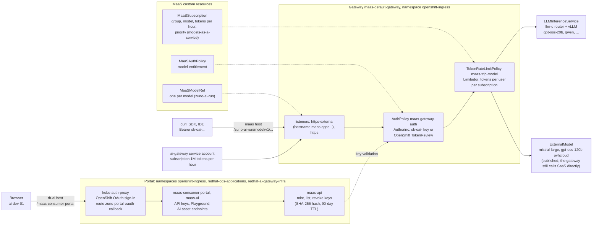

# Scenario: RHOAI Models-as-a-Service - a self-service API key with a governed budget

> **Status:** Not rehearsed in this format. Prerequisites checked read-only on demo333 on 2026-11-12: DSC
> `ModelsAsAServiceReady=True` and `MaaSConsumerPortalAvailable=True`, Deployments `maas-api`, `maas-ui`,
> `maas-consumer-portal` and `kube-auth-proxy` available, Gateway `maas-default-gateway` with its external listener
> `maas.apps.demo333.startx.fr`, MaaSSubscriptions `gpt-oss-20b-ocp-ai-dev`, `-ocp-ai-ops` and `-ocp-paas-ops` Active,
> AuthPolicy `maas-gateway-auth` Enforced. At the time of the check `gpt-oss-20b` was not Ready (the local models were
> restarting). The human subscriptions cover that model only, so a key had nothing to call. Check it before any
> session.
> **Show-ready ([ADR-0606](../../../adr/0606-admit-new-experiences-with-a-definition-of-done-and-a-wip-limit.md)):** no
> golden-path probe. Rehearse it before showing it to an audience.
> **Personas:** see [Personas](#personas).
> **Used in workshops:** RHOAI end to end (planned).

## Introduction

Models-as-a-Service (MaaS) is the part of Red Hat OpenShift AI that publishes models behind one gateway, with API keys,
subscriptions and token limits. In Zuno it is the **model access plane** under everything else (see
[Appendix A](#appendix-a---hld)):
- the ai-gateway reaches the local models through it;
- a developer, OpenShift Lightspeed or a tool such as Claude Code reaches them directly with a MaaS key.

A developer signs in to the consumer portal, creates a key on the subscription of their group, and calls an
OpenAI-compatible endpoint. The key is valid only for the models and budget of that subscription, and it can be
revoked at any time. The gateway, the Kuadrant policies and the custom resources behind it are in
[Appendix B](#appendix-b---lld).

**The message:** "A developer gets a governed model key in one minute, without a ticket. The platform still decides
which models, how many tokens per hour, and can revoke it."

**Decisions:**
- [ADR-0201](../../../adr/0201-complete-the-openshift-ai-maas-governance-plane-integration.md): MaaS is the model
  access and consumption plane; Zuno's business policy router sits in front of it.
- [ADR-0521](../../../adr/0521-route-local-model-traffic-through-maas.md): all local-model traffic of the ai-gateway
  goes through MaaS.
- [ADR-0541](../../../adr/0541-integrate-mistral-and-gpt-oss-120b-as-maas-externalmodels.md): Mistral and OVHcloud
  gpt-oss-120b are published as MaaS external models.
- [ADR-0570](../../../adr/0570-slim-the-ai-gateway-by-delegating-quotas-keys-and-exposure-to-maas.md): keys,
  per-subscription quotas and exposure belong to MaaS. Per-persona budgets stay in the ai-gateway.

## Personas

The personas are fictional role accounts of the Keycloak realm `zuno`
([ADR-0349](../../../adr/0349-restructure-demo-personas-cluster-access-groups-and-new-agents.md)). They share one
password, kept in Vault at `keycloak/demo-personas`. The [catalogue](../../README.md#personas) lists all of them.

| Persona | Profile | What it can do here | Role in this demo |
|---|---|---|---|
| **ai-dev-01** | AI developer, back office. Group `ocp-ai-dev` (edit on the Zuno namespaces), `agent_tekos`. | Subscription `gpt-oss-20b-ocp-ai-dev`: 5,000,000 tokens per hour on gpt-oss-20b. Creates and revokes its own keys in the portal. | The developer of the 5-minute version: signs in to the portal, creates a key, calls the model from a terminal. |
| **ai-ops-01** | AI platform operator, back office. Group `ocp-ai-ops` (admin on the Zuno namespaces, `zuno-monitoring` included). | Subscription `gpt-oss-20b-ocp-ai-ops`, same budget. Opens Grafana. | Shows the **Mesh & gateway** dashboard in the 15-minute version. Can replace **ai-dev-01** as the key creator. |
| **paas-ops-01** | Platform operator, back office. Group `ocp-paas-ops` (cluster-admin). | Reads the MaaS objects outside the AI namespaces (`models-as-a-service`, `openshift-ingress`). | The presenter's `oc` terminal for the subscription and policy steps of the 15-minute version. |
| **sale-01** | Salesperson, front office. Group `sales`. | Subscription `*-sales`: 5,000 tokens per hour. | Named only, as the contrast of budgets by group. Not signed in during this scenario. |

Other identities: the ai-gateway's service account holds its own subscription (1,000,000 tokens per hour, and the only
one on the SaaS models). It carries the traffic of every chat experience.

## Before you start

- [ ] `gpt-oss-20b` is Ready: `oc get llminferenceservice gpt-oss-20b -n zuno-ai-run`. The three human subscriptions
  cover this model only.
- [ ] **ai-dev-01** has signed in to OpenShift once before the session. Its OpenShift group is created at first
  sign-in.
- [ ] A browser profile on `https://rh-ai.apps.demo333.startx.fr/maas-consumer-portal/`. The sign-in is the
  **OpenShift** sign-in (Keycloak behind it), not a Keycloak client of the portal.
- [ ] A terminal with `curl`, large font. Paste the key into a variable without showing it:
  `read -rs MAAS_API_KEY && export MAAS_API_KEY`.
- [ ] Set the endpoint: `export MAAS=https://maas.apps.demo333.startx.fr/zuno-ai-run/gpt-oss-20b`.
- [ ] Plan to **revoke the key at the end** of the session (15-minute version, or right after the 5-minute one).
- [ ] 15-minute version: a terminal logged in with `oc` as **paas-ops-01**, and Grafana as **ai-ops-01**, dashboard
  **Mesh & gateway** (the Authorino and Limitador panels).

## 5-minute version

| Time | Do | Say | You should see |
|---|---|---|---|
| 0:00 | Open the portal and sign in as **ai-dev-01** | "This is the Red Hat AI portal. I sign in with my company account, through OpenShift." | The portal shell with **AI asset endpoints**, **API keys** and **Playground**. |
| 1:00 | **API keys**: create a key on the subscription `gpt-oss-20b-ocp-ai-dev` | "My group gives me 5 million tokens an hour on a model that runs on our own GPUs. I pick the subscription and get a key: no ticket, no wait." | A key starting with `sk-oai-`, shown **once**. Copy it into `MAAS_API_KEY`; do not leave it on screen. |
| 2:15 | `curl -s -o /dev/null -w '%{http_code}\n' $MAAS/v1/models`, then the same with `-H "Authorization: Bearer $MAAS_API_KEY"` | "Without a key the gateway refuses. With my key it answers." | `401`, then `200`. |
| 3:00 | `curl -s $MAAS/v1/chat/completions -H "Authorization: Bearer $MAAS_API_KEY" -H 'Content-Type: application/json' -d '{"model":"gpt-oss-20b","messages":[{"role":"user","content":"In one short sentence, say what you can help me with."}],"max_tokens":64}'` | "Any OpenAI-compatible tool works the same way: a notebook, a script, an IDE plug-in." | A JSON answer with `choices[0].message.content` and a `usage` block. |
| 4:15 | Close | "One minute to a governed key. The platform keeps the model list, the budget and the right to revoke it." | |

## 15-minute version

Run the 5-minute version, then:

| Time | Do | Say | You should see |
|---|---|---|---|
| 5:00 | `oc get maassubscriptions -n models-as-a-service` | "Budgets are subscriptions bound to groups. Developers and operators get 5 million tokens an hour on gpt-oss-20b; agents 100,000; sales 5,000." | `gpt-oss-20b-ocp-ai-dev`, `-ocp-ai-ops`, `-ocp-paas-ops` (priority 20), `-agents` (10), `-sales` (1), `-ai-gateway` (100), `-lightspeed` (50). |
| 7:00 | `oc get tokenratelimitpolicy -n zuno-ai-run` and `oc get authpolicy maas-gateway-auth -n openshift-ingress -o yaml` | "Kuadrant enforces it on the gateway. Two identities are accepted: a MaaS key, or an OpenShift token. The token limit is counted per user and per subscription." | One `maas-trlp-<model>` per model. The AuthPolicy has two identity sources, `api-keys` (`Bearer sk-oai-`) and `kubernetesTokenReview`. |
| 9:00 | `oc get externalmodels,maasmodelrefs -n zuno-ai-run` | "MaaS also publishes SaaS models, Mistral and gpt-oss-120b on OVHcloud. Only the ai-gateway is subscribed to them, so nobody can skip the classification rules by calling a SaaS model directly." | ExternalModels `mistral-large` and `gpt-oss-120b-ovhcloud`; six MaaSModelRefs. |
| 10:30 | Grafana **Mesh & gateway**: **Authorino: auth decisions** and **Limitador: authorized vs limited calls** | "Every call is authenticated and counted at the gateway, including the 401 we just caused." | Allowed and denied auth decisions; authorized calls. |
| 12:00 | Portal, **API keys**: revoke the key. Then `curl -s -o /dev/null -w '%{http_code}\n' -H "Authorization: Bearer $MAAS_API_KEY" $MAAS/v1/models` | "Revocation is immediate." | `403`. |
| 13:00 | Explain the split with the ai-gateway | "MaaS owns keys, subscriptions and exposure. The ai-gateway owns the business rules: classification, routing across local and SaaS, and one budget per person across all the chat experiences. Experiences never hold a MaaS key: the gateway does." | |
| 14:30 | Close | Repeat the message. | |

## If something goes wrong

| Symptom | Fallback | Say |
|---|---|---|
| The chat call returns 503 or times out | `gpt-oss-20b` is not Ready (check `oc get llminferenceservice -n zuno-ai-run`). Show the 401/200 on `/v1/models` and the subscriptions instead. | "The key and the budget work; the model behind them is restarting. MaaS does not hide that." |
| **API keys** shows "maas-api is not available" | The gateway lost its external listener hostname ([WP-220](../../../roadmap/work-packages/wp-220-evaluate-the-rhoai-3-6-mcp-lifecycle-portal-and-workbenches-v2-components.md), pilot 2). Skip key creation; show the subscriptions and policies. | |
| The portal sign-in ends on a 404 at `/oauth2/callback` | The route `zuno-portal-oauth-callback` is missing on the `rh-ai` host (WP-220). Not fixable on stage. | |
| A `429` | The subscription's token limit is reached. MaaS sends no `Retry-After`. | "That is the budget at work." |
| No subscription offered to the persona | The OpenShift group was not synced. Sign the persona in once to OpenShift, then reload the portal. | |

## Limits

- **The token limit counts OpenAI-format calls only.** `/v1/messages` (Anthropic format, used by Claude Code) is
  authenticated but **not** token-limited: about 72,000 tokens did not move the counter on demo333. Do not present 5
  million tokens an hour as a ceiling for such a key. Metering that path is
  [WP-225](../../../roadmap/work-packages/wp-225-ai-and-agent-surface-guardrails-metering-delegated-scope.md).
- **Human subscriptions cover gpt-oss-20b only.** When that model is down, a developer key has nothing to call.
- **Keycloak tokens are refused by the MaaS gateway.** Only `sk-oai-` keys and OpenShift tokens are accepted.
- **A key is shown once** and lives 90 days by default. It is bound to one subscription when it is created.
- **This scenario does not cover** the portal's **Playground** and **AI asset endpoints** (the [GenAI playground
  scenario](genai-playground.md)) or the classification rules (see
  [the sovereignty scenario](../governance/ai-gateway-sovereignty.md)).
- **SaaS traffic does not go through MaaS yet.** The ai-gateway still calls Mistral, Codestral and OVHcloud directly
  (`MAAS_EXTERNAL_EGRESS_ENABLED=false`, checked 2026-11-13). The ExternalModels are published for a later cutover (WP-219).
  See [external models](external-models.md).
- **Each new rate adds to a Kuadrant EnvoyFilter** close to the etcd object size limit (about 1.34 MB of 1.5 MiB).
  Adding subscriptions on stage is not part of this scenario.

## Appendix A - HLD

Where MaaS sits in Zuno. The highlighted box is the subject of this page. Plain arrows carry requests, dotted arrows
carry identity, policy or telemetry.

## Appendix B - LLD

The portal, the key path and the model path. Drawn from `gitops/charts/openshift-ai/templates/` (`maas-gateway.yaml`,
`maas-portal-*.yaml`), `gitops/charts/models/templates/maas.yaml` and `externalmodel.yaml`, `gitops/charts/models/values.yaml`
(subscriptions), and the live objects listed in the status banner.

