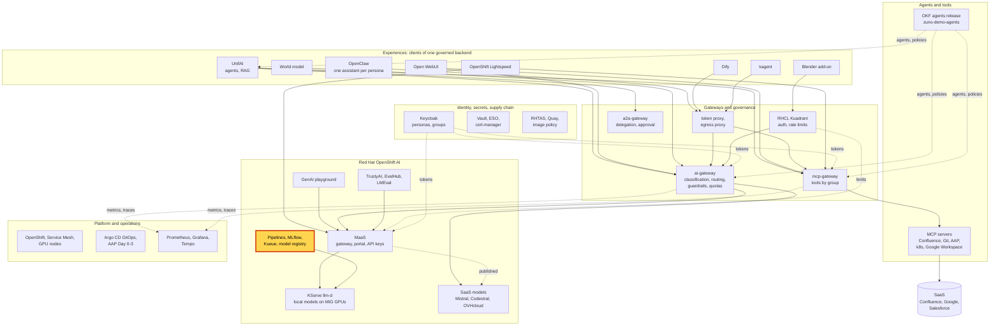
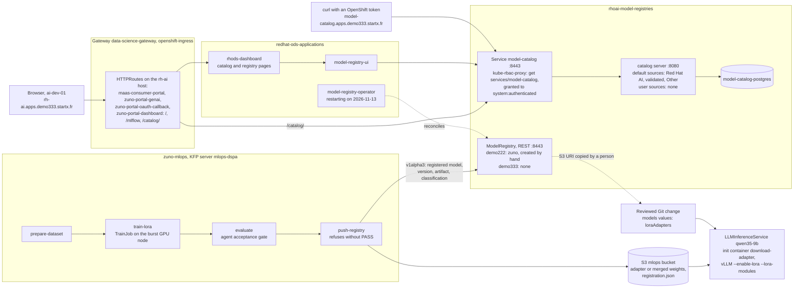

# Scenario: RHOAI model catalog and model registry - from a curated model to a recorded version

> **Status:** Not rehearsed in this format. Prerequisites checked read-only on demo333 on 2026-11-13: in
> `rhoai-model-registries`, Deployments `model-catalog` and `model-catalog-postgres` 1/1, the `Catalog` `catalog`
> Available, Route `model-catalog-https` (`model-catalog.apps.demo333.startx.fr`, reencrypt), ConfigMap
> `default-catalog-sources` with three model sources (Red Hat AI, Red Hat AI validated, Other) and
> `model-catalog-sources` empty (`catalogs: []`), RoleBinding `model-catalog-authenticated` (group
> `system:authenticated`); HTTPRoute `zuno-portal-dashboard` Accepted on `rh-ai.apps.demo333.startx.fr` with `/`,
> `/mlflow` and `/catalog/`; Deployment `model-registry-ui` 1/1; Applications `zuno-openshift-ai-d0`/`-d1`,
> `zuno-mlops-d0`/`-d1` and `zuno-models-d1` Synced and Healthy; DSPA `mlops-dspa` in `zuno-mlops`. **No model
> registry exists:** the DSC has `modelregistry` `Managed` (`registriesNamespace: rhoai-model-registries`), but there is
> no `ModelRegistry` object in any namespace, and the operator `model-registry-operator-controller-manager` restarted
> 25 times between 21:29 and 23:55 UTC on 2026-11-12 (exit code 1, logs not read; `ModelRegistryReady` went from
> `False` to `True` when it last came up). `zuno-models-d1` passes `loraAdapters: []`, and `qwen35-9b` runs without
> `--enable-lora`. **ai-dev-01** is a member of `ocp-ai-dev`; **paas-ops-01** had not signed in to OpenShift.
> **Show-ready ([ADR-0606](../../../adr/0606-admit-new-experiences-with-a-definition-of-done-and-a-wip-limit.md)):** not
> show-ready: demo333 has no model registry (no `ModelRegistry` object, an unstable operator), so the registry part
> can only be told. The catalog part has no golden-path probe: rehearse it before showing it to an audience.
> **Personas:** see [Personas](#personas).
> **Used in workshops:** [RHOAI end to end](../../workshops/rhoai-end-to-end.md).

## Introduction

Red Hat OpenShift AI ships two services for the start and the end of a model's life (see
[Appendix A](#appendix-a---hld)):
- The **model catalog** lists models a developer may start from: Red Hat's models, third-party models Red Hat has
  validated, and others. The dashboard shows it; its API has its own route.
- The **model registry** records the versions of a model and the artifact of each version.

Zuno's MLOps pipeline trains a LoRA adapter, runs the agent's acceptance suite, and registers the version only if the
gate passed. Promotion to serving stays a human-reviewed change in Git: nothing deploys from the registry
automatically. On demo333 today the catalog runs and the registry does not exist. The registry story was proven on the
previous cluster, demo222. The routes, the catalog server and the pipeline's registration call are in
[Appendix B](#appendix-b---lld).

**The message:** "A developer starts from a curated catalog. A trained model is recorded with its version and its
artifact, and it serves only after a reviewed change."

**Decisions:**
- [ADR-0302](../../../adr/0302-build-dataset-to-model-mlops-pipelines.md): the dataset-to-model pipeline, its
  evaluation gate, registration in the Model Registry, and promotion by a human-reviewed GitOps change.
- [ADR-0301](../../../adr/0301-introduce-lora-and-peft-model-customization.md): an adapter is selected statically, its
  artifact is registered, and it inherits the classification of its training data.
- [ADR-0331](../../../adr/0331-revert-openshift-ai-to-the-default-applications-namespace.md): OpenShift AI keeps its
  default namespaces; the registries live in `rhoai-model-registries`.
- [ADR-0526](../../../adr/0526-fine-tune-and-serve-a-french-urban-register-model-variant.md): the fine-tune Zuno
  serves, qwen3.5-9b-wesh, is merged weights run as its own model, not an adapter attached from the registry.

## Personas

The personas are fictional role accounts of the Keycloak realm `zuno`
([ADR-0349](../../../adr/0349-restructure-demo-personas-cluster-access-groups-and-new-agents.md)). They share one
password, kept in Vault at `keycloak/demo-personas`. The [catalogue](../../README.md#personas) lists all of them.

| Persona | Profile | What it can do here | Role in this demo |
|---|---|---|---|
| **ai-dev-01** | AI developer, back office. Groups `ocp-ai-dev` (edit on the Zuno namespaces), `agent_tekos`. | Reads the catalog, like every signed-in user. `ocp-ai-dev` also holds `edit` in `rhoai-model-registries`. | The developer of the 5-minute version: signs in to the dashboard and browses the catalog. |
| **paas-ops-01** | Platform operator, back office. Group `ocp-paas-ops` (cluster-admin). | Reads the catalog sources, the routes, the DataScienceCluster and the model objects. | The presenter's `oc` terminal in the 15-minute version. |
| **ai-ops-01** | AI platform operator, back office. Group `ocp-ai-ops` (admin on the Zuno namespaces, and on `rhoai-model-registries`). | Same catalog view as ai-dev-01. | Can replace **ai-dev-01** in the browser. |

Other identities:
- The dashboard's ServiceAccount `rhods-dashboard` reads the catalog for the dashboard pages.
- The pipeline's `push-registry` step calls the registry with its pod's ServiceAccount token, in `zuno-mlops`.

## Before you start

- [ ] Browser profile **ai-dev-01** on `https://rh-ai.apps.demo333.startx.fr/`. The sign-in is the OpenShift sign-in
  (Keycloak behind it).
- [ ] The dashboard loads at `/`, not as an empty 404. A 404 there is the host-name route trap (see
  [If something goes wrong](#if-something-goes-wrong)).
- [ ] Find the model catalog in the dashboard's left menu and open one card before the audience arrives. The
  navigation of the 3.6.0-ea.2 dashboard was not checked.
- [ ] `oc get deploy model-catalog model-catalog-postgres -n rhoai-model-registries`: both 1/1.
- [ ] Registry: `oc get modelregistries.modelregistry.opendatahub.io -A`. On 2026-11-13: `No resources found`. Play
  the registry steps of the 15-minute version as told, with the evidence. If a registry exists by then, this page is
  out of date: check it again before the session.
- [ ] 15-minute version: **paas-ops-01** has signed in once to the OpenShift console (on 2026-11-13 its group
  `ocp-paas-ops` did not exist yet), then a terminal logged in with `oc` as **paas-ops-01**.
- [ ] Open [WP-133](../../../roadmap/work-packages/wp-133-lora-adapter-live-proof.md) at its State line, and
  `components/mlops/src/mlops.py` at the function `stage_push_registry`.

## 5-minute version

| Time | Do | Say | You should see |
|---|---|---|---|
| 0:00 | Profile **ai-dev-01**: open `https://rh-ai.apps.demo333.startx.fr/` and sign in | "This is the OpenShift AI dashboard. I sign in with my company account, through OpenShift." | The OpenShift AI dashboard. |
| 0:45 | Open the model catalog from the left menu | "Before running anything, a developer picks a model from a catalog Red Hat curates: Red Hat's own models with support, third-party models Red Hat has validated, and others." | Model cards grouped by source: **Red Hat AI**, **Red Hat AI validated**, **Other models**. |
| 2:00 | Filter on **Red Hat AI validated** and open one card | "A validated model comes with tested runtime settings and performance data. The choice is informed, not a guess." | The card's description and, for a validated model, its performance data (not checked on this cluster). |
| 3:15 | Say where Zuno's own models come from | "Our five running models do not come from this page. They are declared in Git, with weights in our own S3 bucket. When we train a model, the version is recorded in a registry, and it serves only after a reviewed change." | |
| 4:15 | Close | "A developer starts from a curated catalog. A trained model is recorded with its version and its artifact, and it serves only after a reviewed change." | |

## 15-minute version

Run the 5-minute version, then:

| Time | Do | Say | You should see |
|---|---|---|---|
| 5:00 | Terminal: `oc get configmap default-catalog-sources model-catalog-sources -n rhoai-model-registries -o yaml` | "The catalog is a small server reading source lists. Red Hat ships three model sources. We have added none, so our own models are not in it." | In `default-catalog-sources`: `redhat_ai_models`, `redhat_ai_validated_models`, `other_models`. In `model-catalog-sources`: `catalogs: []`. |
| 6:15 | `oc get httproute -A \| grep -e NAME -e rh-ai`, then `oc get httproute zuno-portal-dashboard -n redhat-ods-applications -o jsonpath='{range .spec.rules[*]}{.matches[0].path.value}{" -> "}{.backendRefs[0].name}{"\n"}{end}'` | "One trap worth knowing. The developer portal added a route for this host name, and from then on the dashboard and the catalog answered 404 on it. We copied the vendor rules onto the host name. After any OpenShift AI upgrade, they are compared again." | Four routes on `rh-ai.apps.demo333.startx.fr`. `/ -> rhods-dashboard`, `/mlflow/v1 -> mlflow`, `/mlflow -> mlflow`, `/catalog/ -> model-catalog`. |
| 7:45 | `oc get rolebinding model-catalog-authenticated -n rhoai-model-registries -o wide` | "Every signed-in user may read the catalog: a proxy in front of it checks one permission. Its API has its own route." | `Role/model-catalog`, group `system:authenticated`. Optional, untested command: `curl -s -H "Authorization: Bearer $(oc whoami -t)" https://model-catalog.apps.demo333.startx.fr/api/model_catalog/v1alpha1/sources`. |
| 9:00 | `oc get modelregistries.modelregistry.opendatahub.io -A`, then `oc get pods -n redhat-ods-applications \| grep model-registry` | "Honestly: on this cluster the registry component is enabled, but no registry has been created, and its operator keeps restarting. What follows was proven on the previous cluster, demo222." | `No resources found`. The operator pod with a high restart count (25 on 2026-11-13). |
| 10:00 | Show the [WP-133](../../../roadmap/work-packages/wp-133-lora-adapter-live-proof.md) State line, then `stage_push_registry` in `components/mlops/src/mlops.py` | "The pipeline trains a LoRA adapter, runs the agent's acceptance suite, and registers the version only if the gate passed: a registered model, a version, the S3 artifact, the data classification. No pass, no registration." | `tekos-lora`, version `wp126-20260904-201830`, registered on demo222 and served on 2026-09-05. In the code: `push-registry refuses to run ... no passing gate_result.json found`. |
| 11:30 | `oc get llminferenceservice qwen35-9b -n zuno-ai-run -o jsonpath='{.spec.template.containers[0].args}{"\n"}'` | "Promotion is a reviewed Git change that names the registered version and copies its S3 address. Today no adapter is attached. The fine-tune we serve, qwen3.5-9b-wesh, is merged weights run as its own model." | Arguments without `--enable-lora` or `--lora-modules`. |
| 12:45 | Tell the first adapter's failure | "The first registered adapter crashed vLLM on load. It targeted a fused attention module of this model's hybrid architecture, which vLLM's LoRA code does not handle. Retrained on the plain attention projections, it loaded and served. A registry entry does not prove that a model serves." | |
| 14:00 | Close | Repeat the message. | |

## If something goes wrong

| Symptom | Fallback | Say |
|---|---|---|
| `https://rh-ai.apps.demo333.startx.fr/` answers an empty 404 | The host-name copy of the vendor routes is missing or stale: `oc get httproute zuno-portal-dashboard -n redhat-ods-applications`. Try the vendor route `https://rhods-dashboard-redhat-ods-applications.apps.demo333.startx.fr` (not checked). | "The developer portal's route hides the dashboard on that host name; we know it and we fix it in Git." |
| The catalog page is empty or shows an error | `oc get pods -n rhoai-model-registries`: `model-catalog` 3/3, `model-catalog-postgres` 1/1. Show the source ConfigMaps (5:00) instead. | |
| No catalog entry in the menu | The navigation of this version was not checked. Show the source ConfigMaps and the route steps instead. | |
| A registry page says there is no registry | Expected on demo333 on 2026-11-13. Go to the evidence (10:00). | "The registry service is enabled, but no registry has been created on this cluster yet." |
| `forbidden` in the terminal | The terminal is not **paas-ops-01**, or its group was never created. **ai-dev-01** can read `rhoai-model-registries` but not the DataScienceCluster. | |

## Limits

- **No model registry on demo333.** The component is enabled, but no `ModelRegistry` object exists, and its operator
  restarted 25 times in two and a half hours on 2026-11-12 (cause not read). Nothing in this repository creates the
  instance: on demo222 it was created by hand (Service `zuno` in `rhoai-model-registries`, port 8443,
  [WP-087](../../../roadmap/work-packages/wp-087-french-urban-register-model.md)), and the pipeline's defaults name
  it. A pipeline run on demo333 would therefore fail at `push-registry` (inferred, not run).
- **The catalog is Red Hat's, not Zuno's.** It serves the three default sources only. Zuno's five served models and
  its fine-tune are not in it.
- **No adapter is served today.** `loraAdapters` is empty. The path registry, Git change, download init container,
  `--lora-modules` was proven once, on demo222, for `tekos-lora`
  ([WP-133](../../../roadmap/work-packages/wp-133-lora-adapter-live-proof.md)).
- **The registered versions are on demo222.** `comage-lora` version `wesh-20260829-145123` (the merged checkpoint of
  ADR-0526) and `tekos-lora` version `wp126-20260904-201830` were registered there. Nothing was migrated to demo333.
- **Promotion is manual by design** (ADR-0302 point 7). Nothing reads the registry to deploy: a person copies the
  version's S3 address into `gitops/charts/models/values.yaml`.
- **Not checked:** the navigation of the 3.6.0-ea.2 dashboard, the content of the catalog cards and their
  performance data, and the catalog API path.
- **This scenario does not cover** training (the [LoRA pipeline scenario](./lora-pipeline-mlflow-kueue.md)),
  evaluation (the [evaluation scenario](./evaluation-trustyai-evalhub.md)) or serving (the
  [serving scenario](./model-serving-llmd-mig.md)).

## Appendix A - HLD

Where the catalog and the registry sit in Zuno: in the build box with the pipelines. The highlighted box is the
subject of this page. Plain arrows carry requests, dotted arrows carry identity, policy or telemetry.

## Appendix B - LLD

The catalog path, the registry, and how a registered adapter would reach serving. Drawn from
`gitops/charts/openshift-ai/values.yaml` (`modelregistry`), `gitops/charts/openshift-ai/templates/maas-portal-dashboard-route.yaml`,
`gitops/charts/mlops/values.yaml` (`modelRegistry`) and `files/pipeline.py.tpl`, `components/mlops/src/mlops.py`
(`stage_push_registry`), `gitops/charts/models/values.yaml` (`loraAdapters`) and
`templates/llminferenceservice-qwen35.yaml`, and the live objects listed in the status banner. The registry box shows
what demo222 had; demo333 has none.

