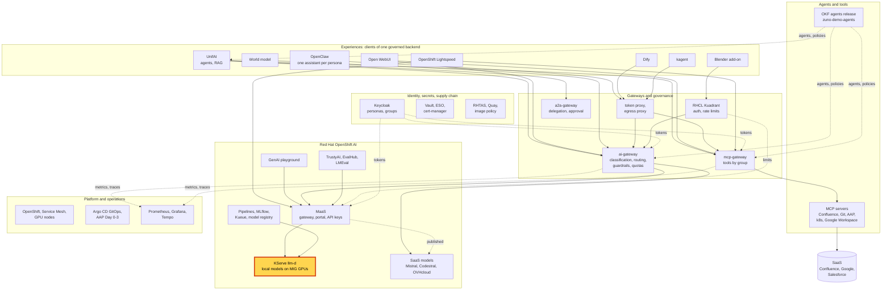
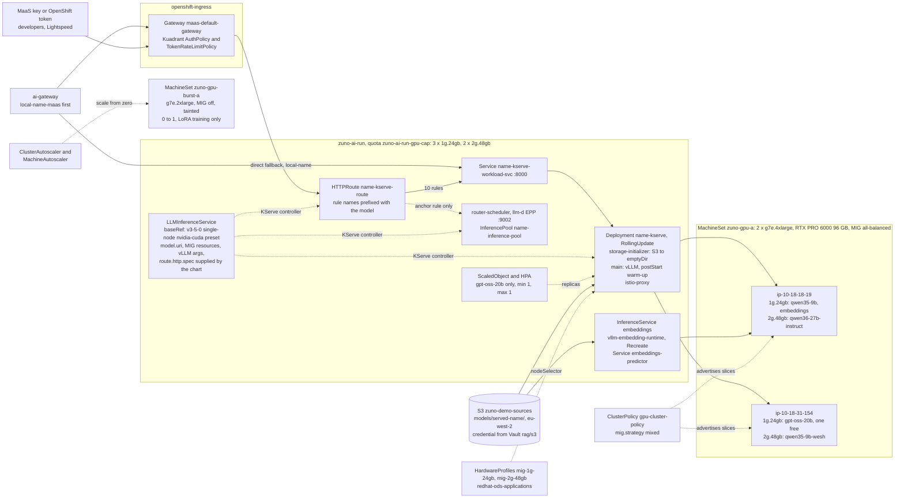

# Scenario: KServe and llm-d - local models on MIG GPU slices

> **Status:** Not rehearsed in this format. Prerequisites checked read-only on demo333 on 2026-11-13: Applications
> `zuno-models-d0` and `zuno-models-d1` Synced and Healthy; the four `LLMInferenceService` (`gpt-oss-20b`,
> `qwen35-9b`, `qwen35-9b-wesh`, `qwen36-27b-instruct`) and the `InferenceService` `embeddings` Ready; two GPU nodes
> `g7e.4xlarge` (MachineSet `zuno-gpu-a`, 2 replicas, both in eu-central-1a), MIG `all-balanced` applied
> (`success`), each advertising `nvidia.com/mig-1g.24gb: 2`, `nvidia.com/mig-2g.48gb: 1`, `nvidia.com/gpu: 0`;
> ResourceQuota `zuno-ai-run-gpu-cap` at `mig-1g.24gb` 3/3 and `mig-2g.48gb` 2/2; HardwareProfiles `mig-1g-24gb` and
> `mig-2g-48gb`; ScaledObject `gpt-oss-20b-kserve-keda` Ready, min 1, max 1; MachineSet `zuno-gpu-burst-a` at 0 with a
> MachineAutoscaler 0 to 1; DSC `kserve.modelCache` `Removed`; ClusterPolicy `mig.strategy: mixed` but `Ready=False`
> (a reconcile timeout) while both nodes advertised their slices. The local models restarted between 21:38 and 22:03
> UTC on 2026-11-12, after a master was cordoned; during that window the new `qwen36-27b-instruct` pod was refused by
> the quota (`FailedCreate ... exceeded quota: zuno-ai-run-gpu-cap`) for several minutes. **One rollout was still
> wedged:** `gpt-oss-20b` has a new ReplicaSet (a new vLLM image) that the quota has refused for about 8 days
> (`ProgressDeadlineExceeded`). The old pod keeps serving, on the previous vLLM image. **paas-ops-01** had not signed
> in to OpenShift (no group `ocp-paas-ops`).
> **Show-ready ([ADR-0606](../../../adr/0606-admit-new-experiences-with-a-definition-of-done-and-a-wip-limit.md)):** no
> golden-path probe. Rehearse it before showing it to an audience.
> **Personas:** see [Personas](#personas).
> **Used in workshops:** [RHOAI end to end](../../workshops/rhoai-end-to-end.md).

## Introduction

Zuno serves its own models on its own GPUs with Red Hat OpenShift AI. Each chat model is one `LLMInferenceService`:
KServe turns it into a vLLM server and an llm-d router-scheduler. The embedding model of the RAG is a classic
`InferenceService`. The models sit under MaaS and the ai-gateway (see [Appendix A](#appendix-a---hld)). Two NVIDIA RTX
PRO 6000 cards of 96 GB are each cut by MIG into three slices, so five models fit on two cards. The weights come from
S3, never from Hugging Face at start. How the objects, the route and the quota fit together is in
[Appendix B](#appendix-b---lld).

| Model (served name) | Object | Slice | Role in routing |
|---|---|---|---|
| `qwen3.5-9b` | `LLMInferenceService` `qwen35-9b` | `mig-1g.24gb` | `default`: the fleet-wide default |
| `gpt-oss-20b` | `LLMInferenceService` `gpt-oss-20b` | `mig-1g.24gb` | `reasoning`; the only model of the human MaaS subscriptions |
| `qwen3.6-27b-instruct` | `LLMInferenceService` `qwen36-27b-instruct` | `mig-2g.48gb` | `quality` |
| `qwen3.5-9b-wesh` | `LLMInferenceService` `qwen35-9b-wesh` | `mig-2g.48gb` | `specialized`: the French fine-tune of qwen3.5-9b, Comage's model |
| `qwen3-embedding-0.6b` | `InferenceService` `embeddings` | `mig-1g.24gb` | embeddings for the RAG, not a chat provider |

**The message:** "Five models run on two GPUs we own. Each is declared in Git, sized to a GPU slice and capped by a
quota."

**Decisions:**
- [ADR-0351](../../../adr/0351-share-rtx-pro-6000-gpus-via-nvidia-mig-with-scale-from-zero-burst-capacity.md): MIG
  `mixed`, the `all-balanced` partition (2 x 1g.24gb + 1 x 2g.48gb), permanent inference nodes, a scale-from-zero
  full-GPU node for training.
- [ADR-0414](../../../adr/0414-consolidate-zuno-ai-run-into-three-tiered-mig-predictors.md): tiered predictors on MIG
  slices; gpt-oss-20b becomes an `LLMInferenceService`.
- [ADR-0518](../../../adr/0518-modernize-local-models-qwen36-chat-qwen3-embeddings-qwen35-training.md): Qwen3.6-27B FP8
  on the 48 GB slice, Qwen3-Embedding-0.6B, weights staged in S3.
- [ADR-0521](../../../adr/0521-route-local-model-traffic-through-maas.md): every chat model is an
  `LLMInferenceService`, and local traffic goes through MaaS.
- [ADR-0526](../../../adr/0526-fine-tune-and-serve-a-french-urban-register-model-variant.md): the fine-tune is served
  as merged weights next to its unmodified base, on another node.
- [ADR-0531](../../../adr/0531-promote-qwen3-5-9b-as-the-fleet-wide-default-and-extend-ovhcloud-reasoning-access.md):
  qwen3.5-9b is the fleet-wide default.
- [ADR-0536](../../../adr/0536-live-node-failover-drill-for-qwen-model-fallback.md): the node failover drill,
  `make d3 scenario-failover-node`.
- [ADR-0537](../../../adr/0537-integrate-rhoai-hardware-profiles-and-maas-external-models.md): one HardwareProfile per
  MIG tier, in `redhat-ods-applications`.
- [ADR-0542](../../../adr/0542-autoscale-one-served-model-through-llminferenceservice-spec-scaling.md): `spec.scaling`
  on gpt-oss-20b only, minimum and maximum 1.
- [ADR-0546](../../../adr/0546-introduce-a-cross-cluster-source-bucket-and-per-cluster-s3-bucket-convention.md): the
  weights live in the shared bucket `zuno-demo-sources`.

## Personas

The personas are fictional role accounts of the Keycloak realm `zuno`
([ADR-0349](../../../adr/0349-restructure-demo-personas-cluster-access-groups-and-new-agents.md)). They share one
password, kept in Vault at `keycloak/demo-personas`. The [catalogue](../../README.md#personas) lists all of them.

| Persona | Profile | What it can do here | Role in this demo |
|---|---|---|---|
| **paas-ops-01** | Platform operator, back office. Group `ocp-paas-ops` (cluster-admin), `agent_tekos`, `aap_admin`, `openwebui_admin`. | Reads the models, the nodes, the MachineSets, the quota and the GPU operator. | The presenter's `oc` terminal in both versions. |
| **ai-ops-01** | AI platform operator, back office. Group `ocp-ai-ops` (admin on the Zuno namespaces, `zuno-ai-run` and `zuno-monitoring` included), `agent_tekos`, `openwebui_admin`. | Opens Grafana. Reads every object in `zuno-ai-run`, not the nodes or the MachineSets. | Shows the vLLM throughput panel (5-minute version) and the GPU panels (15-minute version). Can run the `zuno-ai-run` steps if the paas-ops-01 terminal fails. |
| **sale-01** | Salesperson, front office. Groups `sales`, `agent_comage`, `agent_finage`. | Comage user. | Named only: the failover drill asks Comage a question as sale-01. |
| **consultant-01** | Consultant and architect, front office. Group `consultant`, `agent_tekos`, among others. | Tekos user. | Named only: the drill's control question to Tekos. |

Other identities:
- One ServiceAccount per model, `<model>-s3` in `zuno-ai-run`, reads the weights with an S3 credential synced from
  Vault (`rag/s3`) by an ExternalSecret.
- The ai-gateway's ServiceAccount calls the models through MaaS first, then directly on
  `<model>-kserve-workload-svc:8000` (see the [routing scenario](../governance/ai-gateway-routing.md)).
- A developer with a MaaS key reaches gpt-oss-20b through the same gateway (see the
  [MaaS scenario](./maas-portal-api-keys.md)).

## Before you start

- [ ] **paas-ops-01** has signed in once to the OpenShift console: on 2026-11-13 its group `ocp-paas-ops` did not
  exist yet. Then log a terminal in with `oc` as **paas-ops-01**, large font, at the repository root.
- [ ] `oc get llminferenceservice,inferenceservice -n zuno-ai-run`: five `READY True`. A model restarted in the last
  15 minutes may still be loading (see [If something goes wrong](#if-something-goes-wrong)).
- [ ] Look for a wedged rollout: `oc get rs -n zuno-ai-run | grep -e kserve -e predictor`. A model line with `DESIRED 1`
  and `CURRENT 0` is a rollout the quota refused; the model still serves on its old pod. On 2026-11-13 `gpt-oss-20b`
  had one. Decide with the cluster owner the day before: leave it and show it at 9:45, or have the owner run
  `make d2 reconcile models` (the model is down for a few minutes). Never run it on stage.
- [ ] Browser profile **ai-ops-01**: Grafana `https://grafana-route-zuno-monitoring.apps.demo333.startx.fr`, dashboard
  **Zuno Platform / AI models & serving**, last 1 hour, rows **vLLM serving** and **GPU (DCGM)** open.
- [ ] Optional, 15-minute version: the OpenShift console `https://console-openshift-console.apps.demo333.startx.fr` as
  **paas-ops-01**, **Observe**, **Dashboards**, the RHOAI Perses dashboards **LLM Performance** and **LLM
  Utilization** ([ADR-0552](../../../adr/0552-reuse-rhoais-perses-instance-instead-of-running-an-independent-one.md)).
  Their content was not checked.
- [ ] Open the [failover drill evidence](../../../roadmap/evidence/adr-0536-node-failover-drill.md) and the
  [24 GB slice bench](../../../roadmap/evidence/model-bench-24gb-slice-2026-10-25.md).
- [ ] Known on screen, not a failure: `oc get clusterpolicy` may say `notReady` (on 2026-11-13: a reconcile timeout).
  If both nodes advertise their slices, serving is fine.

## 5-minute version

| Time | Do | Say | You should see |
|---|---|---|---|
| 0:00 | Terminal: `oc get llminferenceservice,inferenceservice -n zuno-ai-run` | "Five models run on our own GPUs: four chat models and one embedding model. Each is one Kubernetes object in Git. OpenShift AI turns it into a running vLLM server." | Four `LLMInferenceService` `READY True`, each with a URL `https://maas.apps.demo333.startx.fr/zuno-ai-run/<name>`. The `InferenceService` `embeddings` `READY True`. |
| 1:00 | `oc get pods -n zuno-ai-run -l kserve.io/component=workload -o custom-columns='MODEL:.metadata.labels.app\.kubernetes\.io/name,NODE:.spec.nodeName,GPU:.spec.containers[?(@.name=="main")].resources.limits'` | "Two GPU servers, one 96 GB card each. MIG cuts each card into three isolated slices: two of 24 GB, one of 48 GB. A small model takes a small slice, a large one a large slice." | Two nodes. `nvidia.com/mig-1g.24gb:1` for `gpt-oss-20b` and `qwen35-9b`; `nvidia.com/mig-2g.48gb:1` for `qwen35-9b-wesh` and `qwen36-27b-instruct`. On 2026-11-13 qwen35-9b and qwen35-9b-wesh were on different nodes. |
| 2:15 | `oc get resourcequota zuno-ai-run-gpu-cap -n zuno-ai-run` | "The namespace may hold three small slices and two large ones, and it holds them all. A new model is a decision: raise the quota, which spends the last free slice, or retire a model." | `requests.nvidia.com/mig-1g.24gb: 3/3`, `requests.nvidia.com/mig-2g.48gb: 2/2`, `requests.nvidia.com/gpu: 0/0`. |
| 3:00 | Grafana profile: **AI models & serving**, row **vLLM serving**, panel **vLLM: token throughput (prompt + generation)** | "Each model reports its own serving metrics. Measured warm, one request at a time: gpt-oss-20b about 85 tokens per second on a 24 GB slice, qwen3.5-9b about 22.5. Which model answers which task is the routing's job." | One prompt and one generation series per model. A flat line means no traffic in the range. |
| 4:15 | Close | "Five models run on two GPUs we own. Each is declared in Git, sized to a GPU slice and capped by a quota." | |

## 15-minute version

Run the 5-minute version, then:

| Time | Do | Say | You should see |
|---|---|---|---|
| 5:00 | `oc get llminferenceservice qwen35-9b -n zuno-ai-run -o jsonpath='{.spec.model.uri}{"\n"}{.spec.baseRefs[0].name}{"\n"}{.spec.template.containers[0].resources.limits}{"\n"}{.spec.template.containers[0].args}{"\n"}'` | "One object holds it all: the weights in our S3 bucket, a vLLM preset shipped by OpenShift AI, the slice, and the vLLM flags. A 9B model in 24 GB is tight, so it runs with a short context and few concurrent sequences." | `s3://zuno-demo-sources/models/qwen3.5-9b/`, `v3-5-0-kserve-config-llm-single-node-template-nvidia-cuda`, `nvidia.com/mig-1g.24gb:1`, args with `--max-model-len=32768`, `--gpu-memory-utilization=0.95`, `--max-num-seqs=4`, `--enforce-eager`. |
| 6:15 | `oc get pods -n zuno-ai-run -l app.kubernetes.io/name=qwen35-9b` | "KServe creates two pods per model: the vLLM server, and an llm-d router-scheduler that would pick the best replica by queue length, KV cache and prefix cache." | `qwen35-9b-kserve-...` and `qwen35-9b-kserve-router-scheduler-...`, both `2/2 Running`. |
| 7:15 | `oc get httproute qwen35-9b-kserve-route -n zuno-ai-run -o jsonpath='{range .spec.rules[*]}{.name}{" -> "}{.backendRefs[0].kind}{" "}{.backendRefs[0].name}{"\n"}{end}'` | "Here we deviate on purpose. The gateway sends traffic straight to the vLLM Service. With one replica per model the picker has nothing to choose, and with it in the path an upstream bug returned empty answers. One dead rule keeps the pool referenced so the model reports Ready." | Ten rules `qwen35-9b-v1-...` to `Service qwen35-9b-kserve-workload-svc`; one `qwen35-9b-inference-pool-anchor` to `InferencePool qwen35-9b-inference-pool`. |
| 8:30 | `oc get hardwareprofiles -n redhat-ods-applications`, then `oc describe node <a node of the 1:00 step> \| grep nvidia.com/` | "The node advertises slices, not GPUs: the GPU operator runs MIG in mixed mode. Hardware profiles describe the two slice sizes to the OpenShift AI dashboard, so a model deployed by hand there asks for a real slice." | `default-profile`, `mig-1g-24gb`, `mig-2g-48gb`. On the node: `nvidia.com/gpu: 0`, `nvidia.com/mig-1g.24gb: 2`, `nvidia.com/mig-2g.48gb: 1`. |
| 9:45 | `oc get rs -n zuno-ai-run \| grep kserve`, then `oc get deploy gpt-oss-20b-kserve -n zuno-ai-run -o jsonpath='{.status.conditions[?(@.type=="Progressing")].reason}{"\n"}'` | "The price of a full quota. A rolling update starts the new pod before stopping the old one, and there is no slice for it. The old pod keeps serving the old version. `make d2 reconcile models` frees the slice, after a confirmation, because the model stops for a few minutes." | On 2026-11-13: two `gpt-oss-20b-kserve-...` ReplicaSets with `DESIRED 1`, one with `CURRENT 0`, and `ProgressDeadlineExceeded`. If nothing is wedged, describe it from the [troubleshooting entry](../../../platform/troubleshooting.md#a-model-change-does-not-take-effect-the-new-pod-never-starts). |
| 11:00 | `oc get scaledobjects.keda.sh,hpa -n zuno-ai-run` | "gpt-oss-20b declares autoscaling, and OpenShift AI creates a KEDA scaler and an HPA from it. Minimum and maximum are both 1: a second replica would need a slice we do not have." | `gpt-oss-20b-kserve-keda` `MIN 1`, `MAX 1`, `READY True`; HPA `keda-hpa-gpt-oss-20b-kserve-keda`. |
| 12:00 | `oc get machinesets,machineautoscalers -n openshift-machine-api \| grep -e NAME -e gpu` | "Inference nodes are permanent: the cluster autoscaler cannot see MIG slices. Training is different: a full-GPU node starts from zero when a LoRA job asks for one, and goes away about ten minutes after." | `zuno-gpu-a` 2/2, `zuno-gpu-c` 0, `zuno-gpu-burst-a` 0; MachineAutoscaler `zuno-gpu-burst-a` min 0, max 1. |
| 13:00 | Show the [failover drill evidence](../../../roadmap/evidence/adr-0536-node-failover-drill.md), Part A | "We proved node loss live. Cordon the node of the fine-tuned model, delete its pod: Comage answers from qwen3.5-9b. Restore: it is back on the fine-tune. It is a command with a human pause, not something we run on stage." | The restore verdict: `comage` on `local-wesh-maas`, `ok: true`. In the AAP rehearsal of 2026-09-05 ([WP-136](../../../roadmap/work-packages/wp-136-webinar-demo-orchestration.md)), the fallback showed about 1 minute after the cordon, and the restored pod was Ready 3 min 37 s after the uncordon. |
| 14:15 | Close | Repeat the message. | |

## If something goes wrong

| Symptom | Fallback | Say |
|---|---|---|
| A model shows `READY False` | `oc get llminferenceservice <name> -n zuno-ai-run -o jsonpath='{range .status.conditions[*]}{.type}={.status} {end}'`. Show the others. | "The platform knows this one is down, and the gateway routes around it ([ADR-0591](../../../adr/0591-route-only-to-ready-local-models-and-fail-fast-on-stalled-candidates.md))." |
| A pod is `Running` but not Ready for minutes | Cold start: S3 download, load, then the warm-up hook (about 82 s of kernel compilation, measured 2026-10-31). Measured from pod status after the 2026-11-12 restart, on a disturbed cluster: 2 min 40 s for gpt-oss-20b to 13 min for qwen36-27b-instruct (8 min 19 s of it the S3 download). For a reconcile, the troubleshooting guide gives about 4 minutes (gpt-oss-20b, qwen35-9b) and 7 minutes (qwen36-27b-instruct). | "A cold model loads 15 to 30 GB from S3 and compiles its kernels before it takes traffic." |
| A ReplicaSet with `DESIRED 1`, `CURRENT 0` and `FailedCreate ... exceeded quota` events | Do not fix it on stage. Show it as the quota at work. After the session, the owner runs `make d2 reconcile models` ([troubleshooting](../../../platform/troubleshooting.md#a-model-change-does-not-take-effect-the-new-pod-never-starts)). | "No slice is free for the new version, so the old one keeps serving." |
| `forbidden` on nodes or MachineSets | The terminal is not **paas-ops-01**, or its group was never created. Run the `zuno-ai-run` steps as **ai-ops-01**; skip 8:30 (node part) and 12:00. | |
| The throughput panel is empty | Widen to 6 hours. Then quote the bench: 85 and 234 tok/s (gpt-oss-20b, 1 and 4 concurrent), 22.5 and 81.5 (qwen3.5-9b). | |
| `oc get clusterpolicy` shows `notReady` | Check the slices on the nodes (8:30). If both nodes advertise them, carry on. | |

## Limits

- **llm-d's load-aware picking is not in the traffic path.** The router-scheduler runs for every model but only serves
  the dead anchor rule. Every model has one replica, so there is nothing to pick between, and an upstream Envoy and
  llm-d race dropped response bodies when it was in the path (`gitops/charts/models/templates/_llmisvc-route.tpl`).
  Revisit when a model goes multi-replica.
- **No real autoscaling.** `spec.scaling` exists on gpt-oss-20b only, with minimum = maximum = 1. A second replica
  needs the quota raised from 3 to 4 small slices, which spends the last free slice and leaves no rollout headroom
  (ADR-0542).
- **No rollout headroom.** The quota leaves no spare slice, and `LLMInferenceService` has no strategy field, so every
  model spec or vLLM image change wedges until `make d2 reconcile models` runs. Only `embeddings` uses `Recreate`. One
  physical 24 GB slice is free on one node, but the quota holds it back.
- **Both inference nodes are in one zone on demo333.** `zuno-gpu-a` runs 2 replicas in eu-central-1a and `zuno-gpu-c`
  (eu-central-1b) is at 0. ADR-0351 put the second node in another zone; losing eu-central-1a stops every local model
  on demo333. Why `zuno-gpu-c` is at 0 is not recorded in this repository.
- **Cold starts are minutes long.** The weights are read from S3 at every start: KServe's node-local model cache is
  off, because it caused a PersistentVolume reconcile loop (`kserve.modelCache: Removed`,
  [WP-086](../../../roadmap/work-packages/wp-086-spread-models-and-platform-hygiene.md),
  [ADR-0545](../../../adr/0545-scope-remaining-rhoai-kubeflow-component-adoption.md)). The bucket is in eu-west-2,
  the cluster in eu-central-1.
- **Throughput figures are measurements, not a live demo.** They were taken against the predictor directly, without
  MaaS or the gateway: on 2026-09-03 ([WP-31](../../../roadmap/work-packages/wp-31-arkos-slice.md)) and on
  2026-10-25 ([bench](../../../roadmap/evidence/model-bench-24gb-slice-2026-10-25.md)). A cold first sample read
  qwen3.5-9b at 5.4 tok/s instead of 22.5: never quote a first sample.
- **Hardware profile ranges are dashboard metadata.** They are not enforced against a pod's resources. The profile
  annotation does inject a nodeSelector, which once triggered a quota-blocked rollout (ADR-0537 correction).
- **The failover drill is not run on stage.** It mutates shared GPU infrastructure, needs a TTY and a human
  confirmation, and took 992 s under AAP. Its last recorded run is 2026-09-05. Since
  [WP-156](../../../roadmap/work-packages/wp-156-retire-zuno-agent-and-rag-code.md) its probe goes through UnifAI; no
  live run of that version is recorded.
- **The models name the RHOAI 3.5.0 vLLM preset** on a 3.6.0-ea.2 platform; the 3.6.0-ea.2 presets exist alongside.
  On 2026-11-13 gpt-oss-20b ran an older vLLM image than the three qwen models (its rollout is the wedged one).

## Appendix A - HLD

Where KServe and llm-d sit in Zuno. The highlighted box is the subject of this page. Plain arrows carry requests,
dotted arrows carry identity, policy or telemetry.

## Appendix B - LLD

One model's request path, the objects KServe generates, and where the GPU slices come from. Drawn from
`gitops/charts/models/values.yaml`, `gitops/charts/models/templates/` (`llminferenceservice-*.yaml`,
`_llmisvc-route.tpl`, `_warmup.tpl`, `_models-s3.tpl`, `hardwareprofile-mig-*.yaml`, `inferenceservice-embedding.yaml`),
`gitops/charts/machines/values.yaml`, `ansible/roles/models/tasks/reconcile.yml`, and the live objects listed in the
status banner. Node names and placement are those of 2026-11-13.

