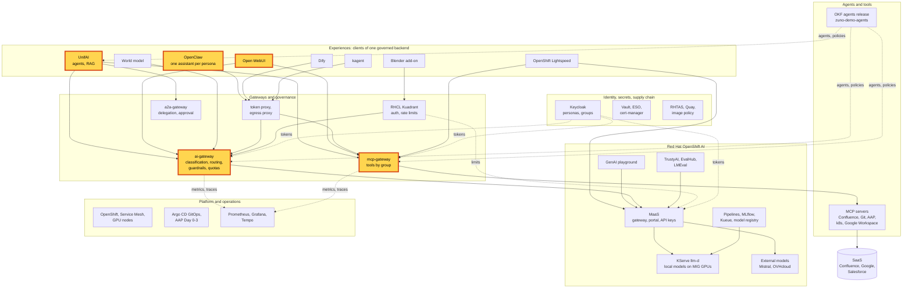

# Workshop: One backend, three experiences

> **Status:** Built from three experience scenarios, linked in the agenda, and one inline block. Not rehearsed as a
> whole in this format. Each block keeps the status of its scenario page. A first version was shown live on 2026-11-03
> ([WP-184](../roadmap/work-packages/wp-184-three-experiences-demonstration.md)). The longer version is
> [One governed backend, many experiences](five-experiences.md).
> **Show-ready:** only if every probe of its blocks passed within the last hour:
> `ONLY=unifai-tekos,open-webui,zuno-code,openclaw make demo golden-path`.
> **Duration:** 30 minutes, presenter-led. **Audience:** any; every block plays its 5-minute version.
> **Personas:** see [Personas](#personas).

## Introduction

Three experiences that look nothing alike: an agent platform, a general-purpose chat and a personal assistant. The
audience sees each one for five minutes. A short dashboard block then shows that one platform served all three, with
the same rules. This is the shortest workshop of the catalogue and the usual opening of a longer session. Where the
three experiences sit in the platform: see [Appendix A](#appendix-a---hld).

**The message:** "Three very different screens, one platform behind them: the UI is a choice, the rules are not."

**Decisions:**
- [ADR-0587](../adr/0587-admit-additional-user-experiences-over-the-one-governed-backend.md): experiences are
  presentation layers over the one governed backend.
- [ADR-0588](../adr/0588-serve-a-general-purpose-chat-experience-with-open-webui.md): Open WebUI.
- [ADR-0589](../adr/0589-serve-per-persona-openclaw-assistants-via-claw-operator-behind-a-token-injecting-egress-proxy.md)
  and [ADR-0590](../adr/0590-front-openclaw-with-oauth2-proxy-and-an-egress-firewall-one-claw-operator-per-persona-namespace.md):
  OpenClaw.
- [ADR-0593](../adr/0593-key-the-per-user-quota-and-telemetry-by-persona-across-experiences.md): one budget per
  persona across experiences.

## Personas

The personas are fictional role accounts of the Keycloak realm `zuno`
([ADR-0349](../adr/0349-restructure-demo-personas-cluster-access-groups-and-new-agents.md)). They share one password,
kept in Vault at `keycloak/demo-personas`. The [catalogue](README.md#personas) lists all of them.

| Persona | Profile | Blocks |
|---|---|---|
| **consultant-02** | Consultant and architect, front office. Confluence subgroups, `agent_tekos`, `agent_arkos`. | UnifAI, OpenClaw (its own assistant, with Confluence) |
| **sale-01** | Salesperson, front office. `sales`, `agent_comage`, `agent_finage`. | Open WebUI, the OpenClaw contrast (no Confluence tool) |
| **ai-ops-01** | AI platform operator, back office. `ocp-ai-ops`. | The UnifAI contrast (Tekos with cluster tools), Grafana |

## Agenda

| Time | Block | Play | Transition to the next block |
|---|---|---|---|
| 0:00 | Opening | The message, then [Appendix A](#appendix-a---hld) on screen | "Three doors into one house." |
| 0:02 | Agents | [UnifAI agents](scenarios/experiences/unifai-agents.md#5-minute-version), 5-minute version | "Agents are one way in. Most people just want a chat." |
| 0:07 | General chat | [Open WebUI](scenarios/experiences/open-webui.md#5-minute-version), 5-minute version | "A chat is shared. Some people want an assistant of their own." |
| 0:12 | Personal assistant | [OpenClaw](scenarios/experiences/openclaw.md#5-minute-version), 5-minute version | "Three screens. Now the view from the platform side." |
| 0:17 | Same rules | [One platform behind the three](#one-platform-behind-the-three), inline | |
| 0:25 | Close and questions | Repeat the message | |

## Before you start

- [ ] Run once the "Before you start" checklist of the three scenarios. The items they share:
  - [ ] Have one browser profile per persona, signed in before the session: **consultant-02**, **sale-01** and
    **ai-ops-01**.
  - [ ] Read OpenClaw's own UI passwords before the session, from the Secret `openclaw-ui` of each persona namespace.
    Never show them on screen.
  - [ ] Open Grafana as **ai-ops-01** on the dashboard **Zuno Platform / Five experiences**, last 1 hour,
    `client` = All.
- [ ] Check that the probes listed in the status banner passed within the last hour.

## One platform behind the three

This block has no scenario page yet: the one-budget scenario is planned for wave 2. Play it in Grafana as
**ai-ops-01**, after the three experiences.

| Time | Do | Say | You should see |
|---|---|---|---|
| 0:00 | Row **Same backend, five experiences**: **Model calls by experience (over range)** and **Tokens by experience (over range)** | "One gateway counted the three experiences we just used." | Series for `unifai`, `open-webui` and `openclaw-*`. |
| 2:00 | Row **Same models, same routing**: **Which provider served each experience (over range)** | "The provider follows the request's classification and task, not the screen. Code questions go to Codestral; turns that used company tools stay on local models." | `mistral-codestral` for Zuno Code turns, local providers for the rest. |
| 4:00 | Row **One budget across the experiences**: **One group across the experiences: tokens (over range)** | "A person has one budget, whatever screen they use. We proved it on 2026-11-03: once the budget was spent in OpenClaw, Open WebUI and UnifAI refused the same person with the same answer." | Token series per group, across the three experiences. Quote the evidence below if asked. |
| 6:00 | Close the block | "Same identity, same models, same tools, same budget. Only the screen changed." | |

**Evidence of the shared budget (2026-11-03 run).** sale-01 was put under the tight `stresstest` class (2,000 tokens per
user per 5 minutes). Its OpenClaw assistant spent the budget in one turn (2,124 tokens). Open WebUI, UnifAI (card "Rate
limit reached - quota_exceeded") and OpenClaw itself were then refused with the same body:
`{"error":"quota_exceeded","quota_class":"stresstest","dimension":"user","budget_tokens":2000,"window":"5m"}`.

## If time runs short

Shorten the inline block to its first and third steps. Do not drop an experience: the story needs three.

## If something goes wrong

| Symptom | What to do |
|---|---|
| A block's probe failed in the morning | Skip the block and say what it would have shown. The dashboard block still shows the others. |
| A block fails on stage | Use the fallback of its scenario page, then move on. Do not debug on stage. |
| 503 "no eligible provider is available" | The local models are not ready, and the turn may not go to SaaS. Say so: the gateway refuses rather than send restricted data out. |
| An experience has no series on the dashboard | Export and scrape take about a minute. Widen the time range. |

## Limits

- **The shared budget is quoted, not replayed.** Replaying it needs a group holding the persona and its OpenClaw
  service account, a gateway setting, a revert and a five-minute window. Concurrent calls all pass the check before any
  consumption is counted, so the budget is spent with one large turn, not a burst.
- **Not in this workshop:** Dify, kagent, Lightspeed and Blender (see the
  [longer workshop](five-experiences.md)), the classification rules (see the
  [sovereignty scenario](scenarios/governance/ai-gateway-sovereignty.md)), guardrails (planned).

## Appendix A - HLD

The platform map with every brick of this workshop highlighted: the three experiences and the two gateways they share.

