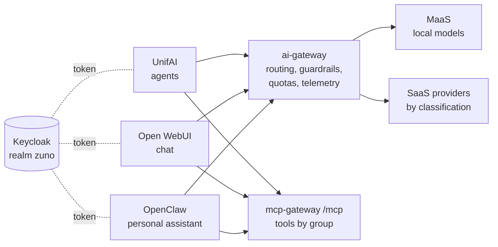

# Demo script: three experiences, one governed backend

Audience: the presenter of the demo333 platform. Decisions:
[ADR-0587](../adr/0587-admit-additional-user-experiences-over-the-one-governed-backend.md) (experience clients),
[ADR-0588](../adr/0588-serve-a-general-purpose-chat-experience-with-open-webui.md) (Open WebUI),
[ADR-0589](../adr/0589-serve-per-persona-openclaw-assistants-via-claw-operator-behind-a-token-injecting-egress-proxy.md) and
[ADR-0590](../adr/0590-front-openclaw-with-oauth2-proxy-and-an-egress-firewall-one-claw-operator-per-persona-namespace.md) (OpenClaw),
[ADR-0591](../adr/0591-route-only-to-ready-local-models-and-fail-fast-on-stalled-candidates.md) (routing around unavailable models).
Work package: [WP-184](../roadmap/work-packages/wp-184-three-experiences-demonstration.md).

## The message

Three very different user experiences - an agent platform, a general-purpose chat and a personal assistant - and one
platform behind them. The UI is a choice; identity, models, routing, guardrails, tools, quotas and telemetry are the
platform's, and they are the same whichever UI the user picks.

## Before the session

- One persona for the whole demo, signed in once per experience: **sale-01** (it has an Open WebUI account and its own
  OpenClaw assistant).
- Open in tabs:
  - UnifAI: `https://unifai-ui-zuno-unifai.apps.demo333.startx.fr`
  - Open WebUI: `https://open-webui.apps.demo333.startx.fr`
  - OpenClaw (sale-01's assistant): `https://assistant-zuno-claw-sale-01.apps.demo333.startx.fr`
  - Grafana, dashboard **Zuno Platform / Three experiences** (time range: last 1 hour, `client` = All, `user` = sale-01's id)
- Check the models: `oc get llminferenceservice -n zuno-ai-run`. If they are `Ready=False` (GPU nodes down), the demo still
  runs: every experience is answered by the first eligible SaaS provider in seconds (ADR-0591), and step 5 shows why.

## Script (about 15 minutes)

1. **Same identity.** Sign in to each experience: all three redirect to the same Keycloak realm. Point out that none of
   them holds a model key or a provider URL.
2. **Same question, three experiences.** Ask the same short question in UnifAI (to an agent), in Open WebUI and in the
   OpenClaw assistant. Three answers, three styles.
3. **Same backend.** On the dashboard, row *Same backend, three experiences*: one series per experience (`unifai`,
   `open-webui`, `openclaw-sale-01`) for calls, tokens, cost and guardrail evaluations - one gateway counted them all.
4. **Same routing.** Row *Same models, same routing*, table *Which provider served each experience*: the provider is
   chosen by the request's data classification, not by the UI.
5. **Resilience, the same for all.** Table *Candidates skipped for availability*: when local models are not ready, every
   experience skips them (`not_ready`) instead of waiting; a local-only task gets an immediate refusal, never a SaaS
   answer. Before ADR-0591 the same situation cost each experience up to fifteen minutes.
6. **Same tools, same rules.** In Open WebUI or OpenClaw, list the tools: they are the mcp-gateway's, filtered by
   sale-01's groups. Ask for a tool outside those groups: refused by the mcp-gateway, whichever UI asked.
7. **Same guardrails.** Send a prompt the rails detect (for example a fake card number): the guardrail evaluation shows
   up in the dashboard for that experience (mode `observe`: recorded, reply unaffected).
8. **One user, one budget.** Row *Same user, one budget*: sale-01's tokens, per experience, add up to one per-user budget
   in the ai-gateway's quota. Spending it in one UI spends it in all of them.

## If something goes wrong

- An experience answers 503 "no eligible provider is available": every candidate its classification allows is down or
  skipped - expected for a local-only task with the GPU nodes down; say so, it is step 5.
- No series for an experience on the dashboard: the export and scrape take about a minute; widen the time range.
- OpenClaw shows an old error: its assistant may still be starting (`oc get claw -A`).

## Not shown live (yet)

The shared quota ending in a 429 in all three experiences needs a lowered ceiling for one persona and calls from the three
UIs; it is planned for a rehearsal, not run in this script (WP-184).
