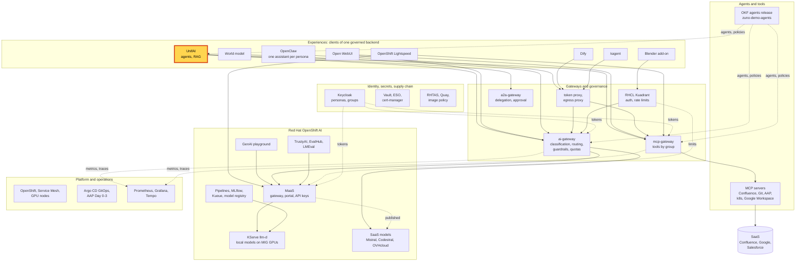
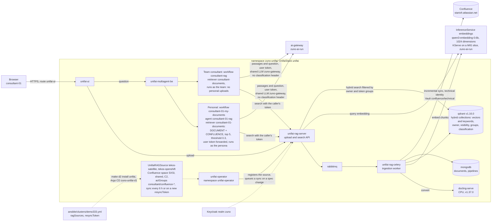

# Scenario: UnifAI - live RAG on your own documents

> **Status:** Not rehearsed in this format. The upload and the Confluence resync last ran live in the browser on
> 2026-11-05 ([WP-200](../roadmap/work-packages/wp-200-show-the-unifai-rag-working-live.md)). Prerequisites checked
> read-only on demo333 on 2026-11-12 at 22:50 UTC: UnifaiStack `unifai` Ready (images v0.1.69), pods `docling-serve`,
> `unifai-rag-server`, `unifai-rag-celery`, `qdrant`, `mongodb` and `rabbitmq` Running, InferenceService `embeddings`
> Ready, workflows `consultant-01-my-documents`, `sale-01-my-documents` and `consultant-rag` Ready, retrievers
> `consultant-01-documents` and `sale-01-documents` Ready, UnifaiRAGSources `tekos-satellite` (90 pages) and
> `tekos-openshift` (411 pages) Ready with their last pipeline `DONE`, ExternalSecret `unifai-confluence` synced, the
> four local models Ready. An earlier check, at about 22:00 UTC, found the local models restarting and Grafana down;
> at 22:50 UTC both were back.
> **Show-ready ([ADR-0606](../adr/0606-admit-new-experiences-with-a-definition-of-done-and-a-wip-limit.md)):** no
> golden-path probe. Rehearse it before showing it to an audience.
> **Personas:** see [Personas](#personas).
> **Used in workshops:** none yet; Agentic AI (planned).

## Introduction

UnifAI's RAG answers questions from documents and cites them. In Zuno it runs inside the UnifAI stack (see
[Appendix A](#appendix-a---hld)):
- docling converts a file to text;
- `qwen3-embedding-0.6b`, served by KServe on a MIG slice of a cluster GPU, turns each chunk into a vector;
- Qdrant stores the chunks for a hybrid search (vectors plus keywords).

It holds two kinds of content:
- **uploads**: the files a person adds in the **Personal** workspace, private to that person;
- **shared sources**: Confluence page trees synced from `startxfr.atlassian.net`, searchable by the Keycloak groups
  listed on each source.

The search runs with the signed-in user's own token, so each person finds only their own uploads and the sources of
their groups. The pods, the objects and the two paths (upload, question) are in [Appendix B](#appendix-b---lld).

**The message:** "A document you upload is answered from a minute later, with its source. It stays yours: neither a
colleague's assistant nor your team's sees it."

**Decisions:**
- [ADR-0568](../adr/0568-adopt-unifai-rag-on-qdrant-with-hybrid-search-and-rhoai-embeddings.md): UnifAI's RAG on
  Qdrant, hybrid search, embeddings served by OpenShift AI, shared sources filtered by groups.
- [ADR-0598](../adr/0598-give-every-persona-default-unifai-team-workspaces-and-a-shared-catalog.md) point 5, amended
  2026-11-05: the personal workflow `<user>-my-documents` runs as the persona. A team workflow runs as the team and
  never sees a member's personal uploads.
- [ADR-0563](../adr/0563-forward-caller-identity-and-zuno-context-headers-from-unifai.md): UnifAI forwards the user's
  token to the RAG search and to the ai-gateway.

## Personas

The personas are fictional role accounts of the Keycloak realm `zuno`
([ADR-0349](../adr/0349-restructure-demo-personas-cluster-access-groups-and-new-agents.md)). They share one password,
kept in Vault at `keycloak/demo-personas`. The [catalogue](README.md#personas) lists all of them.

| Persona | Profile | What it can do here | Role in this demo |
|---|---|---|---|
| **consultant-01** | Consultant and architect, front office. Group `consultant` with six Confluence subgroups (build, run and architecture Satellite; architecture OpenShift, OpenShift AI and Keycloak), `agent_tekos`, `agent_arkos`, `agent_comage`, `agent_naveo`, `aap_admin`. | Personal starters `consultant-01-my-assistant` and `consultant-01-my-documents`. Uploads in Personal. Its groups are in the `aclGroups` of both Confluence sources. Team workspace `consultant`. | The presenter's account in both versions: uploads the files, asks the questions, shows the team contrast and the Confluence answer. |
| **sale-01** | Salesperson, front office. Groups `sales`, `agent_comage`, `agent_finage`. | Personal starter `sale-01-my-documents`. In none of the `consultant/confluence-*` groups. | The isolation contrast of the 15-minute version: same question, nothing from consultant-01's uploads. |
| **ai-ops-01** | AI platform operator, back office. Group `ocp-ai-ops` (admin on the Zuno namespaces, `zuno-monitoring` included). | UnifAI administrator and owner of the shared sources (`sharedPublishers`). Opens Grafana. | Grafana in the 15-minute version. Does not sign in to UnifAI here. |

Other identities:
- the presenter's `oc` session (**paas-ops-01**, cluster-admin) for the terminal steps and the optional resync;
- the Confluence technical identity (Vault `confluence/technical`, ExternalSecret `unifai-confluence`), which reads the
  pages at sync time. It is not a persona and never answers a question;
- the presenter's own Atlassian account, to edit a page before the optional resync. The personas have no Atlassian
  account.

## Before you start

- [ ] Two browser profiles, so two personas stay signed in side by side:
  - profile 1: **consultant-01**;
  - profile 2: **sale-01** (15-minute version only).
- [ ] Open `https://unifai-ui-zuno-unifai.apps.demo333.startx.fr` and sign in through Keycloak. Check the name at the
  top right.
- [ ] The two files of [unifai-rag-upload/](unifai-rag-upload/) on the presenter's laptop:
  `travel-and-expense-policy.md` and `on-call-rota-handbook.md`. **Never upload `questions.md`**: it holds the
  expected answers, so the RAG would answer from it.
- [ ] A clean library: profile 1, **Personal**, **Documents**. If these files or `questions.md` are already listed
  (all three were uploaded on 2026-11-05), delete them, so the audience sees a real upload.
- [ ] Warm the model: profile 1, **Agentic Chats**, **+**, workflow `consultant-01-my-assistant`, ask
  `In one short sentence, say what you can help me with.`
- [ ] `oc get llminferenceservice -n zuno-ai-run` (at least one `Ready=True`) and
  `oc get inferenceservice embeddings -n zuno-ai-run` (`Ready=True`). Without the embedding model, no upload reaches
  **Done** and no search returns anything.
- [ ] Known screen that is not a failure: **RAG Overview** counts only the Slack and Document source types (upstream
  UI). Confluence and web content is indexed but not counted there, so a 0 is not an outage.
- [ ] No golden-path probe: rehearse the whole scenario the same day with the same files, then delete the uploads
  again.
- [ ] 15-minute version:
  - [ ] a terminal at the repository root, logged in with `oc` as **paas-ops-01**;
  - [ ] Grafana as **ai-ops-01**, dashboard **Zuno Platform / Agents, tools & RAG**, last 30 minutes, row **RAG**
    expanded (it is collapsed by default);
  - [ ] the optional Confluence resync only outside a freeze, prepared as in [Appendix C](#appendix-c---setup).

## 5-minute version

Profile 1, **consultant-01**, **Personal** workspace.

| Time | Do | Say | You should see |
|---|---|---|---|
| 0:00 | **Documents** in the sidebar | "I add two documents of my own: a travel policy and an on-call handbook. Both are fictional." | The **Document Library** without the two files, and the **Upload Document** button. |
| 0:30 | **Upload Document**: `travel-and-expense-policy.md` and `on-call-rota-handbook.md` | "The platform converts them with docling, embeds them with a model on our own GPU and stores them in Qdrant. Nothing leaves the cluster to do this." | Both rows, uploaded by `consultant-01`, status moving to **Done** (one chunk each on 2026-11-05, [screenshot](../assets/img/unifai-rag-documents-done.png)). |
| 2:00 | **Agentic Chats**, **+**, workflow `consultant-01-my-documents`. Ask: `Which code goes on a rental car booking?` | "This workflow runs as me. It searches my uploads and the Confluence pages my groups may read." | `ZN-CAR-7`, citing `travel-and-expense-policy.md`. The **Live workflow** panel shows the retriever `consultant-01-documents`. |
| 3:15 | Ask: `What is the hotel ceiling in Madrid?` | "It answers only from what it found, and says so when it found nothing." | An answer that the documents do not say. The policy gives Paris, Lyon, other French cities, London and Brussels only. |
| 4:15 | Close | "A document you upload is answered from a minute later, with its source. It stays yours: neither a colleague's assistant nor your team's sees it." | |

## 15-minute version

Run the 5-minute version, then:

| Time | Do | Say | You should see |
|---|---|---|---|
| 5:00 | Same chat. Ask `When does the on-call week start?`, then `What is the name of the SEV-1 bridge?` | "Each fact comes back with the document it came from." | `Tuesday at 09:30` and `Kestrel`, both citing `on-call-rota-handbook.md`. All expected answers are in [questions.md](unifai-rag-upload/questions.md). |
| 6:15 | **Team**, workspace `consultant`, **Collaboration Hub**, **+**, workflow `consultant-rag`. Ask `Which code goes on a rental car booking?` | "Now my team's RAG workflow. A team workflow runs as the team: it reads the Confluence pages of my groups, never my personal uploads." | An answer that the documents hold no rental car code; the passages it found are Confluence pages on other topics ([screenshot](../assets/img/unifai-rag-team-workflow-no-personal-upload.png)). |
| 7:30 | Profile 2, **sale-01**: **Personal**, **Agentic Chats**, **+**, workflow `sale-01-my-documents`. Ask `Which code goes on a rental car booking?` | "Another person, the same question. consultant-01's uploads are private to consultant-01." | No `ZN-CAR-7`: the documents do not say. This step is not in the 2026-11-05 live record: rehearse it. |
| 8:30 | Profile 1, `consultant-01-my-documents`. Ask: `donne moi la page confluence qui parle de kubevirt et openshift virtualisation dans la meme page` | "The same workflow also searches Confluence, with my rights. These pages are open to the consultant Confluence groups only. And the question can be in French." | The page **O3 : Openshift - Kubevirt**, with its link ([screenshot](../assets/img/unifai-rag-personal-confluence-answer.png), 2026-11-05). |
| 9:30 | **Optional, outside a freeze only.** Terminal: push the commit prepared in [Appendix C](#appendix-c---setup), then run `make d2 install unifai` | "A Confluence source syncs every 6 hours. I can also ask for a sync now: a new token in Git, applied by Argo CD." | `make` exits 0 after a few minutes. Carry on with the next rows meanwhile. During a freeze, skip this row and the row at 12:45. |
| 10:00 | `oc get unifairagsources tekos-satellite tekos-openshift -n zuno-unifai -o custom-columns=NAME:.metadata.name,PHASE:.status.phase,MSG:.status.message,ACL:.spec.aclGroups` | "Each shared source names the Keycloak groups that may search it. sale-01 is in none of them." | `tekos-satellite` with `90 pages (...)` and `tekos-openshift` with `411 pages (...)`, each with three `consultant/confluence-*` groups. |
| 11:00 | `oc get unifairetriever consultant-01-documents -n zuno-unifai -o jsonpath='{.spec.config}'` | "My personal retriever: my uploads plus Confluence, with my token, the five best passages above a score of 0.3." | `source_type` `DOCUMENT`, `extra_source_types` `["CONFLUENCE"]`, `forward_user_token` true, `top_k_results` 5, `threshold` 0.3. |
| 11:45 | Grafana **Agents, tools & RAG**, row **RAG**, panels **RAG searches (rate, by outcome/source type)** and **RAG search latency (p50/p95, seconds)** | "Every search is measured, by outcome and by source type, with its latency." | The searches of the last minutes. |
| 12:45 | Optional, after 9:30: `oc get unifairagsource tekos-satellite -n zuno-unifai -w -o custom-columns=PHASE:.status.phase,PIPELINE:.status.pipelineStatus,MSG:.status.message`. When one page has changed, ask `consultant-01-my-documents` about the word you noted, in your own words (no tested prompt) | "Only the changed page is embedded again. The answer quotes the new version." | `90 pages (1 changed, 0 deleted at the last sync)`, then an answer that quotes the edited page, with its link. |
| 14:00 | Close | Repeat the message. | |

## If something goes wrong

| Symptom | Fallback | Say |
|---|---|---|
| An upload stays in processing | Go on with the Confluence question (8:30), which needs no upload. After the session, read the logs of `docling-serve`, `unifai-rag-celery` and `unifai-rag-server` in `zuno-unifai`. | "The conversion waits in a worker queue. The search itself works: here it is on Confluence." |
| `consultant-01-my-documents` says the documents do not hold an uploaded fact | Check that both files are **Done**, and that you asked the personal workflow in **Personal**, not a team workflow. | |
| The team workflow `consultant-rag` returns `ZN-CAR-7` | Stop the isolation part and say so. A team workflow must not see a personal upload: this is a defect. | "This should not happen, and I will not explain it away." |
| An answer gives a figure with no document cited | **Try Again**, or move on. | "Every answer must cite its document. A figure without a source is not an answer." |
| No Confluence passage comes back | The persona is not in the source's `aclGroups` (the `groups` claim of its token), or every passage scores under the 0.3 threshold. Show the source status (10:00). | |
| The resync reports `0 changed` | The token did not change, Argo CD has not synced yet (`oc get applications.argoproj.io zuno-unifai-d1 -n openshift-gitops`), or the edited page is outside the source's tree or labelled `obsolete`. Never `oc patch` the source: Argo CD selfHeal reverts it, which queues a second sync. | "The source syncs again within 6 hours on its own." |
| A card **Rate limit reached - quota_exceeded** | Switch to the other profile, or stop the questions. | "The token budget is per person, across every experience: this is the quota at work." |
| **RAG Overview** shows 0 | Ignore it. | "This page counts uploads and Slack only. Confluence is indexed, as the answer just showed." |

## Limits

- **Personal uploads are found only by `<user>-my-documents`.** Three personas have that starter: consultant-01,
  sale-01 and ai-ops-01. A team workflow runs as the team, and the Team view has no Documents page, so a team cannot
  hold uploads of its own from the UI (WP-200 live findings).
- **The shared sources are filtered by their `aclGroups`, not by Confluence's own page restrictions.** One technical
  identity reads the pages at sync time; the search then applies the groups listed on the source.
- **A personal RAG turn is routed at C1.** `<user>-my-documents` calls the shared `zuno-gateway` LLM without a
  classification header, and the UnifAI session is not raised by a retrieved chunk, Confluence (C2) included
  ([ADR-0565](../adr/0565-derive-data-classification-from-okf-and-only-allow-raising-it.md), updates of 2026-11-03 and
  2026-11-07). Uploads carry no classification. Never upload real sensitive documents in a demonstration.
- **The resync is a cluster change**: a push and `make d2 install unifai`. It is not allowed during a freeze
  ([freeze protocol](freeze-protocol.md)).
- **The sale-01 contrast (7:30) is not in the 2026-11-05 live record.**
- **The Red Hat documentation web sources are suspended** since 2026-11-03 (docs.redhat.com answered 403 to the
  crawler). They are not part of this scenario.
- **No reranker.** Three CPU rerankers were measured on 2026-10-31 and none beat the fused hybrid ranking.
- **Agents and their tools** are in the [UnifAI agents](scenarios/experiences/unifai-agents.md) scenario.

## Appendix A - HLD

Where UnifAI sits in Zuno. The highlighted box is the subject of this page. Plain arrows carry requests, dotted
arrows carry identity, policy or telemetry.



## Appendix B - LLD

The RAG inside the UnifAI stack: the upload path, the question path and the Confluence sync. Drawn from
`gitops/charts/unifai/` (`values.yaml`, `templates/unifaistack.yaml`, `templates/objects.yaml`, and the
`unifai.personalStarter` and `unifai.teamExamples` templates of `templates/_helpers.tpl`) and from the
`zuno_unifai_values` block of `ansible/clusters/demo333.yml` (`ragSources`, `personalStarters`, `stack.images`).



## Appendix C - Setup

The optional Confluence resync of the 15-minute version (rows 9:30 and 12:45). **Never during a freeze**: the push
and `make d2 install unifai` change the cluster ([freeze protocol](freeze-protocol.md)).

1. **Edit a page** under `Technologie : Satellite` in the Confluence space SXSI, with your own Atlassian account. Note
   a word that only the new version contains. `startxfr.atlassian.net` is a real company site: change a page you may
   change, and revert the edit after the session (the next scheduled sync picks the revert up).
2. **Prepare the commit, without pushing it.** In `ansible/clusters/demo333.yml`, under
   `zuno_unifai_values.ragSources`, set a new `resyncToken` on the source whose tree holds the page:

   ```yaml
   - name: tekos-satellite
     resyncToken: demo-2026-11-05-1   # any new value queues a sync at once
   ```

   The value above is the one of the 2026-11-05 run; use a new one. Never `oc patch` the object instead: Argo CD
   selfHeal reverts the change, which changes the hash again and queues a second sync.
3. **On stage** (row 9:30): push the commit, then run `make d2 install unifai`.
4. **Expected timing** (2026-11-05): after `make d2 install unifai`, `tekos-openshift` reported
   `411 pages (1 changed, 0 deleted at the last sync)` within a minute.
