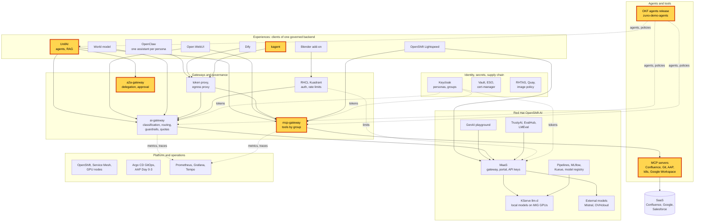

# Workshop: Agentic AI

> **Status:** Built from six scenarios, linked in the agenda, and one inline block. Not rehearsed as a whole. Each
> block keeps the status of its scenario page.
> **Show-ready:** only if every probe of its blocks passed within the last hour:
> `ONLY=unifai-tekos,open-webui,tools,delegation-approval,kagent,sovereignty make demo golden-path`. The live RAG
> block has no probe: rehearse it the same day.
> **Duration:** 60 minutes, presenter-led. **Audience:** technical and business; the delegation block plays its
> 15-minute version, the others their 5-minute version.
> **Personas:** see [Personas](#personas).

## Introduction

Agents are useful only if they can act. On Zuno they act inside the same rules as everyone else. The workshop
follows one agent's working day:
- it answers in a team workspace;
- it calls company tools with the user's rights;
- it reads the user's own documents, and only those;
- it delegates an operation to another agent, and a human approves it.

An operations agent outside UnifAI then uses the same tools under the same rules. The closing block shows where the
agents come from: a signed release, owned by the business, verified by the platform before it starts. Where these
bricks sit in the platform: see [Appendix A](#appendix-a---hld).

**The message:** "Agents act with the user's identity, under the user's rights, through governed tools. They delegate
only when a human approves, and they run only from a signed release."

**Decisions:**
- [ADR-0561](../../adr/0561-adopt-unifai-as-the-agent-platform.md): UnifAI is the agent platform.
- [ADR-0011](../../adr/0011-define-tool-authorization-as-policy-intersection.md) and
  [ADR-0036](../../adr/0036-enforce-the-complete-mcp-authorization-intersection-in-the-gateway.md): tool
  authorization is an intersection, enforced in the mcp-gateway.
- [ADR-0403](../../adr/0403-propagate-the-users-identity-and-the-delegation-chain-across-a2a-calls.md),
  [ADR-0406](../../adr/0406-limit-agent-delegation-by-depth-cycle-and-budget.md) and
  [ADR-0409](../../adr/0409-introduce-human-approval-for-delegated-operations-resumable-from-persisted-checkpoints.md):
  delegation carries the user's identity, is bounded, and waits for a human.
- [ADR-0576](../../adr/0576-extract-agent-definitions-and-corp-policies-into-the-zuno-demo-agents-repository.md),
  [ADR-0578](../../adr/0578-sign-okf-artifacts-keyless-with-github-oidc-and-verify-them-offline-by-identity.md) and
  [ADR-0580](../../adr/0580-consume-the-corp-okf-bundle-by-a-single-digest-pin-promoted-by-pull-request.md): agents
  are released from their own repository, signed, and pinned by digest.

## Personas

The personas are fictional role accounts of the Keycloak realm `zuno`
([ADR-0349](../../adr/0349-restructure-demo-personas-cluster-access-groups-and-new-agents.md)). They share one password,
kept in Vault at `keycloak/demo-personas`. The [catalogue](../README.md#personas) lists all of them.

| Persona | Profile | Blocks |
|---|---|---|
| **consultant-02** | Consultant and architect, front office. Confluence subgroups, `agent_tekos`, `agent_arkos`, `aap_ops`. | UnifAI agents, MCP tools (the wider tool set), delegation with approval |
| **ai-ops-01** | AI platform operator, back office. `ocp-ai-ops`. | The UnifAI contrast (Tekos with cluster tools), kagent, Grafana and Tempo |
| **sale-01** | Salesperson, front office. `sales`. | The MCP tools contrast, the RAG isolation check |
| **consultant-01** | Consultant and architect, front office. | The live RAG upload |
| **paas-ops-01** | Platform operator, back office. `ocp-paas-ops` (cluster-admin). | The presenter's `oc` terminal, the inline release block |

## Agenda

| Time | Block | Play | Transition to the next block |
|---|---|---|---|
| 0:00 | Opening | The message, then [Appendix A](#appendix-a---hld) on screen | "Let us follow an agent through its day." |
| 0:03 | An agent at work | [UnifAI agents](../scenarios/experiences/unifai-agents.md#5-minute-version), 5-minute version | "An agent that only talks is not much use. It needs tools." |
| 0:08 | Governed tools | [MCP tools by group](../scenarios/governance/mcp-tools-by-group.md#5-minute-version), 5-minute version | "Tools reach company systems. Documents are the other half." |
| 0:13 | My documents | [UnifAI live RAG](../unifai-live-rag.md#5-minute-version), 5-minute version | "Now the agent needs something it cannot do itself." |
| 0:18 | Delegation with approval | [A2A delegation with approval](../scenarios/governance/a2a-delegation-approval.md#15-minute-version), 15-minute version | "Agents can live outside UnifAI too." |
| 0:33 | An operations agent | [kagent](../scenarios/experiences/kagent.md#5-minute-version), 5-minute version | "Where do all these agents come from?" |
| 0:38 | Signed agents | [Where the agents come from](#where-the-agents-come-from), inline | "Last: the agent's own rules about data." |
| 0:46 | Agents carry their data rules (optional) | [Sovereignty](../scenarios/governance/ai-gateway-sovereignty.md#5-minute-version), 5-minute version | |
| 0:51 | Close and questions | Repeat the message | |

## Before you start

- [ ] Run once the "Before you start" checklist of every scenario in the agenda. The items they share:
  - [ ] Sign in one browser profile per persona before the session: **consultant-02**, **ai-ops-01**, **sale-01** and
    **consultant-01**.
  - [ ] In UnifAI, start a separate session per persona in a team workspace. A team session is shared, so
    **consultant-02** could read **ai-ops-01**'s cluster answers.
  - [ ] Log in a terminal with `oc` as **paas-ops-01**, which must have signed in to OpenShift once.
  - [ ] Open Grafana and the Tempo search UI as **ai-ops-01**.
  - [ ] Open the agents release in a browser tab:
    [agents/arkos/agent.okf.md](https://github.com/startxfr/zuno-demo-agents/blob/main/agents/arkos/agent.okf.md).
- [ ] Check that the probes listed in the status banner passed within the last hour. The delegation probe can take
  about 5 minutes when the model retries the tool.

## Where the agents come from

This block has no scenario page yet: the signed agent release scenario is planned for wave 4. Play it from the
presenter's terminal (**paas-ops-01**) and a browser tab on GitHub.

| Time | Do | Say | You should see |
|---|---|---|---|
| 0:00 | Open [agents/arkos/agent.okf.md](https://github.com/startxfr/zuno-demo-agents/blob/main/agents/arkos/agent.okf.md) in the agents repository | "Agents are declared by their business owners in their own repository: purpose, tasks, tools, data classification. The platform team does not write them." | The OKF sheet of Arkos, with its tasks, its tools and `preferred_classification: C3`. |
| 2:00 | Open [`platform/okf/agents.lock`](../../../platform/okf/agents.lock) in this repository | "The platform runs exactly one agents release, pinned by its digest. Changing it is a pull request, reviewed like code." | `# release v0.14.3` and `quay.io/zuno/okf-corp@sha256:2918e463...` |
| 3:30 | `oc logs deploy/mcp-gateway -c okf-fetch -n zuno-ai-run \| grep VERIFIED` | "Each gateway verifies the release's signature when its pod starts. If the signature does not verify, the gateway does not start." | `VERIFIED quay-quay-zuno-registry.apps.demo333.startx.fr/zuno/okf-corp@sha256:2918e463...: release 0.14.3 (release), 8 agent(s): ...` |
| 5:30 | Point at the start of the reference | "The release is read from our own registry mirror, and verified against the same signature as the original." | The reference starts with `quay-quay-zuno-registry.apps.demo333.startx.fr`, not `quay.io`. |
| 7:00 | Close the block | "Signed agents, governed tools, one gateway." | |

The digest and the release number above were read on demo333 on 2026-11-13. Read them again before the session.

## If time runs short

Drop blocks in this order:
1. sovereignty;
2. the inline release block, down to its first and third steps;
3. kagent.

Keep the delegation block in its 15-minute version: it is the centre of the story.

## If something goes wrong

| Symptom | What to do |
|---|---|
| A block's probe failed in the morning | Skip the block and say what it would have shown. |
| The approval request does not appear on stage | Use the fallback of the [delegation scenario](../scenarios/governance/a2a-delegation-approval.md#if-something-goes-wrong). Show the delegation without the approval step and say so. |
| A second approval request appears | The model retried the tool. Answer it too, or the session waits for the expiry. |
| A block fails on stage | Use the fallback of its scenario page, then move on. Do not debug on stage. |

## Limits

- **The release block shows verification, not a release.** Publishing a new agents release and promoting it is
  owner work: a pull request in the agents repository, a signed build, then a promotion pull request here. It is not
  run on stage.
- **Delegation is shown between two agents only**, Arkos to Tekos. Depth, cycle and budget limits are described, not
  triggered.
- **Not in this workshop:** the other experiences (see the
  [many-experiences workshop](../five-experiences.md)), guardrails and budgets (see the
  [sovereign and governed AI workshop](sovereign-governed-ai.md)).

## Appendix A - HLD

The platform map with every brick of this workshop highlighted: the agent platform, the delegation gateway, the tool
gateway and its servers, the signed release, and the operations agent.

