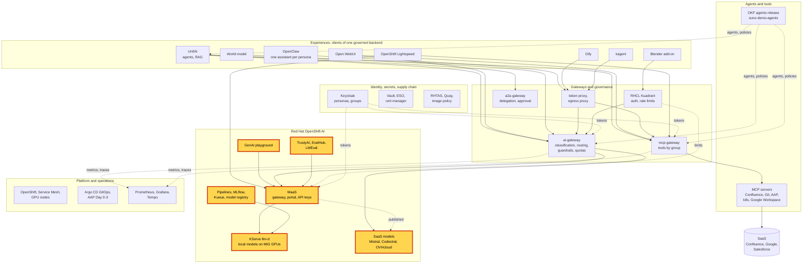

# Workshop: RHOAI end to end

> **Status:** Built from seven scenarios, linked in the agenda. Not rehearsed as a whole. Each block keeps the status of
> its scenario page.
> **Show-ready:** none of these blocks has a golden-path probe. Rehearse every block on the day, and run
> `make demo golden-path` before the session anyway: its Open WebUI moment proves that a local model answers.
> **Duration:** 70 minutes, presenter-led. With the 15-minute versions of the playground and evaluation blocks it
> takes 90 minutes. **Audience:** data scientists, ML engineers, platform teams.
> **Personas:** see [Personas](#personas).

## Introduction

Red Hat OpenShift AI is the model layer under everything else in Zuno. The workshop follows a model through its life
on the platform:
1. it is chosen from a catalog;
2. it is served on shared GPU slices;
3. it is published next to SaaS models behind one governed gateway;
4. a developer consumes it with a self-service key and a playground;
5. it is improved with a fine-tuning pipeline;
6. it is evaluated before anyone relies on it.

Every step happens on the platform the audience already saw. The models answering UnifAI, Open WebUI or Dify are
these models. Where these bricks sit in the platform: see [Appendix A](#appendix-a---hld).

**The message:** "One platform takes a model from the catalog to a governed, fine-tuned and evaluated service, on GPUs
you share and control."

**Decisions:**
- [ADR-0019](../../adr/0019-use-openshift-ai-model-serving-for-local-inference.md): OpenShift AI model serving for
  local inference.
- [ADR-0351](../../adr/0351-share-rtx-pro-6000-gpus-via-nvidia-mig-with-scale-from-zero-burst-capacity.md): GPUs
  shared through MIG, with burst capacity from zero.
- [ADR-0201](../../adr/0201-complete-the-openshift-ai-maas-governance-plane-integration.md),
  [ADR-0541](../../adr/0541-integrate-mistral-and-gpt-oss-120b-as-maas-externalmodels.md) and
  [ADR-0570](../../adr/0570-slim-the-ai-gateway-by-delegating-quotas-keys-and-exposure-to-maas.md): MaaS as the
  model access plane, for local and SaaS models.
- [ADR-0301](../../adr/0301-introduce-lora-and-peft-model-customization.md) and
  [ADR-0302](../../adr/0302-build-dataset-to-model-mlops-pipelines.md): LoRA customization and dataset-to-model
  pipelines.
- [ADR-0027](../../adr/0027-evaluate-every-agent-with-twenty-acceptance-scenarios.md) and
  [ADR-0534](../../adr/0534-integrate-trustyai-for-ai-evaluation-and-guardrails.md): evaluation before trust.

## Personas

The personas are fictional role accounts of the Keycloak realm `zuno`
([ADR-0349](../../adr/0349-restructure-demo-personas-cluster-access-groups-and-new-agents.md)). They share one password,
kept in Vault at `keycloak/demo-personas`. The [catalogue](../README.md#personas) lists all of them.

| Persona | Profile | Blocks |
|---|---|---|
| **ai-dev-01** | AI developer, back office. `ocp-ai-dev` (edit on the Zuno namespaces), MaaS subscription on gpt-oss-20b. | Catalog and registry, MaaS key, the playground (no tools), the pipeline and its runs, evaluation |
| **ai-ops-01** | AI platform operator, back office. `ocp-ai-ops` (admin on the Zuno namespaces). | The playground with nine tools, Grafana and the console dashboards |
| **paas-ops-01** | Platform operator, back office. `ocp-paas-ops` (cluster-admin). | The presenter's `oc` terminal: serving, external models, subscriptions |

The scenario pages name a few more accounts; their Personas sections say which.

## Agenda

| Time | Block | Play | Transition to the next block |
|---|---|---|---|
| 0:00 | Opening | The message, then [Appendix A](#appendix-a---hld) on screen | "Everything starts with choosing a model." |
| 0:03 | Choose | [Model catalog and registry](../scenarios/rhoai/model-catalog-registry.md#5-minute-version), 5-minute version: the catalog is shown, the registry is only told (demo333 has none) | "A chosen model has to run somewhere." |
| 0:08 | Serve | [Model serving with llm-d on MIG](../scenarios/rhoai/model-serving-llmd-mig.md#15-minute-version), 15-minute version | "Local models are not the only ones. Some work goes to SaaS models." |
| 0:23 | Publish SaaS models | [External models](../scenarios/rhoai/external-models.md#5-minute-version), 5-minute version | "Local or SaaS, a developer reaches them the same way." |
| 0:28 | Consume with a key | [MaaS portal and API keys](../scenarios/rhoai/maas-portal-api-keys.md#5-minute-version), 5-minute version | "A key is for code. A playground is for trying things." |
| 0:33 | Try | [GenAI playground](../scenarios/rhoai/genai-playground.md#5-minute-version), 5-minute version (15-minute version in the 90-minute run) | "A generic model is a start. Our own data makes it better." |
| 0:38 | Improve | [LoRA pipeline with MLflow and Kueue](../scenarios/rhoai/lora-pipeline-mlflow-kueue.md#15-minute-version), 15-minute version | "Better according to whom? We measure it." |
| 0:53 | Prove | [Evaluation with TrustyAI and EvalHub](../scenarios/rhoai/evaluation-trustyai-evalhub.md#5-minute-version), 5-minute version (15-minute version in the 90-minute run) | |
| 0:58 | Close and questions | Repeat the message. Then, if asked, show how the same models serve the experiences (one slide of Appendix A of the [many-experiences workshop](../five-experiences.md#appendix-a---hld)). | |

## Before you start

- [ ] Run once the "Before you start" checklist of every scenario in the agenda. The items they share:
  - [ ] Sign in to OpenShift once as **ai-dev-01**, **ai-ops-01** and **paas-ops-01** before the session. Their
    OpenShift groups are created at first sign-in.
  - [ ] Open the RHOAI dashboard (`https://rh-ai.apps.demo333.startx.fr`) in one browser profile per persona.
  - [ ] Open a terminal at the repository root, logged in with `oc` as **paas-ops-01**.
  - [ ] Open Grafana as **ai-ops-01**. Open the OpenShift console, **Observe, Dashboards**, for the RHOAI and llm-d
    dashboards.
- [ ] Check that the local models are Ready: `oc get llminferenceservice -n zuno-ai-run`. The MaaS key and the
  playground need gpt-oss-20b.
- [ ] Do not start a pipeline run or an evaluation job on stage. The pipeline and evaluation blocks show past runs;
  starting one is a cluster change, made only in a rehearsal.

## If time runs short

Play the serving and pipeline blocks in their 5-minute versions. Drop the external-models block next: its message
also appears in the MaaS block. Keep the catalog, the key and the evaluation: they open and close the story.

## If something goes wrong

| Symptom | What to do |
|---|---|
| A local model is not Ready | Say why: a GPU slice is busy or a rollout is in progress. Show the serving block from the configuration and the dashboards, then move on. The MaaS and playground blocks need gpt-oss-20b. |
| The portal key pages fail | Show the subscriptions and policies from the terminal, as the [MaaS scenario](../scenarios/rhoai/maas-portal-api-keys.md#if-something-goes-wrong) describes. |
| A block fails on stage | Use the fallback of its scenario page, then move on. Do not debug on stage. |

## Limits

- **The model registry is told, not shown.** demo333 has no `ModelRegistry`. The pipeline block uses the recorded
  evidence of a registered adapter.
- **Nothing is trained or evaluated live.** The pipeline and evaluation blocks show runs that already happened. A
  live run takes longer than the slot and changes the cluster.
- **No block has a golden-path probe.** Rehearsal is the only check for this workshop.
- **The governance on top of these models is not shown here:** classification, routing, guardrails and budgets. See
  the [sovereign and governed AI workshop](sovereign-governed-ai.md).

## Appendix A - HLD

The platform map with every brick of this workshop highlighted: MaaS, the local and external models, the playground,
the build chain and the evaluation.

