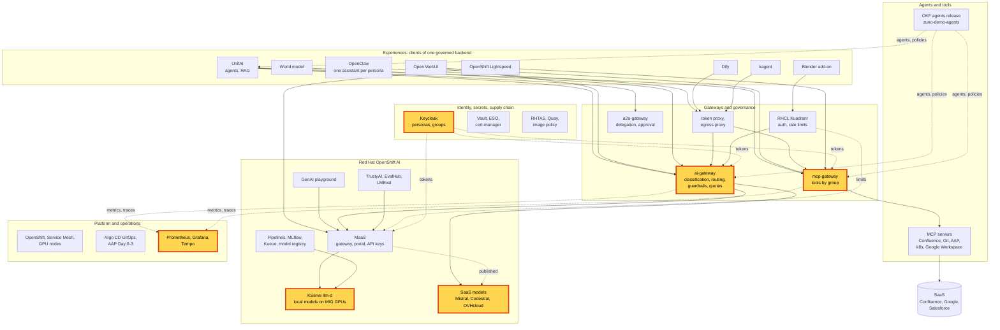

# Workshop: Sovereign and governed AI

> **Status:** Built from six scenarios, linked in the agenda, plus two steps of a seventh. Not rehearsed as a whole.
> Each block keeps the status of its scenario page.
> **Show-ready:** only if every probe of its blocks passed within the last hour:
> `ONLY=open-webui,tools,sovereignty,unifai-tekos,trace,zuno-code,guardrails make demo golden-path` (`trace` looks
> up the run that `unifai-tekos` makes, so the two go together). The identity and budget blocks
> have no probe: rehearse them the same day.
> **Duration:** 45 minutes, presenter-led. **Audience:** decision makers, security and compliance teams, architects;
> every block plays its 5-minute version.
> **Personas:** see [Personas](#personas).

## Introduction

Before they adopt AI, organisations ask the same questions:
- Who may use which assistant and which data?
- Does sensitive data leave our infrastructure?
- Which model answered, and why?
- What stops a malicious prompt?
- What does it cost per person?
- Can we prove all of this afterwards?

The workshop answers them in that order, one control per block, on the live platform. Every control sits in the
backend, so it holds whatever screen the user picks. Where these controls sit in the platform: see
[Appendix A](#appendix-a---hld).

**The message:** "Every AI request on Zuno is checked for who sends it, where its data may go, which model may answer,
what it contains and what it costs, and leaves a trace you can show an auditor."

**Decisions:**
- [ADR-0349](../../adr/0349-restructure-demo-personas-cluster-access-groups-and-new-agents.md): personas and groups
  drive every entitlement.
- [ADR-0565](../../adr/0565-derive-data-classification-from-okf-and-only-allow-raising-it.md): data classification
  from the agent's signed sheet, raised and never lowered.
- [ADR-0591](../../adr/0591-route-only-to-ready-local-models-and-fail-fast-on-stalled-candidates.md) and
  [ADR-0596](../../adr/0596-let-experience-clients-pick-a-declared-code-model-routed-to-codestral-first.md): routing
  to ready models, code questions to Codestral first.
- [ADR-0567](../../adr/0567-move-trustyai-guardrails-into-the-ai-gateway.md): guardrails inside the ai-gateway.
- [ADR-0593](../../adr/0593-key-the-per-user-quota-and-telemetry-by-persona-across-experiences.md): one budget and
  one telemetry key per persona.
- [ADR-0036](../../adr/0036-enforce-the-complete-mcp-authorization-intersection-in-the-gateway.md): tools authorised
  by the full intersection of rules.

## Personas

The personas are fictional role accounts of the Keycloak realm `zuno`
([ADR-0349](../../adr/0349-restructure-demo-personas-cluster-access-groups-and-new-agents.md)). They share one password,
kept in Vault at `keycloak/demo-personas`. The [catalogue](../README.md#personas) lists all of them.

| Persona | Profile | Blocks |
|---|---|---|
| **sale-01** | Salesperson, front office. `sales`. | Identity, tools (three tools), routing, budget |
| **consultant-02** | Consultant and architect, front office. Confluence subgroups, `agent_tekos`, `agent_arkos`. | Identity, tools (six tools), guardrails (through Dify) |
| **finance-01** | Finance, middle office. `finance`. | Tools (two tools) |
| **ai-ops-01** | AI platform operator, back office. `ocp-ai-ops` (admin on `zuno-monitoring`). | Grafana and Tempo in every block that shows a dashboard or a trace |
| **paas-ops-01** | Platform operator, back office. `ocp-paas-ops` (cluster-admin). | The presenter's `oc` terminal: the sovereignty probe and the configuration steps |

The scenario pages name a few more accounts; their Personas sections say which.

## Agenda

| Time | Block | Play | Transition to the next block |
|---|---|---|---|
| 0:00 | Opening | The six questions, then [Appendix A](#appendix-a---hld) on screen | "First question: who are you?" |
| 0:03 | Who you are | [Identity and personas](../scenarios/governance/identity-personas.md#5-minute-version), 5-minute version | "Your groups also decide which company systems an AI may reach for you." |
| 0:08 | What you may reach | [MCP tools by group](../scenarios/governance/mcp-tools-by-group.md#5-minute-version), 5-minute version | "Reaching data is one thing. Where that data may then go is another." |
| 0:13 | Where data may go | [Sovereignty by data classification](../scenarios/governance/ai-gateway-sovereignty.md#5-minute-version), 5-minute version | "Within what is allowed, which model answers?" |
| 0:18 | Which model answers | [Model routing and fallback](../scenarios/governance/ai-gateway-routing.md#5-minute-version), 5-minute version | "Whatever the model, the prompt itself is checked." |
| 0:23 | What the prompt contains | [Guardrails](../scenarios/governance/guardrails.md#5-minute-version), 5-minute version | "And all of it is counted, per person." |
| 0:28 | What it costs | [One budget per persona](../scenarios/governance/quotas.md#5-minute-version), 5-minute version | "Last question: can you prove it afterwards?" |
| 0:33 | The proof | [Sovereignty, 15-minute version](../scenarios/governance/ai-gateway-sovereignty.md#15-minute-version), only its Tempo step (10:30) and its skipped-candidates step (12:30) | |
| 0:38 | Close and questions | Repeat the message | |

## Before you start

- [ ] Run once the "Before you start" checklist of every scenario in the agenda. The items they share:
  - [ ] One browser profile per persona, signed in before the session: **sale-01**, **consultant-02** and
    **finance-01**.
  - [ ] Grafana and the Tempo search UI, signed in as **ai-ops-01**.
  - [ ] A terminal at the repository root, logged in with `oc` as **paas-ops-01**. The persona must have signed in to
    OpenShift once.
- [ ] Check that the probes listed in the status banner passed within the last hour.
- [ ] Check that the local models are Ready: `oc get llminferenceservice -n zuno-ai-run`. Sovereignty needs at least
  one.

## If time runs short

Drop the routing block first, then the proof block. Never drop sovereignty or identity: the rest of the story depends
on them.

## If something goes wrong

| Symptom | What to do |
|---|---|
| A block's probe failed in the morning | Skip the block and say what it would have shown. |
| 503 "no eligible provider is available" during sovereignty or routing | Show it. No local model was ready, so the gateway refused rather than send restricted data to SaaS. That is the rule at work. |
| A block fails on stage | Use the fallback of its scenario page, then move on. Do not debug on stage. |
| Grafana or Tempo does not load | Skip the dashboard steps. The sovereignty probe's result line is enough proof. |

## Limits

- **Guardrails observe; they do not block.** Every level runs in `observe` mode today. Say so before someone asks.
- **The shared budget is quoted, not replayed.** Replaying it needs a cluster change and a revert (see the
  [budget scenario](../scenarios/governance/quotas.md#limits)).
- **The classification comes from the caller, the agent and the tools, never from reading the question.** A caller
  that hides the agent is not raised (the known gap of ADR-0565).
- **Not in this workshop:** the experiences themselves (see the
  [many-experiences workshop](../five-experiences.md)), and delegation between agents (see the
  [agentic AI workshop](agentic-ai.md)).

## Appendix A - HLD

The platform map with every brick of this workshop highlighted: identity, the two gateways, the local and external
models, and the telemetry that proves it.

