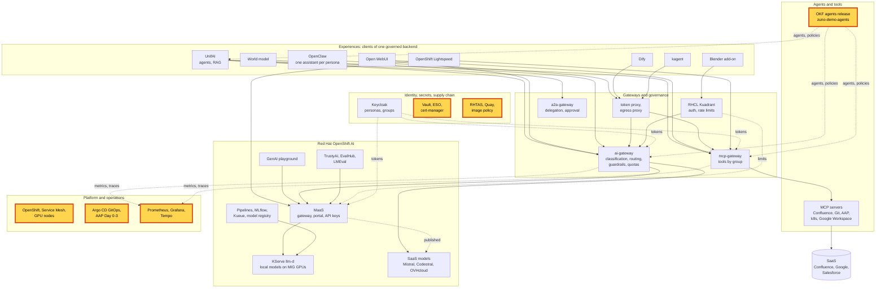

# Workshop: Trusted platform and operations

> **Status:** Built from seven scenarios, linked in the agenda. Not rehearsed as a whole. Each block keeps the status of
> its scenario page.
> **Show-ready:** only the observability block has a golden-path probe (`trace`). Run `make demo golden-path` before the
> session, and rehearse every other block the same day.
> **Duration:** 60 minutes, presenter-led. **Audience:** platform, security and operations teams; the observability
> block plays its 15-minute version, the others their 5-minute version.
> **Personas:** see [Personas](#personas).

## Introduction

An AI platform is only as trustworthy as the platform under it. This workshop shows the foundations that the other
workshops take for granted:
- everything is declared in Git and applied the same way every time;
- every image and every agents release that runs is signed and verified;
- no application holds a static secret;
- traffic between services is encrypted and identified;
- every request can be traced;
- operations are audited.

Each block shows one of these foundations on the live cluster, mostly from the presenter's terminal and from read-only
screens. Where these bricks sit in the platform: see [Appendix A](#appendix-a---hld).

**The message:** "What runs is declared, signed and verified. Secrets come from Vault, traffic is encrypted, and every
request and operation leaves a trace. The platform can show this, not just claim it."

**Decisions:**
- [ADR-0060](../../adr/0060-restructure-day-0-day-1-day-2-day-3-deployment-sequencing.md) and
  [ADR-0605](../../adr/0605-gate-every-live-demo-on-a-golden-path-check-and-a-freeze-window.md): a Day 0-3 contract,
  and a golden-path check before any live demonstration.
- [ADR-0115](../../adr/0115-use-immutable-and-verifiable-software-supply-chain-artifacts.md) and
  [ADR-0535](../../adr/0535-adopt-rhtas-as-the-artifact-trust-and-supply-chain-service.md): immutable, signed and
  verifiable artifacts, with RHTAS.
- [ADR-0024](../../adr/0024-use-vault-for-application-secrets.md) and
  [ADR-0211](../../adr/0211-publicly-trusted-wildcard-tls-via-lets-encrypt-and-route53.md): Vault for secrets, publicly
  trusted certificates.
- [ADR-0037](../../adr/0037-protect-mcp-servers-with-network-and-workload-identity-boundaries.md): network and
  workload identity boundaries.
- [ADR-0029](../../adr/0029-instrument-model-usage-costs-and-distributed-traces.md): usage, cost and distributed
  traces.
- [ADR-0354](../../adr/0354-add-ansible-automation-platform-as-a-day-1-component.md) and
  [ADR-0355](../../adr/0355-expose-aap-audits-to-agents-through-an-mcp-aap-server.md): audited operations with AAP.
- [ADR-0602](../../adr/0602-harden-the-platform-trust-boundaries-before-a-customer-runs-it.md): the hardening of the
  trust boundaries.

## Personas

The personas are fictional role accounts of the Keycloak realm `zuno`
([ADR-0349](../../adr/0349-restructure-demo-personas-cluster-access-groups-and-new-agents.md)). They share one password,
kept in Vault at `keycloak/demo-personas`. The [catalogue](../README.md#personas) lists all of them.

| Persona | Profile | Blocks |
|---|---|---|
| **paas-ops-01** | Platform operator, back office. `ocp-paas-ops` (cluster-admin), `aap_admin`. | The presenter's `oc` terminal in every block |
| **ai-ops-01** | AI platform operator, back office. `ocp-ai-ops` (admin on the Zuno namespaces). | Grafana, Tempo and the mesh dashboards |
| **consultant-02** | Consultant, front office. `aap_ops`. | The AAP block. Its chat in UnifAI also produces the run traced in the observability block. |
| **consultant-03** | Consultant (run), front office. `aap_reader`. | The AAP contrast: same screen, read-only rights |

The scenario pages name a few more accounts; their Personas sections say which.

## Agenda

| Time | Block | Play | Transition to the next block |
|---|---|---|---|
| 0:00 | Opening | The message, then [Appendix A](#appendix-a---hld) on screen | "Everything starts in Git." |
| 0:03 | Declared | [GitOps and Day 0-3](../scenarios/foundation/gitops-day0-3.md#5-minute-version), 5-minute version | "What Git declares must be what actually runs. That is what signatures prove." |
| 0:08 | Signed images | [Image signing and admission](../scenarios/foundation/image-signing-admission.md#5-minute-version), 5-minute version | "Images are signed. Agents are too." |
| 0:13 | Signed agents | [Signed agent release](../scenarios/foundation/okf-signed-agent-release.md#5-minute-version), 5-minute version | "Signed code still needs credentials. None of them live in the code." |
| 0:18 | No static secrets | [Vault and PKI](../scenarios/foundation/vault-pki.md#5-minute-version), 5-minute version | "Secrets are safe at rest. In transit, the mesh protects the traffic." |
| 0:23 | Encrypted traffic | [Service mesh and Kiali](../scenarios/foundation/service-mesh-kiali.md#5-minute-version), 5-minute version | "Encrypted traffic is also observed traffic." |
| 0:28 | Observed | [Observability and traces](../scenarios/foundation/observability-trace.md#15-minute-version), 15-minute version | "Last foundation: the operations themselves are audited." |
| 0:43 | Audited | [AAP audited operations](../scenarios/foundation/aap-audited-operations.md#5-minute-version), 5-minute version | |
| 0:48 | Close and questions | Repeat the message | |

For a two-hour session, follow this workshop with the [sovereign and governed AI workshop](sovereign-governed-ai.md):
the foundations first, then the AI controls built on them.

## Before you start

- [ ] Run once the "Before you start" checklist of every scenario in the agenda. The items they share:
  - [ ] Log in a terminal at the repository root with `oc` as **paas-ops-01**. The persona must have signed in to
    OpenShift once, because its OpenShift group is created at first sign-in. Use a large font and a dark background.
  - [ ] Sign in to Grafana, the Tempo search UI and Kiali as **ai-ops-01**.
  - [ ] Open the AAP console in two browser profiles, **consultant-02** and **consultant-03**.
  - [ ] Have a UnifAI chat of **consultant-02** with Tekos run during the session, so that the observability block
    finds a recent trace.
- [ ] Check that `make demo golden-path` passed within the last hour.
- [ ] On stage, run only the read-only commands the pages give. Releases, signatures, rollouts and job launches are
  rehearsal-only, with the platform owner's go.

## If time runs short

Play the observability block in its 5-minute version. Then drop the mesh block. Keep GitOps, the two signature blocks
and Vault: together they are the trust story.

## If something goes wrong

| Symptom | What to do |
|---|---|
| A command answers slowly or with an authentication error | The API server may be under load. Wait a few seconds and run it again once. If it fails again, show the next block from its page and say so. |
| A block's screen does not load (Grafana, Kiali, AAP) | Show the terminal steps of the same block instead. Each page gives them. |
| A block fails on stage | Use the fallback of its scenario page, then move on. Do not debug on stage. |

## Limits

- **Nothing is changed on stage.** No release is published, no image signed, no secret rotated, no job launched. The
  pages describe these changes and give their evidence; doing them live is rehearsal work.
- **Only one block has a golden-path probe.** Rehearsal is the check for the others.
- **The AI controls on top of this foundation are shown elsewhere:** see the
  [sovereign and governed AI workshop](sovereign-governed-ai.md) and the [agentic AI workshop](agentic-ai.md).

## Appendix A - HLD

The platform map with every brick of this workshop highlighted: GitOps and AAP, the supply chain, the signed agents
release, Vault, the platform and its mesh, and observability.

