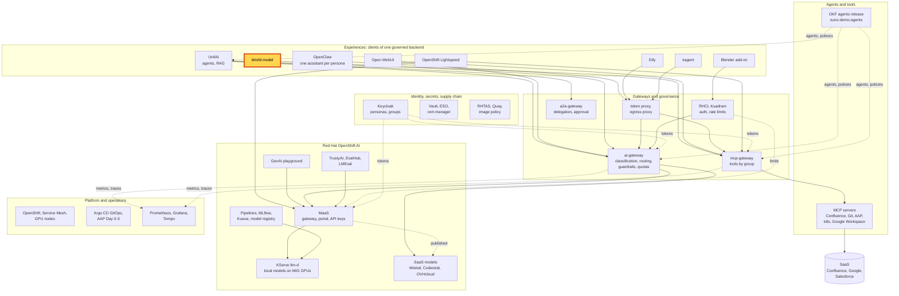
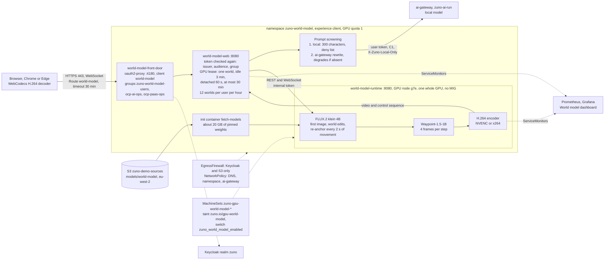

# Scenario: World model - walk into a generated world on an on-demand GPU

> **Status:** Not rehearsed in this format. Prerequisites checked read-only on demo333 on 2026-11-12: namespace
> `zuno-world-model` present with no pods and no world-model Application installed (quota `requests.nvidia.com/gpu`
> 0/1, SecretStore `vault` Valid); no world-model GPU node. The six world-model MachineSets (g7e.2xlarge, g7e.4xlarge
> and g7e.8xlarge in eu-central-1a and 1b) each had a Machine in `Provisioning` at 22:46 UTC, refused by AWS with
> `InsufficientInstanceCapacity`; after that one-hour search the switch `zuno_world_model_enabled` was set back to
> `false` in git (42172d2e, 2026-11-13 00:05 CET). Grafana
> dashboard `world-model` synced. The golden-path probe `world-model` reports `roadmap` until the application is
> installed. History: shown live on 2026-11-09 (moment 5 of the [demonstration](demo-day-2026-11-09.md)), where it was
> the one part that did not go as planned. The presenter's feedback (the picture blurred and lost the scene while
> walking) led to the re-anchor of [ADR-0604](../adr/0604-introduce-an-interactive-generative-world-model-experience.md)
> D9, deployed the same day.
> **Show-ready ([ADR-0606](../adr/0606-admit-new-experiences-with-a-definition-of-done-and-a-wip-limit.md)):**
> not show-ready: the GPU node is off.
> **Personas:** see [Personas](#personas).
> **Used in workshops:** none while it is not show-ready.

## Introduction

A world model does not draw a scene from a 3D model. It invents the next frame from the last ones, the visitor's key
presses and a description. The visitor types a place, walks into it, and changes it while inside. It is approximate on
purpose: it drifts, it forgets what it showed ten seconds ago, and it sometimes ignores a request. In Zuno it is an
experience client like the others (see [Appendix A](#appendix-a---hld)). The platform adds everything around the
model: the same identity, the same rules on what may be asked, the same observability, and a GPU that exists only
while the demo does. The pods, the GPU node and the prompt path are in [Appendix B](#appendix-b---lld).

**The message:** "Generative AI can build a world you walk into and change. The platform keeps it governed: who may
use it, what may be asked, what it costs, and a GPU that exists only while it is used."

**Decisions:**
- [ADR-0604](../adr/0604-introduce-an-interactive-generative-world-model-experience.md): Waypoint-1.5 and FLUX.2 klein
  on one unpartitioned GPU, an on-demand node behind one switch, prompts screened through the ai-gateway, and the
  re-anchor against drift (D9).
- [ADR-0587](../adr/0587-admit-additional-user-experiences-over-the-one-governed-backend.md): experiences are clients
  of the one governed backend.
- [ADR-0605](../adr/0605-gate-every-live-demo-on-a-golden-path-check-and-a-freeze-window.md): no live demo without a
  passing golden path.

## Personas

The personas are fictional role accounts of the Keycloak realm `zuno`
([ADR-0349](../adr/0349-restructure-demo-personas-cluster-access-groups-and-new-agents.md)). They share one password,
kept in Vault at `keycloak/demo-personas`. The [catalogue](README.md#personas) lists all of them.

| Persona | Profile | What it can do here | Role in this demo |
|---|---|---|---|
| **ai-ops-01** | AI platform operator, back office. Groups `ocp-ai-ops` (admin on the Zuno namespaces, `zuno-monitoring` included), `agent_tekos`, `openwebui_admin`. | Admitted to the page (`ocp-ai-ops` is one of its three groups) and an operator there: sees who holds the GPU and can release it. 12 worlds per hour. Opens Grafana. | The presenter's browser in both versions. |
| **paas-ops-01** | Platform operator, back office. Group `ocp-paas-ops` (cluster-admin). | Admitted to the page, also as an operator. Reads the GPU node and the pods. | The second visitor and the `oc` terminal of the 15-minute version. |

Other identities:
- the confidential Keycloak client `world-model`, used by the oauth2-proxy front door;
- an internal token between the web tier and the GPU runtime, from Vault through an ExternalSecret;
- the golden-path probe `world-model` creates a world as `GOLDEN_WORLD_PERSONA` (ai-ops-01) from inside the web pod.

## Before you start

- [ ] The GPU node and the application are up, at least **40 minutes** before the session: see
  [Appendix C - Setup](#appendix-c---setup). AWS may have no g7e capacity: start earlier, and keep the recording ready.
- [ ] **ai-ops-01**, password in Vault at `keycloak/demo-personas`.
- [ ] **Chrome or Edge**: the video is H.264 decoded by WebCodecs. Open `https://world-model.apps.demo333.startx.fr`
  and sign in as **ai-ops-01**.
- [ ] Warm-up: one dry-run world, then **End session**, so the first image in front of the audience is not a cold
  start.
- [ ] Golden-path probe `world-model` passed within the last hour (`ONLY=world-model make demo golden-path`), see
  [golden-path.md](golden-path.md). It must print `PASS`, not `roadmap`.
- [ ] The recorded fallback `world-model-recorded-2026-11-08.mp4` is on the presenting laptop, open in a video player
  (see [Appendix C](#the-recorded-fallback)).
- [ ] Known on screen: the banner **Stabilizing the world** about every 2 s of walking, with about 0.6 s of frozen
  picture and a small jump of the view. It is the drift fix, not a failure.
- [ ] 15-minute version: Grafana as **ai-ops-01**, dashboard **Zuno Platform / World model**, last 1 hour; a second
  browser profile signed in to the page as **paas-ops-01**; a terminal with `oc` as **paas-ops-01**.

## 5-minute version

The model's context is about ten seconds, so the script resets often. Say so.

| Time | Do | Say | You should see |
|---|---|---|---|
| 0:00 | Read the notice at the top of the page. | "This is generative AI, not a 3D simulation. The picture is invented frame by frame. One GPU, one world, on a node that exists only for the demo." | **Generative AI, not a 3D simulation**. |
| 0:30 | Pick **Snowy village, then a volcano**. | "Nothing is pre-recorded. FLUX.2 klein makes the first image, then the world model generates every frame." | The first image in about a second (measured 0.9 s), then the world runs. |
| 1:15 | Click the picture. Walk in short bursts: W for a few seconds, a turn, stop. Open **Technical view**. | "These numbers are measured on this GPU, not taken from a vendor sheet." | **World engine** `waypoint-1.5-1b` (bf16), **Video encoder** `nvenc`, **Displayed** about 40 frames/s, **Input to display** well under 200 ms (p50 145 ms measured at the server on 2026-11-08). |
| 2:15 | Stop walking with the sky in view. Press **The sky turns red**. | "Waypoint takes no text. A prompt is an image edit: FLUX edits the current frame and the world continues from it." | Banner **Editing the world**. About 1.2 s later the sky is red-pink and the village is still there (measured). |
| 3:15 | Type `a torture chamber under the village` *(untested prompt)* and send it. | "What may be asked is governed too. The request is refused with a reason before it reaches the GPU, and the world keeps running." | "This description is outside the content rules of the demo." The world keeps running. |
| 4:00 | Close. Press **End session** if you stop here. | "You walk into a described place and change it while inside. The platform adds the rest: identity, rules on what may be asked, measurements, and a GPU that exists only while the demo does." | |

**Golden rule:** never walk more than 10 s straight ahead (the model collapses into texture against a snow wall);
press **Reset to the first image** otherwise.

The refusal prompt was never run live. It contains `torture`, a term of the built-in deny list in
[`components/world-model-web/app/prompts.py`](../../components/world-model-web/app/prompts.py), so the local check
refuses it before any call to the ai-gateway.

## 15-minute version

Run the 5-minute version, then:

| Time | Do | Say | You should see |
|---|---|---|---|
| 5:00 | Type your own change: `snow starts falling` *(untested prompt)*. | "My words go through the ai-gateway first: a local model, my own token, public data only. It screens them again and rewrites them for the image model." | The note under the box shows what was really sent. If it says enhancement is off, the filtered text was sent as typed; the demo works either way. |
| 6:15 | Press **Reset to the first image**. | "The model remembers about ten seconds. Reset rebuilds the world from where it started: this is how a long session survives." | The first image again, then the world runs. |
| 7:00 | Walk for about 30 s in short bursts: a few seconds forward, a turn, a pause. | "After our first live show we measured the drift: standing still, the scene holds; walking, it is lost within about ten seconds. Now, every two seconds of walking, FLUX redraws the current frame from the scene text and the world restarts from it. It is a mitigation of a known limit of the model, not a cure." | **Stabilizing the world** about every 2 s, about 0.6 s of frozen picture each time, the view shifts slightly. The village holds. |
| 8:30 | Second browser profile, **paas-ops-01**: open the page. | "One GPU, one world. A second visitor is told, never queued behind the first." | **Another world is running on the GPU**, with the holder's name. As an operator, paas-ops-01 also sees **Release it**: do not click it. |
| 9:30 | Grafana **Zuno Platform / World model**: rows **The GPU node (on demand, billed by the hour)**, **The world, as the GPU sees it**, **What the browser measured (ADR-0604 section 9.1)**, **Who may do what**. | "Everything you saw is measured: GPU, engine step, frames generated against frames displayed, the latency the browser measured, and what happened to each prompt." | **GPU node up for (hours)**; **Input to display, p50 / p95**; the refusal of the 5-minute version under **Prompts, by kind and verdict**. |
| 11:30 | Terminal: `oc get nodes -l zuno.io/gpu-workload=world-model` and `oc get pods -n zuno-world-model` | "The GPU node exists only for the demo. One switch in the repository creates it about 40 minutes before and removes it after. An alert fires if it is forgotten for 8 hours." | One g7e node. Pods `world-model-front-door`, `world-model-web` and `world-model-runtime` Running. |
| 12:30 | Walk through [Appendix B](#appendix-b---lld). | "The front door admits three groups and the web tier checks the token again. Prompts pass a local deny list, then the ai-gateway at C1, local only. Outside the cluster, the namespace may reach only Keycloak and the S3 bucket of the weights. There is no path to an external model." | |
| 14:00 | **End session**, then **Sign out** (top right, next to the name). | "Ending the session frees the GPU at once. Sign out also ends my single sign-on session, so the next person signs in as themselves." | The page asks for a login again. Keycloak may first ask "Do you want to log out?". |
| 14:30 | Close | Repeat the message. | |

## If something goes wrong

| Symptom | Fallback | Say |
|---|---|---|
| The page or the GPU node is down, or the probe fails on the morning | Do not present it as live. Play `world-model-recorded-2026-11-08.mp4` **labelled as recorded, never as live**, or fall back to a roadmap slide. | "This is a recording of a real run on our GPU, made on 2026-11-08. The GPU is not running today." |
| "The GPU runtime is not ready (models loading, or the demo is off)." | Normal for about 10 minutes after `make d2 install world-model`. Watch `oc get pods -n zuno-world-model`. On stage: the recording. | |
| The init container `fetch-models` still copies after 5 minutes | The EgressFirewall's S3 address ranges are stale (`egress.s3CidrsByRegion` in the chart). Refresh them from AWS's published ranges. Not fixable on stage. | |
| "Another world is running on the GPU" and it is nobody's | A tab was closed. The GPU is freed after 60 s (detached) or 3 minutes (idle). As an operator, click **Release it**. | |
| The picture collapses into texture | Press **Reset to the first image**. | "The model remembers about ten seconds. This is its known limit." |
| The red sky does not read well | Say so, and reset. | "The edit is a goal, not a guarantee." |
| The picture is blank, grey or green | Reload the page and start again. If it repeats, the encoder is the suspect (**Technical view** names it): `oc logs -n zuno-world-model deploy/world-model-runtime`. | |
| "This browser cannot decode the video" | Use Chrome or Edge. | |
| A slow first image | The first FLUX call after a cold start compiles kernels. The dry run avoids it. | "The first call warms the GPU up." |
| A refusal for the hourly limit | 12 worlds per user per hour. Continue as **paas-ops-01**. | |
| A forgotten node | The alert `ZunoWorldModelGpuNodeUpTooLong` fires after 8 hours. Switch off as in Appendix C. | |

## Limits

- **A persistent or accurate world.** No geometry, no physics, no memory beyond about ten seconds; two visitors never
  share one.
- **Drift is mitigated, not solved** (ADR-0604 D9). Walking makes the model lose its scene within about ten seconds.
  Every two seconds of walking, the runtime redraws the picture from the scene text and restarts from it ("Stabilizing
  the world", about 0.6 s of frozen picture, the view shifts slightly). A long walk still ends somewhere else than it
  started. A world made from an uploaded image alone has no text and is never re-anchored.
- **A prompt is not always obeyed.** The red sky and the volcano are a goal.
- **The measurements date from 2026-11-08**, before the re-anchor. They were not measured again with the re-anchor
  on, which freezes the picture about 0.6 s every 2 s of walking.
- **Chrome and Edge only.** Other browsers get a message, not a picture.
- **No WebRTC.** The video runs over the HTTPS Route (WebSocket, H.264), so it crosses any network. WebRTC is a
  possible phase 2.
- **No image provider in the ai-gateway.** FLUX makes the first image inside the namespace, with no fallback to an
  external provider.
- **One recording only**, with the red-sky edit, made before the re-anchor. WP-237 asked for one per preset (three
  presets: **Logistics warehouse**, **City at night**, **Snowy village, then a volcano**).
- **GPU capacity is not guaranteed.** The node is a g7e instance on demand in eu-central-1. AWS refused it from
  2026-11-10 to 2026-11-11 and again on 2026-11-12.
- **Acceptance is not complete** ([WP-237](../roadmap/work-packages/wp-237-world-model-final-acceptance-and-rehearsal.md)):
  the negative security tests (a user outside the groups gets 403, no other egress, prompts absent from logs and
  metric labels) are still open.

## Appendix A - HLD

Where the world model sits in Zuno. The highlighted box is the subject of this page. Plain arrows carry requests,
dotted arrows carry identity, policy or telemetry.

## Appendix B - LLD

The three pods, the GPU node and the prompt path. Drawn from `gitops/charts/world-model/` (`values.yaml`,
`templates/front-door.yaml`, `web.yaml`, `runtime.yaml`, `egressfirewall.yaml`, `networkpolicy.yaml`),
`gitops/apps/machines-world-model/application-d0.yaml`, `components/world-model-web/app/prompts.py` and
`components/world-model-runtime/app/session.py`. The one-screen map is
[docs/architecture/world-model.md](../architecture/world-model.md).

## Appendix C - Setup

The GPU node is created on demand and bills by the hour. Lead time: about **40 minutes** from the switch to a warm
page (15 minutes for the node, 10 for the application, then the checks and a dry run), when AWS has g7e capacity.
Without capacity there is no node at all: start earlier and prepare the recording.

### Switch on

1. In `ansible/clusters/demo333.yml` set `zuno_world_model_enabled: true`, commit and push it. The Day-2 install runs
   through AAP, which reads the repository, not your workstation.
2. `make d0 install world-model-gpu`, run locally (the AAP credential has no Machine API rights). It scales each
   MachineSet named in `zuno_world_model_gpu_sets` to one Machine (six on demo333: g7e.4xlarge, g7e.2xlarge and
   g7e.8xlarge in zones a and b) and waits until one node is Ready with a whole GPU: about 15 minutes. When one node
   has joined, scale the other world-model MachineSets to 0
   (`oc scale machineset <name> -n openshift-machine-api --replicas=0`): the role expects exactly one node. A Machine
   stuck in `Provisioning` with `InsufficientInstanceCapacity` (`oc describe machine -n openshift-machine-api <name>`)
   means AWS has no capacity in that zone for now.
3. `make d2 install world-model`: applies the chart. The runtime copies about 20 GB of weights from S3 (about 2.5
   minutes, measured) and loads two models: about 10 more minutes. The Route is
   `https://world-model.apps.demo333.startx.fr`.
4. `make d2 check world-model`: the preflight. It must be green: GPU node, runtime engine `waypoint-1.5-1b`, image
   model `flux2-klein-4b`, encoder `nvenc` (or `x264`), Keycloak 200, ai-gateway reached, no other egress, Route up.
5. Sign in once as the presenter in the browser you will use: **Chrome or Edge**. The persona must be in
   `zuno-world-model-users`, `ocp-ai-ops` or `ocp-paas-ops` (for instance **ai-ops-01**).
6. Open Grafana, dashboard **Zuno Platform / World model** (last 1 hour).
7. Do one dry run of a scene, then **End session**, so the first frame in front of the audience is not a cold start.
8. Run `ONLY=world-model make demo golden-path`: it must print `PASS`.

### Switch off (after the session)

1. In the page, **Sign out** (top right, next to your name) frees the GPU if you hold it, ends the oauth2-proxy cookie,
   then ends your Keycloak single sign-on session and brings you back to the site. The next visit asks for a login, so
   another person can sign in on the same browser. Keycloak may show one "Do you want to log out?" confirmation first
   (no ID token is passed to it, by design). The client `world-model` must list `https://world-model.<domain>/*` in its
   post-logout redirect URIs (set in the realm file, applied to a live realm by the client-reconcile Job).
2. `make d2 uninstall world-model` removes the application.
3. `make d0 uninstall world-model-gpu` terminates the GPU node and removes the world-model MachineSets. It refuses while
   the application exists.
4. Set `zuno_world_model_enabled: false` in `ansible/clusters/demo333.yml`, commit and push. Otherwise the next
   `make d0 install` creates the node again. `make d0 check world-model-gpu` reports whether the node and the switch
   agree.

### Where the dashboards are

- **Grafana** (`zuno-monitoring`): **Zuno Platform / World model**, the demo dashboard. Empty while the demo is off.
- **Alert**: `ZunoWorldModelGpuNodeUpTooLong` in the platform Prometheus, when a world-model Machine has existed for
  more than 8 hours.
- A Perses copy of the dashboard is deferred (ADR-0604, phase 2).

### The recorded fallback

`world-model-recorded-2026-11-08.mp4`: 24 s, 1280x720, a real run of this runtime on 2026-11-08 with the red-sky
edit, with the label "RECORDED" burnt in. It is not in git (7 MB): it
is kept at `/home/cl/demo-fallback/` on the operator's workstation. Copy it to the presenting laptop beforehand. Show
it labelled as recorded, never as live. It predates the re-anchor, so it shows no **Stabilizing the world** banner.
