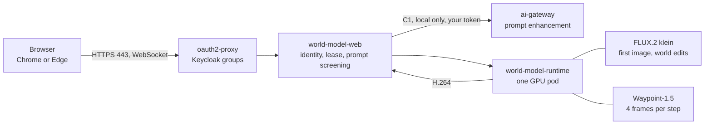

# Demo script: an interactive generative world model

Audience: the presenter of the demo333 platform. Decision: [ADR-0604](../adr/0604-introduce-an-interactive-generative-world-model-experience.md)
(the experience), under [ADR-0605](../adr/0605-gate-every-live-demo-on-a-golden-path-check-and-a-freeze-window.md) (golden path,
freeze) and [ADR-0606](../adr/0606-admit-new-experiences-with-a-definition-of-done-and-a-wip-limit.md) (definition of done).
Work packages: [WP-236](../roadmap/work-packages/wp-236-world-model-observability-and-demo-kit.md) (this script),
[WP-237](../roadmap/work-packages/wp-237-world-model-final-acceptance-and-rehearsal.md) (its rehearsal on the GPU).

> **Status (2026-11-07):** written and tested without the GPU. Nothing in it has been rehearsed on the RTX PRO 6000 yet, and
> the timings and the model's behaviour below come from the vendor and from the mock, not from this platform. WP-237 replaces them
> with measurements. **Do not show this to an audience before WP-237 has passed**: ADR-0606 requires the golden-path probe, a
> tested rollback and this script before any experience is shown.

## The message

A world model does not draw a scene from a 3D model: it invents the next frame from the last ones, your key presses and a
description. You type a place, walk into it, and change it while you are in it. It is approximate on purpose: it drifts, it forgets
what it showed ten seconds ago, and it sometimes ignores you. What the platform adds is everything around the model: the same
identity, the same rules on what may be asked, the same observability, and a GPU that exists only while the demo does.

## Before the session

The GPU node is created on demand and bills by the hour. Start about **40 minutes** before you need it.

1. In `ansible/clusters/demo333.yml` set `zuno_world_model_enabled: true`, commit and push it (the Day-2 install runs through
   AAP, which reads the repository, not your workstation).
2. `make d0 install world-model-gpu`: creates the node, waits for it to be Ready with a whole GPU (about 15 minutes).
3. `make d2 install world-model`: applies the chart; the runtime copies about 20 GB of weights from S3 and loads two models
   (about 10 more minutes). The Route is `https://world-model.apps.demo333.startx.fr`.
4. `make d2 check world-model`: the preflight. It must be green: GPU node, runtime engine `waypoint-1.5-1b`, image model
   `flux2-klein-4b`, encoder `nvenc` (or `x264`), Keycloak 200, ai-gateway reached, no other egress, Route up.
5. Sign in once as the presenter in the browser you will use: **Chrome or Edge** (the video is H.264 decoded by WebCodecs). The
   group must be `zuno-world-model-users`, `ocp-ai-ops` or `ocp-paas-ops` (for instance persona **ai-ops-01**).
6. Open Grafana, dashboard **Zuno Platform / World model** (last 1 hour).
7. Do one dry run of a scene, then **End session**, so the first frame in front of the audience is not a cold start.

## Script (about 8 minutes, short segments)

The model's context is about ten seconds, so the script resets often. Say so.

1. **The frame (30 s).** Read the notice at the top: generative AI, not a 3D simulation.
2. **Enter a world (1 min).** Pick **Snowy village, then a volcano**. The first image is made by FLUX.2 klein in a couple of
   seconds, then the world starts. Nothing is pre-recorded: the picture is generated frame by frame.
3. **Walk (1 min).** Click the picture, then W A S D and the mouse. Open **Technical view**: world engine and precision, the
   encoder, the server step, displayed frames per second, and **input to display**, which the browser measures from a key press to
   the first frame that reflects it. Say these are measured on this GPU.
4. **Change the world (1 min 30).** Press **The sky turns red**. The banner says *Editing the world*: FLUX edits the current frame
   and the result is spliced into the running world, which continues from it. Say why: Waypoint-1.5 takes no text, so a prompt
   is an image edit. Keep walking: the scene should carry on from the edited image, and may not.
5. **Your own words (1 min).** Type a change, for instance "snow starts falling". The note under the box shows what was really
   sent: the ai-gateway (a local model, your own token, public data only) rewrote it. If it says enhancement is off, the filtered
   text was sent as typed; the demo works either way.
6. **A refusal (30 s).** Type something outside the rules. It is refused with a reason before it touches the GPU, and the world
   keeps running.
7. **Reset (30 s).** **Reset to the first image** rebuilds the world from where it started. This is how a long session survives.
8. **One GPU, one world (30 s).** From a second browser, or a colleague: *Another world is running on the GPU.* A second visitor
   is told, never queued behind the first.
9. **The dashboard (1 min).** GPU utilization and VRAM, the engine step, frames generated against frames displayed, the
   input-to-display latency the browser measured, how prompts were treated, and the **GPU node up for** gauge.

## What it does not show

- **A persistent or accurate world.** No geometry, no physics, no memory beyond about ten seconds; two visitors never share one.
- **A prompt that is always obeyed.** The red sky and the volcano are a goal. If the edit does not read well, say so and reset.
- **WebRTC.** The video runs over the HTTPS Route (WebSocket, H.264), so it crosses any network. WebRTC is a possible phase 2.
- **Any browser.** Chrome and Edge only; others get a message, not a picture.
- **The ai-gateway's image provider.** The first image is made inside the world-model namespace, by FLUX, with no fallback to an
  external provider.

## If something goes wrong

- **"The GPU runtime is not ready (models loading)"**: normal for about 10 minutes after `make d2 install world-model`. Watch
  `oc get pods -n zuno-world-model`; the runtime pod is Ready only when both models are loaded and warmed.
- **Nothing is installed / no GPU node**: the switch is off, or `make d0 install world-model-gpu` has not run. The role says
  which. There is no recorded fallback video yet (WP-237 records them, each labelled "recorded"): without the node, do not
  present this demo as live.
- **"Another world is running on the GPU" and it is nobody's**: a tab was closed. The GPU is freed after 60 seconds
  (detached) or 3 minutes (idle). An operator (`ocp-ai-ops`, `ocp-paas-ops`) sees who holds it and can release it from the page.
- **The picture is blank, grey or green**: reload the page and start again; if it repeats, the encoder is the suspect (the
  technical view names it), `oc logs -n zuno-world-model deploy/world-model-runtime`.
- **"This browser cannot decode the video"**: use Chrome or Edge.
- **Slow first image**: the first FLUX call after a cold start compiles kernels; the dry run of step 7 above avoids it.
- **A forgotten node**: the alert `ZunoWorldModelGpuNodeUpTooLong` fires after 8 hours. Disable below.

## After the session

1. `make d2 uninstall world-model` removes the application.
2. `make d0 uninstall world-model-gpu` terminates the GPU node (it refuses while the application exists).
3. Set `zuno_world_model_enabled: false` in `ansible/clusters/demo333.yml`, commit and push: otherwise the next
   `make d0 install` creates the node again. `make d0 check world-model-gpu` reports whether the node and the switch agree.

## Where the dashboards are

- **Grafana** (`zuno-monitoring`): **Zuno Platform / World model**, the demo dashboard. Empty while the demo is off.
- **Alert**: `ZunoWorldModelGpuNodeUpTooLong` in the platform Prometheus (the node has existed for more than 8 hours).
- A Perses copy of the dashboard is deferred (ADR-0604, phase 2).
