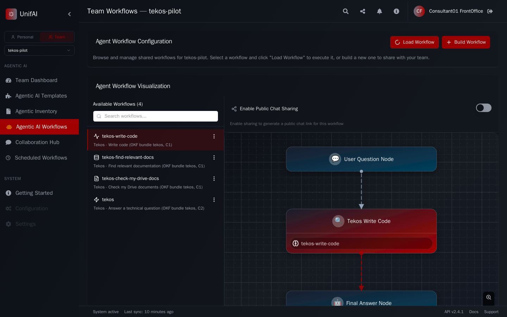
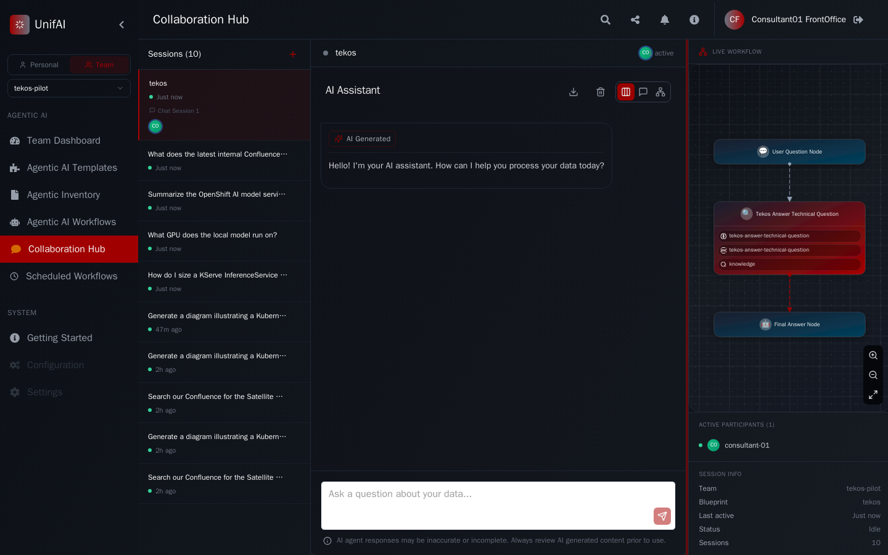

# WP-154: tekos pilot on UnifAI, phase A (no GPU)

Measured on `demo333` on 2026-10-22, with the GPU nodes down (`NotReady`). That
removes every local model, the embedding predictor and therefore the RAG corpus.
Phase B (RAG, C3 local-only, restore drill) waits for the GPU nodes.

## What ran

| Element | Value |
|---|---|
| Stack | `zuno-unifai/unifai`, UnifAI images `devel-46b9a60f4` (fork `devel` with WP-146..149 and the team-session fix), operator 0.1.20 |
| Agent | the tekos OKF bundle, published with a throwaway cosign key as `okf-test-tekos@sha256:33d648f4...`, verified by the operator, 16 objects emitted |
| Tools | per-task `UnifaiProvider` (`spec.mcp`) to `mcp-gateway:/mcp`, the user's own JWT forwarded with `X-Zuno-Agent`/`X-Zuno-Task` |
| Models | through the ai-gateway; with the local models down the gateway falls back to the SaaS providers eligible for the classification |
| Workspace | a UnifAI team (`consultant-01..03` + `ai-ops-01`) owns the workflows; the persona selects it with `teamId` |
| Harness | `evaluations/tekos/run_scenarios.py --target unifai` and `security_checks.py --target unifai` (same `scenarios.yaml`) |
| Baseline | the same scenarios against agent-runtime tekos on the same cluster, the same day, the same GPU outage |

## Scenarios (ADR-0027, threshold 75%)

| | agent-runtime baseline | UnifAI |
|---|---|---|
| Passed | 16 / 20 (80%) | 15 / 16 (94%), 4 skipped |
| Failed | 7 timeout, 10 timeout, 11 RAG returns 0 results, 19 needs the in-cluster Kubernetes client | 8 first-token latency |

Skipped on UnifAI, not counted: 6 (no placeholder tiles), 11 (RAG source not
deployed yet), 17 (no bearer-token API: UnifAI uses a server-side session
cookie), 19 (in-cluster-only check, runs in the Day 3 evaluation Job).

Scenario 8 failed on UnifAI because the first token took 7 to 24 s, not the
6 s objective: with the local models down the gateway tries the local
providers (retries, connection errors) before the SaaS fallback. It is a
property of the outage, not of UnifAI, and is re-measured in phase B.

## Security-negative checks

11 of 12 pass.

| Check | Result |
|---|---|
| `unifai_forwards_identity_to_the_gateways` | pass: a Confluence tool call is served through the mcp-gateway, which only accepts the user's JWT |
| `unifai_ignores_a_client_supplied_identity_header` | pass: an outside `X-Authenticated-User` without a session gets 401 |
| `business_role_without_entitlement_denied_by_unifai` | pass: the workflow is not visible and the mcp-gateway answers 403 to the agent declaration |
| `unifai_tekos_never_generates_photorealistic_images` | pass: no SDXL tool call, no PNG (a diagram request takes about 80 s, with three tool calls) |
| shared-service checks (7) | pass |
| `ai_gateway_local_only_forces_local_provider` | **fail, blocked by the GPU outage**: HTTP 502, every local provider unreachable. The gateway failed closed and did not fall back to a SaaS provider, which is the safe outcome; the check needs a local model to answer. |

## Defects found and fixed

| Defect | Fix |
|---|---|
| A team workspace session ran with the team id as the acting user, so identity forwarding failed ("team sessions need a credential user") and the agent ended without output | fork `fix/team-session-credential-user` (`0a173d9c6`), generic, merged in local `devel`, with unit tests |
| `forward_user_token` LLMs were validated with the static key and produced 404s on every validation | fork `fix/openai-compatible-validator-forwarded-token` (`bbabc2144`), in the pushed `devel` |
| A non-streamed execute was dropped by the UI proxy on long answers | the harness consumes the NDJSON stream, as the UI does |
| The agent called `confluence.page.search` in a loop until `max_rounds` (found in WP-152) | not reproduced with the bundle-generated agent: it searches once or twice and answers. The loop came from the throwaway agent's prompt and from the team defect above |

## Observations to follow up

- The ReAct strategy rejects a final answer shorter than 10 characters ("Reasoning too short (5 chars, min 10)"); a one-word answer fails the turn. `min_reasoning_length` is an agent setting to expose through the bundle's `agentConfig`.
- UnifAI visibility is by owner or team workspace. A team cannot yet mean "everyone with the Keycloak group `agent_tekos`": ADR-0583 clause 1 (the `oidc-claims` directory provider, zuno-demo-59) closes that. Until then the pilot uses a hand-made team.
- UnifAI traces reach Tempo (`mas.session` with `chat auto` spans). At the first measurement the gateways did not read `traceparent`, so UnifAI and gateway traces were separate roots. The first fix (`7d44a423`, `0d0a8935`) still produced separate roots: the FastAPI dependency was a plain `def`, which runs in a worker thread on a copy of the context, so the ContextVar it set never reached the handler. Unit tests that call the function directly passed anyway. The fix (`783cb632`) makes it `async`, and the tests now go through a FastAPI app (verified to fail with the synchronous version).

## Continuous trace (WP-147 acceptance)

One Tempo trace (`7d48c3f2...`, root `unifai-multiagent-be mas.session`) now crosses every hop of a tool-using tekos turn, with the images built from `783cb632`:

| Service | Spans |
|---|---|
| `unifai-multiagent-be` | `mas.session`, `StartWorkflow:GraphTraversalWorkflow` |
| `unifai-multiagent-temporal-worker` | `RunWorkflow`, 3 `execute_graph_node`, `mas.node tekos-answer-technical-question`, 2 `mas.agent.iteration`, 2 `chat auto`, `execute_tool confluence.page.search` |
| `ai-gateway` | 2 `model_call` |
| `mcp-gateway` | `tool_invoke`, then the MCP calls `initialize`, `tools/list`, `tools/call search_pages` to the Confluence server |

## Same checks on the secured fork build (2026-10-22, later)

zuno-unifai was repinned to images built from the fork's secured `devel`
(access-control fixes, `INTERNAL_AUTH_SECRET`, `oidc-claims` identity directory),
held in demo333's internal registry only; the fork is not public while the
upstream report is pending. Operator 0.1.22 injects the shared secret.

| | before (devel-46b9a60f4) | secured build (devel-ee33a47ca) |
|---|---|---|
| Scenarios | 15 / 16 (94%) | 14 / 16 (88%) |
| Security checks | 11 / 12 | 11 / 12 (same failing check, GPU outage) |
| Failed scenarios | 8 first token latency | 8 first token latency, 9 streaming: no answer |

Scenario 9 is not a regression of the secured code. Without the RAG corpus and
with no Confluence page on the topic, the model keeps searching (Confluence,
then the web) for all 6 rounds and the agent ends with "Agent completed without
producing output"; three runs: 0, 0 and 43 tokens. The old agent-runtime graph
answers after one retrieval pass. Two follow-ups: the RAG corpus in phase B, and a
generic wrap-up in the fork (when `max_rounds` is exhausted, ask the model for a
final answer instead of returning nothing).

### Defect found on the secured build

The services' identity clients called `IDENTITY_HOST`, the public route. The route
strips `X-Internal-Auth`, so the secured identity API answered 401 to every team
lookup; team workspaces became invisible (403) and the tekos agent could not run.
The same request to the in-cluster Service returned 200. Worked around in the chart
(`DIRECTORY_SSO_URL` for multi-agent, `IDENTITY_HOST` for rag and backend, set to
`http://identity:13456`, the bare name the services trust) and fixed in the operator
by startx-unifai-a9 for 0.1.23.

## Phase B started: GPU nodes back (2026-10-22, evening)

Both GPU nodes returned and the embedding predictor (`qwen3-embedding-0.6b`)
became ready.

| Step | Result |
|---|---|
| `UnifaiRAGSource` `tekos-satellite` (space SXSI, tree "Technologie : Satellite") | 90 pages, ready in about 1 min |
| `UnifaiRAGSource` `tekos-openshift` (tree "Technologie : Openshift") | 411 pages, ready in about 1.5 min |
| Retry storm check (operator >= 0.1.18) | none: the Confluence queue stayed at 0 messages, one sync per source |
| Both sources | shared, ACL = the matching `consultant/confluence-{archi,build,run}-<tech>` Keycloak groups, resync every 6 h |
| Retriever `knowledge` | `docs_rag`, source type CONFLUENCE, the caller's token forwarded, attached to the tekos bundle |

ACL proof through the RAG API, from the multi-agent pod, in the pilot team workspace,
with each persona's own token (5 matches requested):

| Persona | Satellite query | OpenShift query |
|---|---|---|
| consultant-01 (Satellite tiers) | 5 matches (Satellite pages) | 5 matches |
| consultant-02 | 5 matches (Satellite pages) | 5 matches |
| consultant-03 (no Satellite group) | 5 matches, none from the Satellite tree | 5 matches |
| ai-dev-01 (no Confluence tier group) | 0 | 0 |
| sale-01 | 0 | 0 |

Defect found and fixed on the way: in a team workspace the request acts for the
team id while the forwarded token is the person's own, so the RAG service
discarded the groups ("Forwarded bearer token belongs to another user than the
request") and every shared source returned 0 results; the agent then searched
until its rounds ran out. The RAG service now also accepts the token of a member
of the workspace (fork `fix/rag-team-workspace-groups`, `a66f9a302`, 194 RAG unit
tests pass). Operator 0.1.23 sets the identity Service URL itself, so the chart's
workaround is off by default.

### Evaluation with the GPUs back and the RAG sources (same evening)

Images: multi-agent `devel-0190df466` (adds a final answer when an agent runs out of
rounds), rag `devel-66f5bdc7a` (team-workspace groups), the rest `devel-e25e40beb`.

| | Result |
|---|---|
| Scenarios | 16 / 17 (94%), 3 skipped. Scenario 11 now runs through UnifAI: the answer goes through the retriever and names the page. |
| Failing scenario | 8, first token in 38.6 s (limit 6 s): the local models were cold right after the GPUs came back. Re-measure once warm. |
| Security checks | 12 / 12, including `ai_gateway_local_only_forces_local_provider`, which needs a local model |

Two questions about the Satellite procedures, in the pilot team workspace:

| Persona | Question about page "S0R42 : Schedule Satellite" | Result |
|---|---|---|
| consultant-01 (Satellite groups) | what does it describe, name the page | answered in 16-18 s from the internal page, naming it (retriever then answer) |
| consultant-03 (no Satellite group) | same | no content for him (ACL), the agent searches, then explains that it could not read the page, instead of returning nothing |

## Backup, check and restore drill (2026-10-22, Day 3)

`make d3 backup unifai`, `make d3 check unifai` and `make d3 restore unifai` (role
`unifai`, tasks `backup`, `check_s3_backup`, `restore`).

| Step | Result |
|---|---|
| spec.backup | on for `zuno-unifai`: bucket `zuno-demo333-backups`, prefix `unifai/zuno-unifai`, the same AWS identity as PostgreSQL's pgBackRest; two daily CronJobs (02:00) |
| On-demand backup | both Jobs succeeded: MongoDB archive (62.8 KiB) and a Qdrant snapshot of `confluence_data_hybrid` (7.1 MiB) |
| Check | newest MongoDB archive and Qdrant run 0.0 h old; fails when a store has none or the newest is older than 36 h |
| Restore drill | into a scratch namespace with throw-away MongoDB 8.0.3 and Qdrant v1.16.0: **501 points** restored in `confluence_data_hybrid` (live 501) and **18 MongoDB collections** (3041 documents), all counts equal to the live stores; namespace deleted afterwards |

The drill never writes to the live stores. Two things only the real run showed:
the throw-away Qdrant crashes at start without the live `qdrant-config` (restricted
SCC, relative storage paths), so the role copies it; and each side is counted from a
Job inside its own namespace because the stack's NetworkPolicies refuse
cross-namespace callers.

## Classification routing at the ai-gateway (GPUs back)

Same task as the tekos pilot (`X-Zuno-Agent: tekos`, `X-Zuno-Task: answer-technical-question`),
called with the persona's own token, two requests per level, the provider read back
from `/v1/routing-decisions/{request_id}`:

| Declared classification | Provider that served it |
|---|---|
| C1 (x2) | `ovhcloud-gpt-oss-120b` (the task's first preference) |
| C2 (x2) | `ovhcloud-gpt-oss-120b` |
| C3 (x2) | `local-gpt-oss` (`gpt-oss-20b`): the SaaS preference is not eligible for C3, so only local providers remain |

C3 never reached a SaaS provider, which is the ADR-0021 rule. This check does not
depend on UnifAI: it is the gateway UnifAI calls with the user's token.

## Redeploy on `devel-e76c71cd0` (2026-10-23)

The pilot was removed after phase A and redeployed on fork `devel` e76c71cd0 with
a team bound to the directory group `agent_tekos` (identity teams API), the
throwaway key and the digest-pinned `okf-test-tekos` artifact.

| Check | Result |
|---|---|
| UnifaiAgentBundle `tekos` | Verified, Valid, WithinCeilings, Emitted; 4 tasks, 16 objects Ready |
| Scenarios (`--target unifai`) | 16/17 (94 %), 3 skipped. Scenario 8 (first token) now passes on warm models |
| Scenario 10 | failed at first: with the retriever attached the agent reads Confluence through `docs_rag_retriever_tool` (ten calls) and never calls `confluence.page.search`. The UnifAI handler now accepts either (the RAG sources are synced from Confluence) and bounds the run; it passes. Scenario 8 (first token) passed on the first run and missed the 6 s objective on the second, while the cluster was building a release: 16/17 both times |
| Security checks | 9/9. The photorealistic-image check never ended because the agent keeps looping on `diagram.generation.create` and the stream's heartbeats defeat its per-read timeout; it now has a 150 s overall deadline (no `image.generation.create` call and no PNG in that time) |
| Group-bound team | consultant-01/-02 (members through the group) see the workspace, sale-01 does not |

### Browser check (Playwright, consultant-01)

A real Keycloak login as consultant-01 (member of the team through the group
`agent_tekos`) lists the four workflows the bundle emitted, with their
classification (C1/C2), and opens the tekos chat in the team workspace. The
first capture showed "Validation Failed" on the workflow: the UI's MCP-provider
validator did a real MCP handshake without the user's token, which an
authenticating gateway refuses. Fixed in the fork (the validator now only checks
reachability for `forward_user_token` providers, devel 86392d870); with that
image the validation report has no error.

### Other agents (WP-155 smoke test)

advantage, comage, finage and naveo (graph shape `retrieve_reason_respond`) were
signed with the throwaway key, published next to tekos in `okf-test-tekos` (one
tag per bundle digest) and deployed, each in its own group-bound team
(`agent_<name>`). For each, a member persona sees the workflow and gets a
streamed answer (HTTP 200), and a persona outside the group does not see the
workflow. They run on the shared `knowledge-<agent>` retrievers; no new RAG
source exists for their sourceless domains. arkos (`plan_draft_write`, no
blueprint template in the operator), cognos and soursage (no `graph_shape`)
were signed and published but not deployed.

## Not yet covered

The quota 429 and the routing badge in the UI (WP-148), the guardrails counter
(WP-153, hook still disabled in the chart), and the run of the pilot against the
released, keyless-signed bundles (zuno-demo-agents v0.1.1): it needs
unifai-operator 0.1.25, and the unifai role only switches to the released list
with `zuno_unifai_released_bundles: true`.
