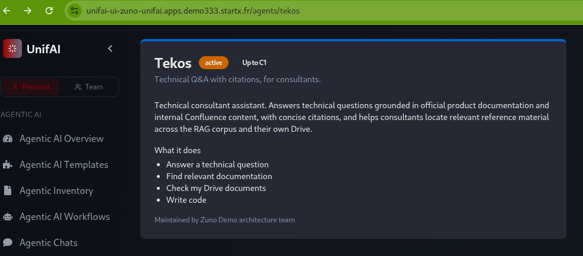
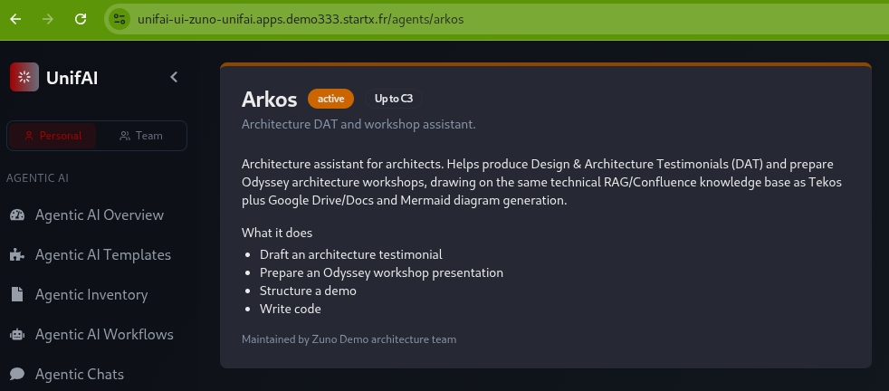
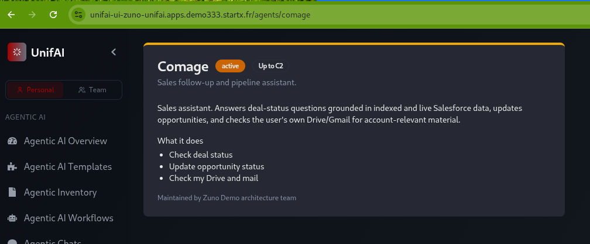
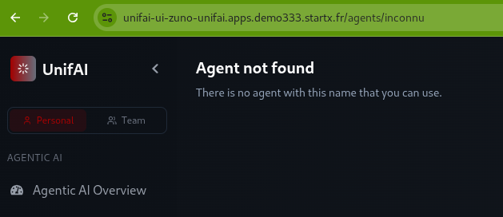
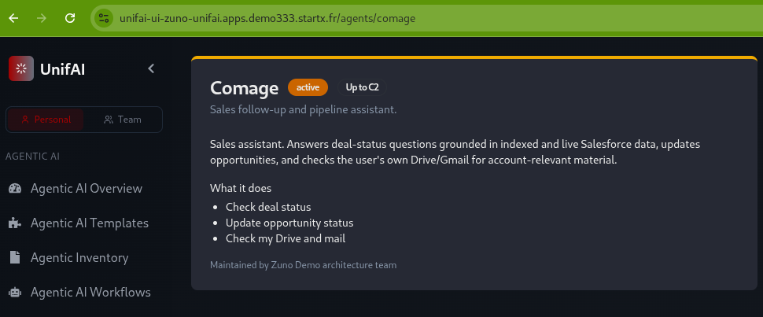
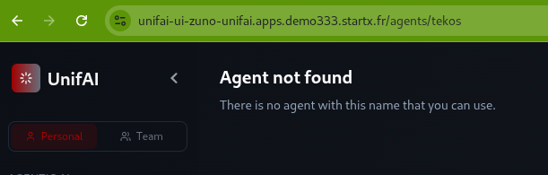

# WP-167: the per-agent sheet and its visibility on UnifAI 0.1.59 (2026-11-05)

The proof of step 5 of [WP-167](../work-packages/wp-167-per-agent-entry-and-sheet.md), made again on the current release.

- **Where.** demo333, UnifAI 0.1.59 (pinned 2026-11-05), `https://unifai-ui-zuno-unifai.apps.demo333.startx.fr/agents/<agent>`.
- **Who and when.** The user, in a real browser signed in through Keycloak, on 2026-11-05 between 18:26 and 18:27 local time.
- **The first proof** (2026-10-23, operator 0.1.29) used consultant-02. consultant-02 does not hold `agent_comage`; consultant-01 does. The table below uses consultant-01 and sale-01, the two personas of the demo script.

## Results

| Persona (agent groups) | tekos | arkos | comage | unknown agent |
|---|---|---|---|---|
| consultant-01 (`agent_comage`, `agent_tekos`, `agent_arkos`, `agent_naveo`) | sheet, "Up to C1" | sheet, "Up to C3" | sheet, "Up to C2" (he holds `agent_comage`, so this is not a refusal) | "Agent not found" |
| sale-01 (`agent_comage`, `agent_finage`) | "Agent not found" | "Agent not found" (user's observation, no capture) | sheet | "Agent not found" (user's observation, no capture) |

- **A sheet shows**, and only this: the title, the state (`active`), the classification ceiling, the tile description, the description, the "What it does" task list and "Maintained by Zuno Demo architecture team". No prompt, tool, knowledge, retrieval setting, access group or limit appears.
- **The refusal page is the same for a hidden agent and an unknown one:** "Agent not found. There is no agent with this name that you can use." Existence is not revealed (ADR-0582 clause 5).

## Captures

Cropped to the address bar and the page. The persona of each capture is the one the user was signed in as, noted at the time; the page itself does not show it.

| Persona | Page | Capture |
|---|---|---|
| consultant-01 | `/agents/tekos` |  |
| consultant-01 | `/agents/arkos` |  |
| consultant-01 | `/agents/comage` |  |
| consultant-01 | `/agents/inconnu` |  |
| sale-01 | `/agents/comage` |  |
| sale-01 | `/agents/tekos` |  |

There is **no capture** of sale-01 on arkos or on an unknown agent; the user reports that both showed "Agent not found", and this record keeps that as an observation.
