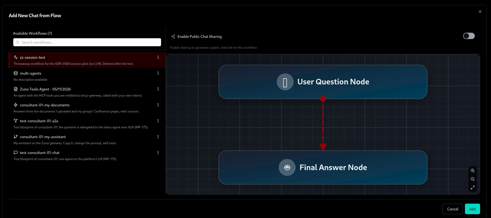
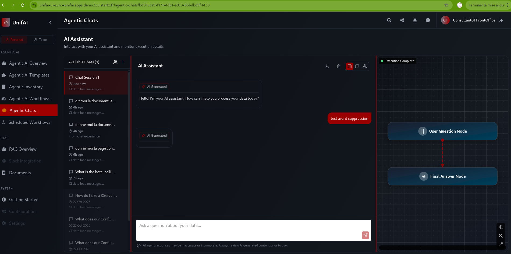
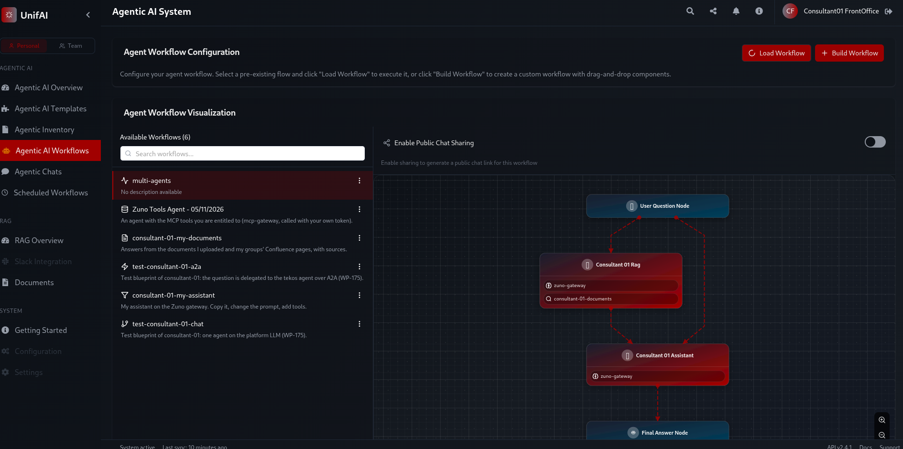
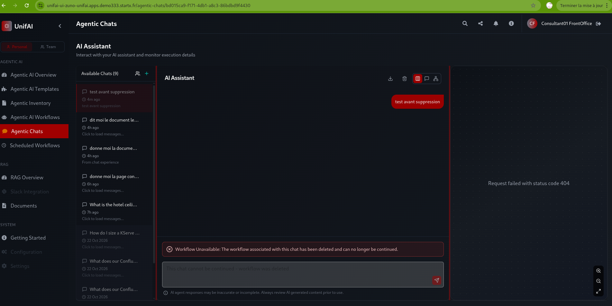

# WP-221: what happens to a session when its workflow is deleted (2026-11-05)

The pilot of [ADR-0584](../../adr/0584-define-agent-lifecycle-states-roles-and-incident-revocation.md) clause 4 (sessions on retirement), run on demo333, UnifAI 0.1.59, `unifai-ui-zuno-unifai`.

## Method

1. A throwaway `UnifaiWorkflow` `zz-session-test`, owned by consultant-01, with two nodes only (a user question and a final answer, so no LLM call), in `zuno-unifai`.
2. consultant-01 created a chat from it in **Agentic Chats** and sent the message "test avant suppression" (session `bd015ca9-f171-4db1-a8c3-86bdbd9f4430`).
3. The workflow was deleted with `oc delete unifaiworkflow zz-session-test` at 19:56 local time. This is what the operator does to the objects of a retired agent.
4. consultant-01 reloaded the page, opened the session and tried to continue it. The checks ran at 19:58 and 19:59.

## Result

| Check | What consultant-01 saw |
|---|---|
| The session in the chat list | still listed, now titled with the first message, "test avant suppression" |
| Opening it | the user's message is still shown; the right-hand workflow panel reads "Request failed with status code 404" (the workflow it drew no longer exists) |
| Sending a new message | refused: the banner reads "Workflow Unavailable: The workflow associated with this chat has been deleted and can no longer be continued." and the input is disabled with "This chat cannot be continued - workflow was deleted" |
| The workflow list | `zz-session-test` is gone (6 workflows left, from 7), also from the "Add New Chat from Flow" dialog |

## What it means for clause 4

UnifAI already does what the clause asks, with no change in the fork: **the owner keeps the session in the list and can open it, and cannot resume it**. So "retired = the operator deletes the emitted objects" is enough for clause 4.

## Limits of this pilot

- The test workflow has no LLM node, so there was no answer from an agent. Only the owner's own message was displayed afterwards: whether an agent's answers stay readable is not shown. A pilot on a real agent chat would show it.
- The "404" in the workflow panel is a cosmetic rough edge, not a data loss.

## Captures

Cropped to the address bar and the page.

| Step | Capture |
|---|---|
| The workflow is in the list, before the deletion (7 workflows) |  |
| The chat, before the deletion |  |
| The workflow is gone from the list, after the deletion (6 workflows) |  |
| The chat after the deletion: still listed, still openable, refused when continued |  |
